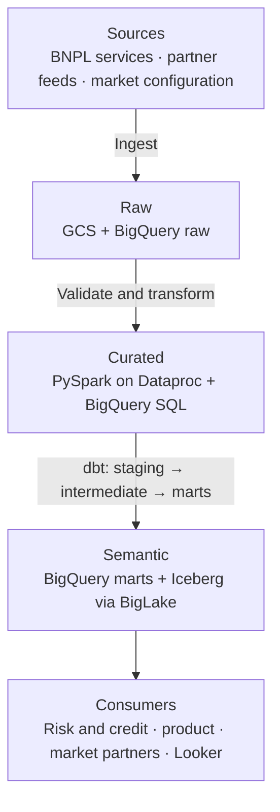
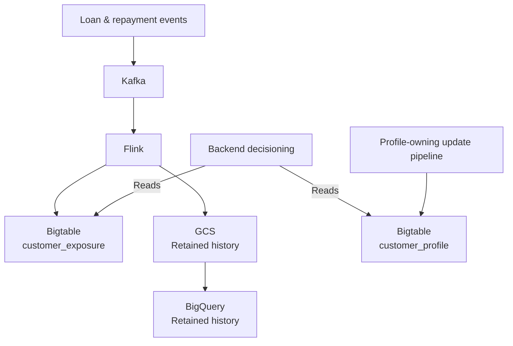
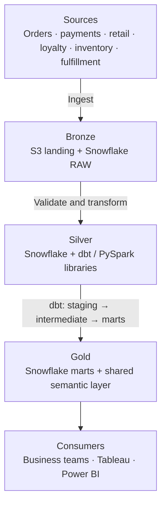
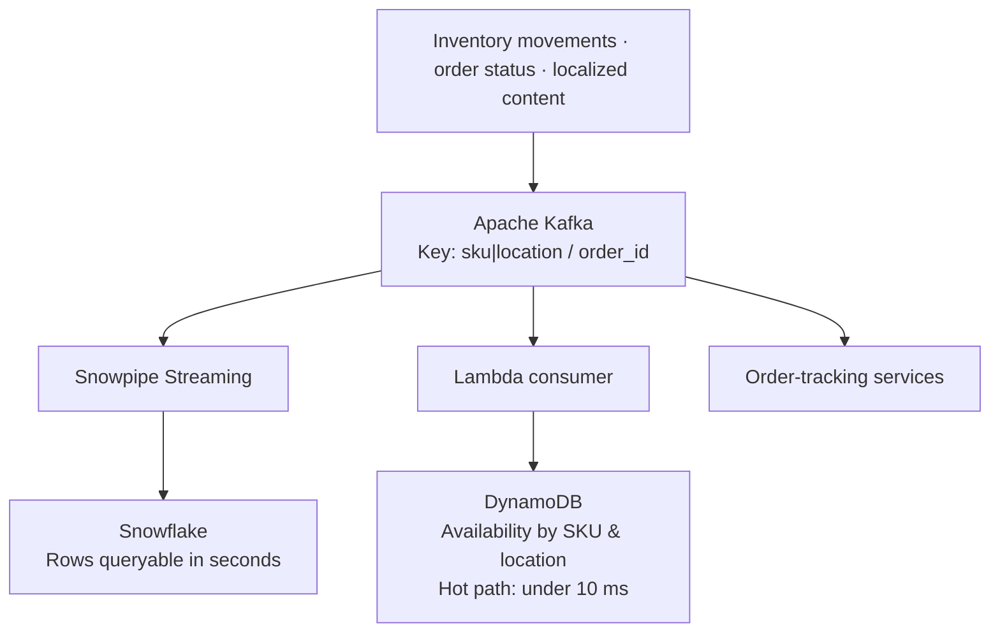
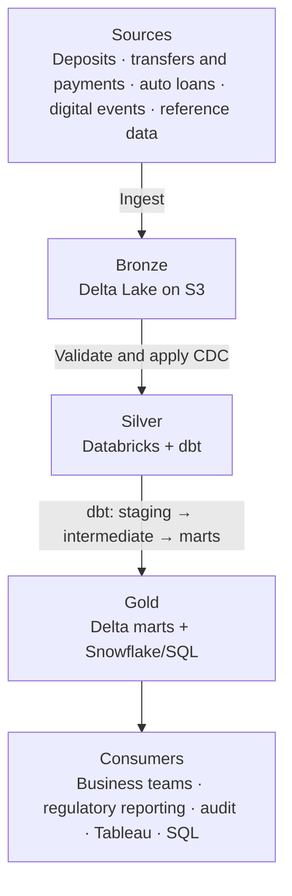
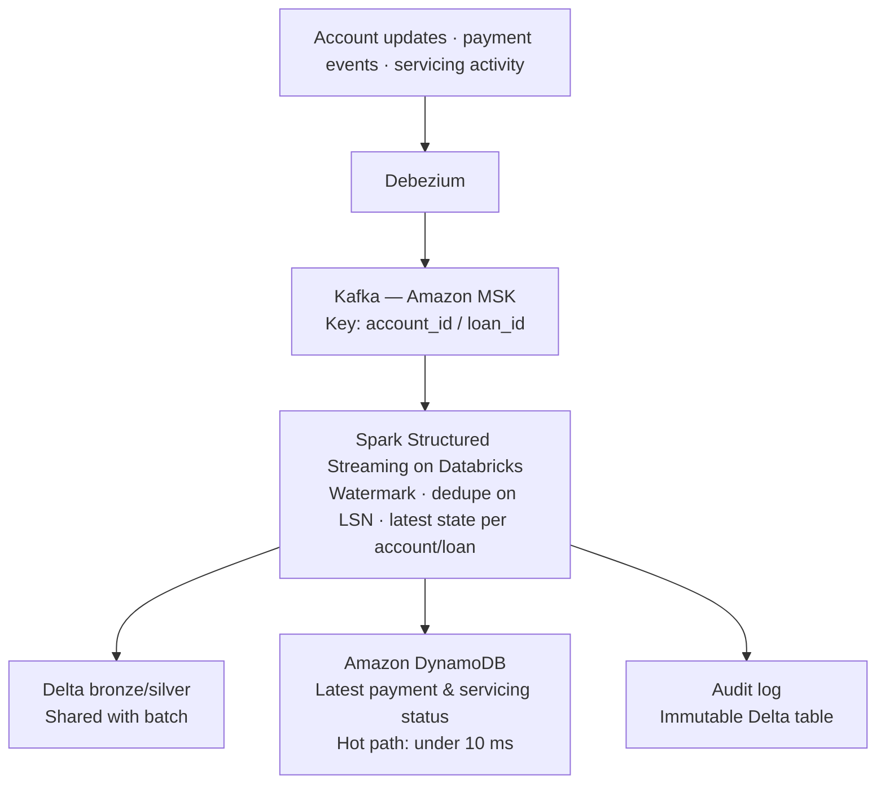

# Pipeline architectures

> Interview-practice architectures. These are hypothetical study notes, not verified descriptions of company systems or employment experience.

Read each architecture in the same order: **sources → ingestion → storage → transformation → serving → consumers**. The batch lane is primary; the streaming lane is separate and supplementary.

## At a glance

| Architecture | Batch backbone | Streaming backbone | Orchestration |
| --- | --- | --- | --- |
| [PayPal](#paypal) | GCS + BigQuery → Dataproc / BigQuery SQL → BigQuery marts + Iceberg via BigLake | Kafka → Flink → Bigtable; retained history in GCS → BigQuery | Cloud Composer |
| [Neiman Marcus](#neiman-marcus) | S3 + Snowflake RAW → Snowflake / dbt / PySpark → Snowflake marts | Kafka → Snowflake / DynamoDB / order-tracking services | Apache Airflow |
| [Ally Bank](#ally-bank) | Delta Lake on S3 → Databricks / dbt → Delta marts + Snowflake/SQL | Debezium → MSK → Spark Structured Streaming → Delta / DynamoDB / audit | Apache Airflow + Step Functions |

## PayPal

### Batch lane · primary

**Recall:** Sources → Raw → Curated → Semantic → Consumers

| Stage | Details to remember |
| --- | --- |
| Sources | BNPL application, decision, disbursement & repayment services (GraphQL/REST); international partner feeds (Pub/Sub + Cloud Storage landing zones); market configuration (country rules, feature flags). |
| Ingestion | PySpark on Dataproc API ingestion; Pub/Sub → GCS → BigQuery. |
| Raw | GCS + BigQuery raw, partitioned by `market=` / `load_date=`. |
| Schema and quality gates | GCS finalize → Pub/Sub → Cloud Function schema-drift check; circuit breaker with quality thresholds per market → open/closed. |
| Curated | PySpark (Dataproc) + BigQuery SQL; retry / quarantine / partial-load / full-failure per stage. |
| Modeling | dbt: staging → intermediate → marts. |
| Semantic | BigQuery marts + Apache Iceberg via BigLake. |
| Consumers | Risk & credit; product; market partners; Looker. |

**Orchestration:** Cloud Composer with config-driven market enablement + sensors.

### Streaming lane · separate and supplementary

**Recall:** Loan & repayment events → Kafka → Flink → Bigtable exposure, with retained history in GCS → BigQuery.

### Governance & DevOps

| Area | Controls and tools |
| --- | --- |
| Governance | IAM; CMEK; BigQuery policy tags; row access by market; tokenized customer identifiers. |
| DevOps | Terraform + GitHub Actions, with dev / staging / prod variants. |
| Quality | dbt tests; Great Expectations; circuit breaker; Datadog. |

## Neiman Marcus

### Batch lane · primary

**Recall:** Sources → Bronze → Silver → Gold → Consumers

| Stage | Details to remember |
| --- | --- |
| Sources | Order & payment systems (CDC); POS & e-commerce; clienteling app; InCircle loyalty; merchandising & inventory; fulfillment & carriers. |
| Ingestion | Fivetran CDC; AWS Lambda API pulls → S3; Glue jobs. |
| Bronze | S3 landing + Snowflake RAW, using external stage / Snowpipe. |
| Schema gate | EventBridge "Object Created" → Lambda schema-drift check. |
| Silver | Snowflake + dbt (shared macros) / PySpark libraries; tokenize, conform, dedupe, identity resolution. |
| Modeling | dbt: staging → intermediate → marts. |
| Gold | Snowflake marts + shared semantic layer. |
| Consumers | Merchandising; marketing; clienteling; supply chain; finance; Tableau & Power BI. |

**Orchestration:** Apache Airflow. **CI/CD:** GitLab CI. **IaC:** Terraform.

### Streaming lane · separate and supplementary

**Recall:** Inventory / order / content events → Kafka → three consumer branches.

### Governance & DevOps

| Area | Controls and tools |
| --- | --- |
| Security | Tokenization; Snowflake masking policies; RBAC; PCI DSS. |
| Privacy | CCPA/CPRA requests; PII restricted roles. |
| DevOps | GitLab CI (dbt + Airflow); Terraform; Docker. |
| Quality | dbt tests; Great Expectations; testing framework. |

## Ally Bank

### Batch lane · primary

**Recall:** Sources → Bronze → Silver → Gold → Consumers

| Stage | Details to remember |
| --- | --- |
| Sources | Core deposit system; transfer/payment systems; auto loan origination; auto loan servicing; digital banking events; reference data. |
| Ingestion | Debezium CDC → Kafka (Amazon MSK) → Delta; REST → S3. |
| Bronze | Delta Lake on S3, storing CDC events with `op` & commit LSN. |
| Schema gates | S3 file landings → EventBridge → Lambda schema-drift check; CDC topics use Schema Registry compatibility. |
| Silver | Databricks: tokenize, apply CDC, MERGE-based SCD Type 2. |
| Modeling | dbt (from Teradata stored procs): staging → intermediate → marts. |
| Gold | Delta marts (deposits, transfers, auto loans) + Snowflake/SQL. |
| Consumers | Risk; servicing & collections; marketing; finance; regulatory reporting; audit; Tableau & self-service SQL. |

**Orchestration:** Apache Airflow (+ Step Functions). **Delivery:** Jenkins + Terraform.

### Streaming lane · separate and supplementary

**Recall:** Account / payment / servicing events → Debezium → MSK → Spark Structured Streaming → three destinations.

### Governance & Compliance

| Area | Controls and tools |
| --- | --- |
| Security | Field-level encryption; tokenized account & SSN; KMS keys. |
| Access | Unity Catalog RBAC; column masks; IAM least privilege. |
| Regulatory | FDIC; CFPB; BSA/AML; SOX — audit logging + lineage. |
| Quality | PyTest; dbt tests; Great Expectations; PyDeequ; recon. |
