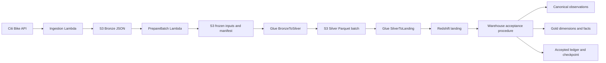
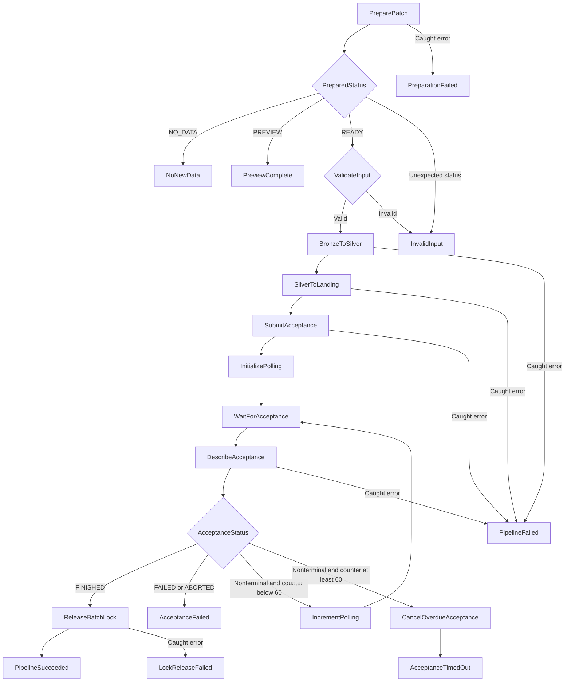

# Presenting the Citi Bike Step Functions workflow

> Level: Beginner to intermediate. Deployed baseline: 22-state Standard workflow after the 2026-10-19 PrepareBatch deployment. The local EventBridge extension adds a proposed 23rd state and has not been deployed. Evidence: a live preview, a full prepared-batch execution, and a no-new-data execution succeeded. Failure and competing-owner checks for preparation ran offline; overlapping live executions were not tested.

## What to understand first

The workflow prepares one fixed processing batch, runs two Glue jobs in order, accepts the warehouse changes, and releases its run lock. Step Functions coordinates the work; Lambda prepares the batch, Spark transforms the observations, and Redshift accepts the warehouse results.

After studying this guide, you should be able to explain every state, trace the JSON payload, distinguish submission from completion, identify the checkpoint owner, and explain what the verified execution establishes.

Read beside the [workflow source](workflows/incremental.asl.json.tftpl), [PrepareBatch guide](prepare-batch-guide.md), and [verified execution record](verification.md#preparebatch-deployment--2026-10-19). Terraform substitutes the preparation Lambda ARN and two Glue job names into the `.tftpl` file before deployment. The [Friday implementation walkthrough](../5.4_Fri_prepare_batch_walkthrough.md) explains how to build and deploy these changes yourself; the [command runbook](../5.3_Fri_pipeline_commands.md) starts an existing deployment.

## EventBridge extension staged after this baseline

The current local [workflow source](workflows/incremental.asl.json.tftpl) includes **WaitForBatchLock**, a proposed 23rd state. Preparation can return BUSY when a different execution owns the lock; PreparedStatus then waits 30 seconds and returns to PrepareBatch. The preparation Task reads `$$.Execution.Input` so this loop preserves the original completion_key request. It does not retry Glue or SQL.

The proposed completion-event path is ingestion → final S3 marker → EventBridge rule → this workflow. Duplicate or older events become NO_DATA after their observations are accepted; concurrent participating executions wait for lock release. Failed owners retain their locks, so waiting executions can time out and need reconciliation. The rule-delivery DLQ covers failure to start a workflow, not later failures inside it.

AWS validated the proposed definition, but EventBridge inspection and pattern testing were denied. This extension is **local and undeployed**; the state-by-state explanations and October 19 runtime evidence below describe the live 22-state baseline. The local preparation suite now has 30 passing offline checks. See the [staged event guide](capture-events-guide.md) for source changes, resources, exact permission request and deployment/test sequence.

## What changed from the original workflow

| Responsibility | Original October 16 version | Current version |
| --- | --- | --- |
| Execution input | Manually supplied batch ID, window, checkpoint and count | `{}` for processing; `{"preview":true}` for inspection |
| Batch preparation | Performed manually outside the workflow | PrepareBatch Lambda reads progress and source data |
| Processing inputs | Glue discovered Bronze objects from a time window | Preparation freezes inputs and publishes a manifest; Glue reads that manifest |
| Workflow ownership | Warehouse locks serialized acceptance only | Conditional S3 lock reserves the participating workflow through acceptance |
| No new captures | Caller had to prepare valid nonempty input | `NoNewData` finishes successfully without Glue |
| Completion | SQL FINISHED → PipelineSucceeded | SQL FINISHED → ReleaseBatchLock → PipelineSucceeded |
| Graph size | 15 states | 22 states; seven added states |

The infrastructure deployment added **five Terraform resources**, updated **four existing resources**, and deleted none. Graph states and AWS resources are different counts: `PrepareBatch` and `ReleaseBatchLock` invoke the same new Lambda. The [walkthrough resource inventory](../5.4_Fri_prepare_batch_walkthrough.md#what-was-added-and-updated) names each resource.

## Separate data flow from control flow



- **Data flow:** JSON is frozen, Parquet is written, and rows are loaded and accepted.
- **Control flow:** Step Functions invokes Lambda, starts Glue, waits for job completion, polls SQL, and selects branches.
- **Ingestion is outside this state machine.** Invoke it successfully before starting processing. EventBridge and an ingestion completion marker are still pending.
- **Workflow state carries metadata:** batch IDs, windows, counts, S3 references, job results and SQL status. Station records remain in storage.

## The current control graph



The cancellation task also enters `AcceptanceTimedOut` if its own API call fails. `NoNewData`, `PreviewComplete`, and `PipelineSucceeded` are three separate Succeed states with different meanings.

## Which Redshift tables participate?

The current model uses four supporting tables in `public` and three analytical tables in `gold`. Schema names are namespaces; `public` does not imply raw data.

| Table | What it holds | Who uses it |
| --- | --- | --- |
| `public.richard_citibike_pipeline_checkpoint` | Last successfully accepted exclusive capture boundary | Preparation reads it; acceptance validates and advances it |
| `public.richard_citibike_station_snapshot_landing` | Incoming rows with batch identity | SilverToLanding appends rows; acceptance validates the selected batch |
| `public.richard_citibike_station_snapshot_canonical` | Accepted observations at station/capture grain | Acceptance preserves the first accepted observation per key |
| `public.richard_citibike_accepted_batch` | Accepted batch identity, window and logical count | Acceptance recognizes committed replays and records new acceptance |
| `gold.incremental_dim_station` | Latest accepted station attributes | Acceptance updates it; analysts join on station_id |
| `gold.incremental_dim_date` | Calendar attributes for UTC capture dates | Acceptance populates it; facts join on snapshot_date |
| `gold.incremental_fact_station_snapshot` | One observation per station/capture timestamp | Acceptance inserts facts; dashboard and analytical queries read them |

Canonical, Gold, ledger and checkpoint changes commit together. Landing was loaded earlier, so landing rows may remain after acceptance fails. The S3 workflow lock is also outside the warehouse transaction.

The three `_pre_gold_20261017` backups and the older `public.citibike_station_snapshot` / `_stage` pair were removed on 2026-10-19. The older manual loader still references removed targets and requires redesign before reuse. `gold.station_availability_summary` now reads the incremental fact; it is an analytical view rather than a pipeline stage. See the [cleanup record](verification.md#retired-table-cleanup--2026-10-19).

## Execution input and prepared output

Normal processing input is:

```json
{}
```

Preview input is:

```json
{"preview": true}
```

The optional `window_end` supplies a whole-second, exclusive UTC bound. For example, `{"preview":true,"window_end":"2026-10-19T18:00:00Z"}` is a historical illustration, not a current batch to replay. Preparation chooses the actual checkpoint and rejects legacy fields such as caller-supplied `expected_rows`.

These are the actual prepared fields from the successful October 19 full execution:

```json
{
  "status": "READY",
  "batch_id": "auto_8f134b30fa25883742c348d6aa0bee46",
  "window_start": "2026-10-16T17:52:30Z",
  "window_end": "2026-10-19T17:32:58Z",
  "checkpoint_before": "2026-10-16T17:52:30Z",
  "expected_rows": 2519,
  "manifest_key": "control/citibike/incremental/batches/auto_8f134b30fa25883742c348d6aa0bee46/manifest.json",
  "capture_count": 1
}
```

| Field | Meaning |
| --- | --- |
| `batch_id` | Execution-derived identity connecting frozen inputs, Silver, landing and accepted ledger |
| `window_start` | Inclusive lower bound, read from the current accepted checkpoint |
| `window_end` | One second after the latest selected capture; exclusive upper bound |
| `checkpoint_before` | Prior accepted boundary that warehouse acceptance must still observe |
| `expected_rows` | Distinct station/capture observations counted from selected source JSON |
| `manifest_key` | Published manifest naming the frozen status and metadata objects |
| `capture_count` | Number of selected status snapshots |

The clock is capture time encoded in the source filename, not S3 LastModified or station last_reported time. A three-day window containing one collected capture is one snapshot, not three days of continuous observations. `expected_rows` is a station count only when exactly one capture is selected.

## Read the workflow syntax

| Syntax | Meaning | Example |
| --- | --- | --- |
| `Task` | Invoke a service operation | Lambda invocation, Glue start, Data API call |
| `Choice` | Select the next state using current data | PreparedStatus and AcceptanceStatus |
| `Pass` | Add or replace workflow metadata | Poll initialization/increment |
| `Wait` | Pause before continuing | Five-second SQL polling pause |
| `Succeed` / `Fail` | End this execution | NoNewData / PreparationFailed |
| `Resource` | Service integration to use | `arn:aws:states:::lambda:invoke` |
| `Parameters` | Request sent to that service | FunctionName and Payload |
| `$` / `$.batch_id` | Current state input / a field in it | Read the generated batch ID |
| `$$.Execution.Id` | Current execution's AWS context | Lock owner and batch identity |
| A key ending in `.$` | Resolve a path or intrinsic function | `"--BATCH_ID.$":"$.batch_id"` |
| `OutputPath` | Select which result becomes output | Preparation uses `$.Payload` |
| `ResultPath` | Store a result alongside current context | Glue result stored in `$.bronze_result` |
| `Catch` | Route a matching error | Store `$.failure`, then enter a named failure state |

Optimized Lambda invocation returns a service envelope containing `Payload`. Preparation uses `OutputPath: "$.Payload"` so the next state receives its prepared fields at the root. By contrast, Glue uses ResultPath to add job metadata while keeping those fields available. [AWS Lambda integration](https://docs.aws.amazon.com/step-functions/latest/dg/connect-lambda.html), [ResultPath](https://docs.aws.amazon.com/step-functions/latest/dg/input-output-resultpath.html)

The Data API request's outer `Parameters` configures the API. Its inner `Parameters` array binds SQL placeholders such as `:batch`; these are two uses of the same name at different levels.

## State-by-state: preparation and processing

### PrepareBatch — Task

**What:** Invoke `richard-citibike-prepare-batch` with action `prepare`, the caller's request, and the execution ARN.

**Why:** Replace manually guessed input values with a batch derived from accepted progress and source observations.

**How:** For a normal run, reserve `control/citibike/incremental/active.json` using a conditional S3 write, read the checkpoint, select status captures, check matching metadata, count logical observations, freeze the inputs and publish the manifest last. Return READY and the generated arguments. Preview reads without reserving or writing; no eligible captures returns NO_DATA and releases any normal-run lock.

**Say:** “The first Lambda decides exactly which observations this run owns. It reads progress but does not move it.”

### PreparedStatus — Choice

**What:** Route READY to ValidateInput, NO_DATA to NoNewData, and PREVIEW to PreviewComplete. Unexpected status routes to InvalidInput.

**Why:** A valid inspection or empty window should finish without starting Spark.

**Say:** “Preparation tells the workflow whether to process data or finish after inspection.”

### ValidateInput — Choice

**What:** Check that the generated batch/window/checkpoint fields are strings and the expected count is numeric and positive.

**Why:** Catch a malformed preparation result before starting Glue.

**How:** All configured conditions must pass. This is a basic shape check; the Lambda, Glue manifest checks and warehouse procedure enforce additional rules.

**Say:** “This checks the coordinator's output before starting the processing jobs.”

### BronzeToSilver — Task

**What:** Run `richard-citibike-bronze-to-silver-incremental` with `.sync`.

**Why:** Transform the exact frozen source set into a separately identifiable Parquet batch.

**How:** Pass BATCH_ID, WINDOW_START, WINDOW_END and MANIFEST_KEY. The [script](glue/bronze-to-silver.py) validates the manifest context, reads the frozen JSON, flattens/casts observations, rejects conflicting keys, joins the frozen latest metadata, and writes with `errorifexists`. Published row count must match preparation; key, metadata and measure checks also run. Job metadata is stored under `$.bronze_result`.

**Say:** “Glue transforms the inputs named in the prepared manifest, and Step Functions waits until the job finishes.”

### SilverToLanding — Task

**What:** Run `richard-citibike-silver-to-redshift-incremental` with the same BATCH_ID and `.sync`.

**Why:** Transfer the prepared Silver batch into Redshift before warehouse acceptance.

**How:** The [loader](glue/silver-to-redshift.py) reads its batch Parquet directory, casts the target columns, checks keys and required measures, adds batch_id, and appends through the existing Glue connection and COPY role. Metadata goes under `$.landing_result`.

**Say:** “The second Glue job loads landing. Loading rows and accepting warehouse progress are separate steps.”

The `.sync` integration waits for job completion rather than returning immediately after submission. The state machine remains Standard to support this job-waiting pattern. [AWS Glue integration](https://docs.aws.amazon.com/step-functions/latest/dg/connect-glue.html), [integration patterns](https://docs.aws.amazon.com/step-functions/latest/dg/connect-to-resource.html)

### SubmitAcceptance — Task

**What:** Submit `CALL public.sp_richard_accept_citibike_batch(...)` through the Redshift Data API.

**Why:** Accept canonical/Gold changes, ledger and progress in one warehouse transaction.

**How:** Bind the prepared fields to SQL parameters; cast the expected count to BIGINT; pass FALSE for the controlled-failure flag. Store the returned statement ID under `$.statement`. `States.Hash($$.Execution.Id, 'SHA-256')` supplies a stable per-execution submission token within the Data API's supported idempotency period.

**Say:** “The returned statement ID confirms submission. I still need to check whether the SQL committed successfully.”

A new execution has a different token. The warehouse ledger separately recognizes a matching already-accepted batch; API submission identity and warehouse acceptance identity solve different problems. [ExecuteStatement](https://docs.aws.amazon.com/redshift-data/latest/APIReference/API_ExecuteStatement.html), [Data API considerations](https://docs.aws.amazon.com/redshift/latest/mgmt/data-api.html)

### InitializePolling — Pass

**What:** Add `poll.attempts = 0`, preserving the prepared context and statement ID.

**Why:** Bound observation of a still-running SQL statement.

**Say:** “This starts the status-check counter; it does not process data.”

### WaitForAcceptance — Wait

**What:** Pause for five seconds, then enter DescribeAcceptance.

**Why:** Space SQL status requests apart.

**Say:** “Five seconds is the polling interval, not the capture window or ingestion schedule.”

### DescribeAcceptance — Task

**What:** Call DescribeStatement using the existing `$.statement.Id` and save the result under `$.sql_status`.

**Why:** Observe the submitted SQL without resubmitting the procedure.

**Say:** “Each check asks about the same statement.”

### AcceptanceStatus — Choice

**What:** Choose based on SQL status and the polling counter.

| Condition, evaluated in order | Next state |
| --- | --- |
| FINISHED | ReleaseBatchLock |
| FAILED or ABORTED | AcceptanceFailed |
| Nonterminal and attempts at least 60 | CancelOverdueAcceptance |
| Otherwise | IncrementPolling |

**Why:** Continue only after acceptance finishes, expose SQL failures, and bound further polling.

**Say:** “A successful SQL result lets us release the run lock. Other results either wait or fail.”

### IncrementPolling — Pass

**What:** Replace poll with an object containing `States.MathAdd($.poll.attempts, 1)`, then return to WaitForAcceptance.

**Why:** Make the nonterminal-status loop finite.

**Say:** “This repeats the observation loop, not the Glue jobs or SQL submission.”

### ReleaseBatchLock — Task

**What:** Invoke the same preparation Lambda with action `release` and this execution ARN.

**Why:** Let the next participating execution reserve the pipeline after warehouse acceptance finishes.

**How:** The Lambda checks ownership and conditionally writes the idle state using the current ETag. Result metadata is added under `$.lock_release`. A caught error enters LockReleaseFailed.

**Say:** “The warehouse has accepted the batch. This separate step releases coordination ownership.”

### PipelineSucceeded — Succeed

**What:** End the processed-batch path after acceptance and lock release succeed.

**Why:** State completion requires more than successful Glue jobs.

**Say:** “This run finished processing, confirmed warehouse acceptance, and released its lock.”

## State-by-state: inspection, cancellation and failure

The remaining nine states complete the 22-state inventory.

| State | Type | What and why |
| --- | --- | --- |
| NoNewData | Succeed | No eligible captures; preparation released the normal-run lock. No Glue job ran and progress was not advanced. |
| PreviewComplete | Succeed | Return a proposed batch after read-only preparation. No lock reservation or frozen-data publication occurred. |
| PreparationFailed | Fail | A caught Lambda error stopped preparation. The lock may already be held; inspect ownership and output before recovery. |
| CancelOverdueAcceptance | Task | Request cancellation of the same SQL statement, then enter AcceptanceTimedOut even if cancellation itself fails. |
| InvalidInput | Fail | Preparation returned an unexpected status or invalid basic batch fields. A held run lock requires inspection. |
| PipelineFailed | Fail | A caught Glue or Data API task error ended processing; saved failure details identify the operation. |
| AcceptanceFailed | Fail | Redshift reported SQL FAILED or ABORTED; inspect the error and warehouse state. |
| AcceptanceTimedOut | Fail | The nonterminal polling budget expired; cancellation was requested or failed. Reconcile ledger/checkpoint before deciding on a retry. |
| LockReleaseFailed | Fail | Acceptance already reached FINISHED, but lock release failed. Verify the committed batch and release ownership rather than reloading data. |

`Catch` routes errors; it does not retry work. This definition has no Retry blocks. `States.ALL` is not universal: runtime and data-limit cases require attention, and a top-level timeout is not caught by a task's catcher. A stop, timeout or failed processing step can leave the lock active. [AWS error handling](https://docs.aws.amazon.com/step-functions/latest/dg/concepts-error-handling.html)

Cancellation is a request, not proof of rollback. A failed workflow can coexist with a committed acceptance transaction, especially after a status-read or lock-release failure.

## How the lock, manifest and checkpoint differ

| Artifact | Question it answers | Owner |
| --- | --- | --- |
| S3 active.json | Which participating execution currently owns processing? | Preparation/release Lambda actions |
| Frozen inputs and manifest | Which exact files and count were chosen for this attempt? | Preparation publishes them; Glue reads them |
| Redshift accepted-batch ledger | Which batch was committed? | Warehouse acceptance |
| Redshift checkpoint | Through which exclusive capture boundary was warehouse processing accepted? | Warehouse acceptance |

The lock has no automatic expiry. It is not a warehouse progress marker. The manifest does not certify warehouse acceptance. Preparation never updates the checkpoint. A preview's manifest_key is a proposed path; preview does not create that object.

On failure, preserve the lock while reconciling the owning execution, partial Silver output, landing rows, accepted ledger and checkpoint. A new execution-derived batch ID does not repair old output. Per-job max_concurrent_runs settings do not reserve the full two-job workflow. See the [recovery procedure](prepare-batch-guide.md#lock-ownership-and-recovery).

## Polling and timeout clocks

The first SQL check occurs with counter zero. If all checks remain nonterminal, 61 checks and 305 seconds of Wait-state pauses occur before cancellation, plus API durations. FINISHED is checked before the counter threshold, so the last permitted check can still succeed.

| Clock | Configured limit |
| --- | --- |
| Preparation Lambda runtime | 300 seconds |
| Preparation's checkpoint polling | 90 seconds |
| Each Lambda Task state | 330 seconds |
| Each Glue Task state | 900 seconds |
| Each Glue job configuration | 10 minutes |
| Each Data API Task state | 30 seconds |
| Whole workflow | 3,000 seconds |

These limits govern different operations. They do not promise that every configured limit can be exhausted in one execution; service-call durations and cancellation behavior also matter.

## What happens inside warehouse acceptance

```text
Lock acceptance tables
  → validate expected prior checkpoint and batch identity
  → collapse exact landing copies; reject conflicting/invalid observations
  → insert missing canonical observations
  → update latest station attributes and insert missing dates
  → insert missing station/capture facts
  → validate keys, references, date attributes and canonical/fact agreement
  → record batch acceptance and advance checkpoint
  → commit the atomic CALL
```

The procedure is publicly named but writes the incremental Gold tables. Its [original installation](sql/11-create-acceptance-procedure.sql) and [Gold migration](sql/15-migrate-incremental-to-gold.sql) explain its evolution; these are already-applied records. A matching accepted replay returns without writes. A stale new batch fails. Station attributes use Type 1 updates; facts retain capture-time capacity.

Warehouse rollback covers the transaction's canonical/Gold/ledger/checkpoint changes. It does not roll back earlier S3 or Glue work. [Redshift procedure transactions](https://docs.aws.amazon.com/redshift/latest/dg/stored-procedure-transaction-management.html)

## Trace the JSON payload

| After state | Payload change |
| --- | --- |
| PrepareBatch | Replace the Lambda envelope with its Payload: generated batch metadata |
| PreparedStatus / ValidateInput | Route the same metadata |
| BronzeToSilver | Add bronze_result |
| SilverToLanding | Add landing_result |
| SubmitAcceptance | Add statement.Id and submission metadata |
| InitializePolling | Add poll.attempts = 0 |
| DescribeAcceptance | Add or replace sql_status |
| IncrementPolling | Replace poll with incremented attempts |
| ReleaseBatchLock | Add lock_release; keep batch and acceptance context |
| Caught task failure | Add failure.Error / failure.Cause where configured |

In `prepare_live_20261019_v1`, acceptance statement `ece73aa0-43d9-4a2d-b56a-4fcd1e19b886` reached FINISHED after polling. The final release result was RELEASED. The saved [evidence JSON](evidence/2026-10-19-prepare-batch.json) identifies both Glue runs and the independent audit.

## What Terraform and permissions contribute

[Preparation Terraform](terraform/prepare-batch.tf) creates the Lambda, dedicated execution role, scoped inline policy, log group, and prepared-input policy on the existing Glue role. [Workflow Terraform](terraform/step-functions.tf) grants invocation of that Lambda and renders the updated definition. [Glue Terraform](terraform/glue.tf) uploads the changed transform script and makes the transform job depend on prepared-input access.

IAM and database privileges are separate. The preparation role can call the workgroup's Data API and its database identity receives checkpoint SELECT. The workflow role invokes warehouse acceptance; the SECURITY DEFINER procedure uses its owner's table privileges. The Glue connection and Redshift COPY role keep their existing responsibilities. [Preparation database grants](sql/17-grant-preparation-checkpoint.sql) are applied separately from Terraform.

Terraform deployment does not invoke ingestion or Glue, apply the manual SQL grants, or prove correct warehouse results. Those have their own evidence.

## Why the teacher's graph is smaller

The supplied teacher workflow has five states: PrepareBatch → BronzeToSilver → SilverToRedshift → CompleteBatch → PipelineSucceeded. Its coordinator Lambda performs both preparation and completion-side SQL polling internally. Our 22-state graph keeps SQL polling and failure paths visible and adds explicit preview/no-data routing and lock release.

The [teacher coordinator source](../4.3-thur-bedrock-streamlit-lab/reference/instructor/coordinator.py) uses its own lookback/lag choices; ours starts from the accepted checkpoint and freezes the selected input set. This compares saved source, not a live audit of the teacher's deployment. More visible states do not establish greater completeness.

## Present the verified execution

Select Ohio → Step Functions → `richard-citibike-incremental-workflow` → execution `prepare_live_20261019_v1`.

1. Show the empty input object: the caller no longer supplies the count or checkpoint.
2. Open PrepareBatch: identify execution ownership, the one selected capture, expected_rows 2,519, and manifest_key.
3. Show PreparedStatus → ValidateInput → BronzeToSilver and its four job arguments, including MANIFEST_KEY. Explain `.sync`.
4. Open SilverToLanding and show the same BATCH_ID.
5. Open SubmitAcceptance, then DescribeAcceptance. Match their statement IDs and distinguish submission from FINISHED.
6. Show ReleaseBatchLock returning RELEASED, then PipelineSucceeded.
7. Show the independent warehouse audit rather than relying solely on green graph boxes.
8. Open `prepare_preview_20261019_v1` and `prepare_no_data_20261019_v1` to explain successful paths that do not load new rows.

| Recorded October 19 evidence | Result |
| --- | --- |
| Full execution | SUCCEEDED, 17:34:32.495–17:39:27.797 UTC |
| Selected source | One capture at 17:32:57 UTC; 2,519 logical observations |
| Both Glue jobs | SUCCEEDED |
| Acceptance statement | FINISHED |
| New landing / fact / accepted logical rows | 2,519 / 2,519 / 2,519 |
| Checkpoint | Advanced from October 16 17:52:30 to October 19 17:32:58 UTC |
| Total canonical / fact history | 7,555 / 7,555 observations |
| Station / date dimensions | 2,519 / 2 rows |
| Duplicate-key, missing-reference, invalid-measure and station-attribute checks | All zero |
| Subsequent no-data run | SUCCEEDED; skipped Glue; lock idle |
| Final Terraform plan | No changes |

These are recorded results, not expected constants for every future run. The fact contains three accepted captures; station dimensions contain one row per station identity. Offline preparation tests cover failure/concurrency cases, and older live warehouse tests cover rollback/recovery/replay. Live overlapping workflows, every new failure branch, and automatic end-to-end recovery remain unverified.

## A short spoken explanation

“My ingestion Lambda first saves a capture to S3. I then start this workflow with an empty input object. PrepareBatch reads the accepted checkpoint, reserves the run, chooses source captures, counts the observations, and freezes those inputs behind a manifest.

“Step Functions waits for the first Glue job to transform that manifest's JSON into Silver, then waits for the second job to load the same batch into Redshift landing. It submits one warehouse acceptance procedure and polls the returned statement ID until SQL finishes.

“Acceptance commits the warehouse changes, ledger and checkpoint together. The workflow then releases its S3 lock and succeeds. Preview and no-data branches finish without Glue. EventBridge and automatic partial-output recovery are future work.”

## Completion checklist and knowledge check

- [ ] Distinguish the five new Terraform resources, four updates, and seven new graph states.
- [ ] Trace execution ARN → batch ID → frozen manifest → Silver path → landing batch → accepted ledger.
- [ ] Explain why only acceptance advances the checkpoint.
- [ ] Explain READY, PREVIEW, NO_DATA and RELEASED without treating all Succeed states as a new data load.
- [ ] Distinguish a polling loop, an API submission token, an accepted-batch replay, and a full-workflow retry.
- [ ] Explain why failed or stopped executions can leave an active lock and partial output.
- [ ] Show the recorded successful run and identify the remaining evidence boundaries.

Rehearse: Which service transforms the data? Why does preparation copy JSON before Glue reads it? What happens if SQL commits but lock release fails? Why is expected_rows not always the number of stations? What still needs to change before ingestion alone can trigger the full pipeline?
