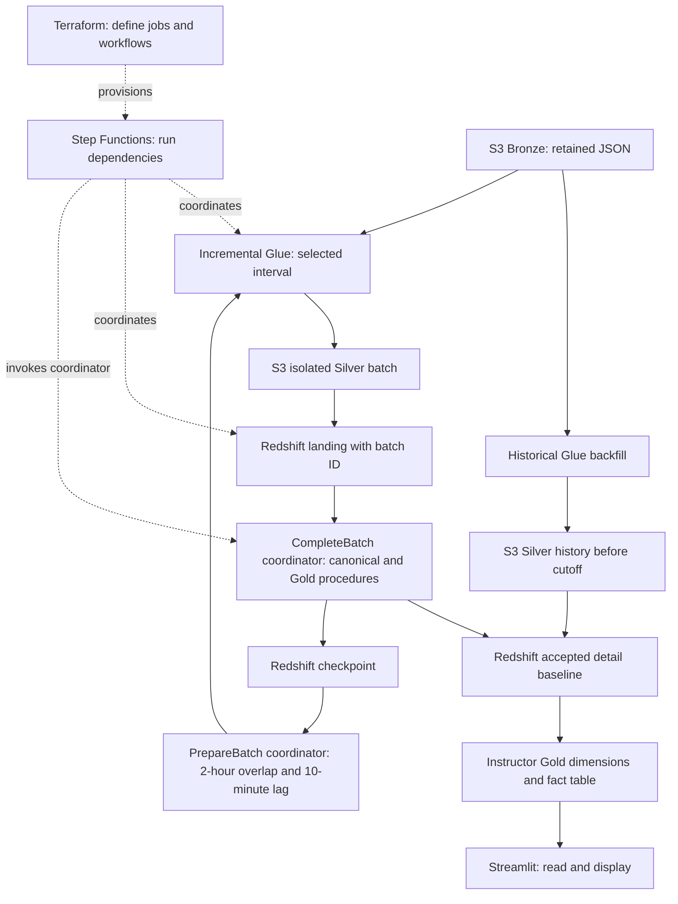

# Wednesday — Citi Bike: initial → backfill → incremental → Streamlit

> Status: Follow-along material prepared; Richard deployment and cloud execution pending  
> Level: Beginner → Intermediate  
> Applies to: Existing Richard S3, Lambda, Glue, and Redshift resources in us-east-2  
> Evidence: Instructor Glue source/configuration/run inspection plus local checks; no AWS resources changed  
> Last reviewed: 2026-10-14

## Start here

Your instructor evolved the Glue processing twice: **initial → historical backfill → incremental**. Step Functions coordinates the processing stages; Terraform defines their infrastructure; Streamlit reads the resulting reporting data. These are different responsibilities in one pipeline.

The local [follow-along directory](3.1-wed-citibike-step-functions-lab/README.md) contains the files for each stage, with a reading order and explanation of every important file. Keep it open beside this guide. You do not need to create EMR for this Glue route.

The instructor's deployed Glue scripts and four successful v2 job histories were inspected. His finished Terraform project, actual Step Functions definition, merge/Gold SQL, and Streamlit app were not available. The local instructor snapshots are preserved as references; the Richard Terraform, workflows, SQL, and dashboard are clearly labeled reconstructions. His reported completion does not establish that your personal pipeline is deployed or verified.

**Handoff update:** the instructor has now supplied the final architecture and reported a successful controlled end-to-end run. Read [the instructor handoff alignment](3.1-wed-citibike-step-functions-lab/reference/instructor-handoff.md) before implementation. His final flow is **PrepareBatch coordinator → two Glue jobs → CompleteBatch coordinator → canonical/physical Gold/checkpoint**. Ingestion is independently scheduled. The existing lab's direct-SQL workflow and ordinary Gold view remain an isolated teaching alternative, not his final design. Obtain the exact source using the prompt in that alignment document before adapting Terraform to match him.

### Learning objectives

- Explain why the initial job, backfill job, and incremental job have different source/output contracts.
- Follow one station at one captured UTC timestamp through Bronze, Silver, landing, accepted detail, and Gold.
- Explain how Terraform configuration, workflow execution, Glue transformation, SQL acceptance, and dashboard reads fit together.
- Validate a historical baseline and process a closed incremental batch without accidental duplicates or overwritten history.
- Locate the right script, job run, SQL statement, or permission when a stage fails.

### Prerequisites

Read [Tuesday's orchestration notes](2_Tue_Terraform_Airflow.md) and use the [Week 5 Glue/Redshift walkthrough](../Week5/4.2_Thur_Glue_Redshift_HW.md) for existing roles, JDBC connection, VPC paths, and database grants. The new files build on those working dependencies.

## Step 1 — Understand the three stages before clicking Run

| Stage | Problem solved | Main behavior | When to use it |
| --- | --- | --- | --- |
| Initial | Demonstrate the basic ETL chain | Read Bronze, flatten station arrays, enrich metadata, publish Silver, load Redshift | Understand and verify the original pipeline |
| Backfill | Establish a corrected historical v2 baseline | Process retained history before a fixed cutoff into separate v2 outputs | One-time migration/recovery, followed by reconciliation |
| Incremental | Keep accepted data current | Process a bounded new/catch-up batch, load landing, merge accepted data, record progress | Ongoing processing after the baseline is accepted |

“Updated Glue twice” describes changes in processing design and code, not necessarily upgrades to the Glue runtime. Keep the jobs separate: repeatedly scheduling the historical overwrite job does not make it incremental.

The screenshot showed an earlier failed Silver backfill. The later observed histories showed successful October 14 completion of both backfills and four successful runs of each incremental Glue job, with the latest landing load finishing at 2:32 PM Boise. This confirms more batch runs, not the identity of their trigger or completion of separate SQL stages. Details, exact instructor names, and limitations are retained in [resource observations](3.1-wed-citibike-step-functions-lab/reference/resource-observations.md).

**Checkpoint:** explain why a backfill should finish before ongoing incremental processing starts.

## Step 2 — Map the services to their responsibilities

- **Terraform provisions:** script uploads, Glue job settings, and state-machine definitions. Applying Terraform does not load data.
- **Step Functions orchestrates:** starts a job, waits for its result, and chooses the next state. It does not execute Spark transformations itself.
- **Glue transforms/loads:** reads JSON/Parquet, runs Spark, and uses the Redshift connector.
- **Coordinator prepares/completes:** reads the checkpoint, computes the window and batch ID, then submits and polls the completion procedure after Glue finishes.
- **Redshift accepts/reports:** the instructor's procedures process landing into canonical and physical Gold tables, check consistency, and advance `public.citibike_pipeline_checkpoint`. Exact transaction semantics await the procedure source.
- **Streamlit presents:** queries reporting data; refreshing the visual does not trigger ingestion or ETL.

The record grain is **one station at one captured UTC snapshot_timestamp**, identified by `(station_id, snapshot_timestamp)`. Keep that capture time distinct from the station's source `last_reported` time and from an hourly reporting key.

## Step 3 — Open your resources and the local files

Use account `866934333672`, Region **US East (Ohio), us-east-2**.

| Existing Richard resource | Confirmed name |
| --- | --- |
| Bucket | `richard-wilkerson-citibike-pipeline-866934333672-us-east-2-an` |
| Ingestion Lambda | `richard-citibike-ingestion` |
| Initial Glue jobs | `richard-citibike-bronze-to-silver`, `richard-citibike-silver-to-redshift` |
| Glue role | `AWSGlueServiceRole-RichardCitiBike` |
| JDBC connection | `richard-citibike-redshift-connection` |
| Redshift workgroup / database | `richard-citibike-wg` / `dev` |
| Redshift S3 role | `RichardCitiBikeRedshiftRole` |
| Optional EMR Serverless application | `richard-citibike-spark`; observed STOPPED |

Read [the directory's file map](3.1-wed-citibike-step-functions-lab/README.md#directory-and-reading-order). `initial/` contains copies of your existing code; `reference/instructor/` contains his retrieved code; `backfill/` and `incremental/` contain Richard adaptations. Instructor reference scripts still point to his bucket and must not be deployed unchanged as your jobs.

**Checkpoint:** identify which local file becomes which Glue job's uploaded Script location.

## Step 4 — Resolve IAM, then review Terraform

For following the instructor's final implementation, first collect his active Terraform and coordinator files using the [source request](3.1-wed-citibike-step-functions-lab/reference/instructor-handoff.md#prompt-to-request-the-exact-missing-source). His project uses AWS provider `~> 5.0` and Archive `~> 2.0`, and retains imported existing resources. The steps below describe our earlier separate AWS 6.x lab only; do not point that new-resource plan at his existing resource names or state.

Your current identity was denied `states:ListStateMachines`. Give your teacher the [IAM prerequisites and action checklist](3.1-wed-citibike-step-functions-lab/iam/README.md). Listing permission belongs to your signed-in identity; starting Glue and submitting SQL belong to the workflow role; Spark/S3 access belongs to the Glue role; SQL grants belong to database identities.

Open `terraform/versions.tf`, `variables.tf`, and `main.tf` in that order. Set the actual reviewed `workflow_role_arn` in a local `terraform.tfvars`. The explicit existing Glue/Redshift role ARNs, bucket, and JDBC connection are reused. Terraform does not recreate your warehouse or original jobs.

Follow [Terraform preparation](3.1-wed-citibike-step-functions-lab/README.md#terraform-preparation): initialize, format, validate, then review a saved plan. With empty state, expect four script objects, four new Glue jobs, and two new Standard workflows. Apply only the reviewed plan when ready to provision those resources. If names already exist outside Terraform state, resolve ownership/import before applying.

New jobs use prefix `richard-citibike-v2-lab-`. New outputs use `silver/citibike/v2-lab/` and Redshift schema `citibike_v2_lab`. There is no automatic schedule or job execution in the Terraform project.

**Checkpoint:** understand the planned resources, existing dependencies, workflow role, and SQL identity before applying.

## Step 5 — Compare the initial scripts

Open `initial/bronze-to-silver.py`. Trace: nested `data.stations` → `explode` → filename capture timestamp → station metadata join → availability calculations → Silver overwrite → read-back validation.

Open `initial/silver-to-redshift.py`. Your existing personal loader validates station/snapshot keys, loads shared staging, merges into `public.citibike_station_snapshot`, and clears staging. Keep one concurrent loader because that staging table is shared.

Compare the two instructor initial scripts under `reference/instructor/`. His initial warehouse example limits the load to 100 rows and appends. Your personal loader had already progressed to repeat-safe staging/merge; “initial” is not identical for every student.

The original optional workflow is preserved in [initial.asl.json](3.1-wed-citibike-step-functions-lab/workflows/initial.asl.json) for reading/comparison. The new Terraform project deploys the backfill and incremental workflows instead.

**Checkpoint:** predict what a full-history overwrite does if you accidentally restrict its input to only the newest snapshot.

## Step 6 — Prepare the historical destination and choose a cutoff

In **Redshift Query Editor v2**, connect to Richard's workgroup and `dev`. Read and run [01-setup.sql](3.1-wed-citibike-step-functions-lab/sql/01-setup.sql), then [02-accept-batch.sql](3.1-wed-citibike-step-functions-lab/sql/02-accept-batch.sql), with the appropriate schema/table/procedure permissions.

These create separate lab detail, landing, accepted-batch, and summary-view objects. They do not replace your existing public detail table or Gold star schema. `IF NOT EXISTS` does not repair an incompatible existing schema.

Choose an **exclusive UTC backfill cutoff**. For a snapshot captured at 02:41 UTC, a 03:00 UTC cutoff includes it. Historical processing covers retained files with capture timestamps `< cutoff`; the adapted ongoing interval starts at `cutoff` inclusively.

Inspect Bronze and record the intended files. A new Lambda call cannot recover historical snapshots that were never retained. For reproducibility, freeze inputs or record the precise object set; a timestamp cutoff alone is not an immutable manifest.

**Checkpoint:** lab detail table is empty before its one-time append load; cutoff and historical source scope are recorded.

## Step 7 — Run and validate the backfill

1. Open **Step Functions → richard-citibike-v2-lab-backfill → Start execution**.
2. Use [backfill.example.json](3.1-wed-citibike-step-functions-lab/inputs/backfill.example.json), edited to your selected cutoff.
3. `BuildHistory` runs the historical Silver job with `--CUTOFF_UTC`. Inspect the Glue run/logs and published read-back checks.
4. `LoadHistory` starts only after Silver succeeds. It reads the separate historical prefix and appends eleven columns into the prepared lab detail table.
5. Record the execution ARN, both Glue run IDs, input scope, row counts, and output paths.
6. Run [03-validate.sql](3.1-wed-citibike-step-functions-lab/sql/03-validate.sql); compare actual Silver and warehouse snapshots/keys/counts before accepting the baseline.

Use **Standard**, because Glue's `.sync` integration waits for the job to complete. A request that merely starts Glue is not evidence that Parquet or Redshift data is ready. [AWS workflow types](https://docs.aws.amazon.com/step-functions/latest/dg/choosing-workflow-type.html).

This historical loader appends and requires an empty table. Do not blindly rerun it after a timeout: inspect whether the warehouse write committed. A failed Silver overwrite can leave partial output. Stop downstream work, preserve accepted versions, and repair from a known input.

**Checkpoint:** historical baseline accepted; no duplicate keys; actual counts reconcile; no active backfill work remains.

## Step 8 — Trace one incremental batch

Open `incremental/bronze-to-silver.py`. Required arguments are `BUCKET`, `BATCH_ID`, `START_AT_UTC`, and `END_BEFORE_UTC`. The script selects filename capture timestamps in `[start, end)`, reads only selected status files, enriches metadata, writes `batch_id=.../`, and verifies published keys.

The current instructor reference uses inclusive start and exclusive end in its executable comparison, despite its stale docstring claiming exclusive start. The Richard adaptation uses the same boundaries with the clearer argument name `START_AT_UTC`. Both reject overwriting an existing batch. Rerunning a successful immutable Silver writer with the same ID will fail unless recovery deliberately reuses accepted output.

Open `incremental/silver-to-redshift.py`. It reads one Silver batch, adds `batch_id`, and appends to landing. Landing success is not accepted-detail success. Duplicate landing loads are possible; the next SQL stage handles exact duplicates and rejects conflicting values.

Metadata is latest-state enrichment, not point-in-time station history. Late-arriving older snapshots need a deliberate catch-up batch; a latest-timestamp checkpoint alone could miss them.

**Checkpoint:** draw the difference between a Silver batch, landing rows, accepted detail rows, and an accepted-batch marker.

## Step 9 — Execute the incremental workflow and understand its JSON

**Instructor route:** `PrepareBatch` invokes `citibike-batch-coordinator` to read pipeline `citibike_incremental` from `public.citibike_pipeline_checkpoint`, subtract two hours from the checkpoint for the start, choose current time minus ten minutes for the exclusive end, and use the execution name as batch ID. Both Glue tasks use `.sync`. `CompleteBatch` invokes the coordinator to submit/poll `sp_complete_citibike_batch`, which processes canonical/Gold data and advances the checkpoint. Ingestion is not a state in this downstream workflow. Inspect the actual coordinator payloads/result paths once the source arrives; do not invent them from state names.

**Existing isolated lab alternative:** the following manual-input/direct-Data-API instructions describe the earlier reconstruction, not the instructor's final coordinator implementation.

Use the [input generator](3.1-wed-citibike-step-functions-lab/prepare-input.py) to prepare an actual populated, closed interval. It validates the batch ID, UTC timestamps, and elapsed end, then writes matching Glue input and the SQL procedure call. The provided example dates are illustrative, not a claim that those files exist in your bucket.

Capture a new snapshot through your existing Lambda if necessary, inspect its returned object keys, and wait until your chosen end has passed. A selected window does not include files that arrive after its listing; late data still needs reconciliation.

Open [incremental.asl.json](3.1-wed-citibike-step-functions-lab/workflows/incremental.asl.json):

- `ChooseSilver` normally starts `BuildSilver`; `reuse_silver: true` skips the writer only after you validate the existing published batch.
- `BuildSilver.Parameters.Arguments` maps JSON fields into the script's Glue arguments. The `.$` suffix selects a value from a JSONPath such as `$.batch_id`.
- `ResultPath` saves job metadata under `silver` or `load` while retaining the original input. It does not put Parquet rows in workflow state.
- `LoadLanding` waits for its Glue run, then `CreateSqlToken` makes a stable token for this SQL submission.
- `SubmitAcceptance` submits the reviewed `accept_sql` to Richard's workgroup. The returned `Id` means submitted, not finished.
- `WaitForSql` and `DescribeSql` poll the statement. `FINISHED` reaches success; `FAILED`/`ABORTED` reach failure; the workflow deadline bounds ongoing polling.
- Failure paths preserve a `failure` object. SQL error details and statement ID remain in execution history. `Catch` does not undo S3 or database side effects, and some runtime errors are not catchable by `States.ALL`.

The workflow's SQL input is trusted operator input, not a public API. Use the generator and restricted SQL grants. Data API temporary IAM authentication needs separate workgroup credential permission and database grants; the Glue JDBC login is not automatically the workflow's database identity.

**Checkpoint:** execution ARN _____; batch ID/interval _____; two Glue run IDs _____; SQL statement ID _____; final status _____.

## Step 10 — Validate acceptance, reporting, and replay

**Instructor route:** inspect `sp_process_citibike_batch` and `sp_complete_citibike_batch`, then verify canonical/Gold counts, duplicate station/timestamp keys, station/date dimension orphans, and the advancing checkpoint. The handoff reports a successful redrive after fixing SQL grants for `IAMR:CitiBikeBatchCoordinatorRole`; those grants do not automatically cover a new Richard coordinator role. The earlier 1,579,415-row audit is historical baseline evidence, not a current expected count. Our separate `citibike_v2_lab.sp_accept_batch` is a different example and must not replace the teacher's procedures.

**Existing isolated lab alternative:** the following procedure/view explanation applies to our reconstructed lab only.

Read `sql/02-accept-batch.sql` in sequence: lock the lab tables → check prior acceptance → deduplicate exact landing rows → reject conflicting keys/invalid intervals/counts → merge accepted detail → check duplicates → insert accepted marker → clear this batch's landing rows.

The default atomic stored-procedure transaction commits these changes together. A failure rolls back its changes; it does not roll back the earlier Glue append. A replay with the same accepted batch ID/interval does not remerge accepted rows; a changed interval under that ID is rejected. This is a reconstructed classroom pattern, not recovered instructor SQL. [AWS stored procedures](https://docs.aws.amazon.com/redshift/latest/dg/r_CREATE_PROCEDURE.html).

Run `sql/03-validate.sql`. Expected: no duplicate groups, zero invalid keys, no landing rows for accepted batches, correct accepted intervals, and Gold operational counts agreeing with detail. Reconcile source snapshots and values too; zero duplicates does not prove completeness.

Gold here is an **ordinary view**. It reads current accepted detail without a stored-result refresh. Physical facts/dimensions or materialized views would need separate reviewed loading/refresh logic before progress is accepted. Keep your existing star-schema work separate.

For replay after Silver succeeded, use the input generator's `--reuse-silver` flag. Inspect active service work before retrying a timed-out execution. Follow the [failure/replay table](3.1-wed-citibike-step-functions-lab/README.md#failure-and-replay).

**Checkpoint:** key/value reconciliation _____; accepted marker _____; landing cleanup _____; Gold checks _____; same-input replay evidence _____.

## Step 11 — Add the Streamlit visual

Open [dashboard/app.py](3.1-wed-citibike-step-functions-lab/dashboard/app.py). Start it using the command in [Streamlit instructions](3.1-wed-citibike-step-functions-lab/README.md#streamlit-learn-the-visual-first). It defaults to three clearly labeled synthetic snapshots, showing latest operational stations, bikes, docks, a time-series chart, and a table.

After the real lab view exists, select **Richard Redshift → Load accepted snapshots**. The reader uses fixed SELECT SQL through the Data API, waits for completion, and fetches result pages. It uses your local SDK credentials, which may differ from the MCP session used for resource inspection.

The visual reads at most the latest 1,000 operational-station summary snapshots. Displayed data freshness depends on ingestion, processing, acceptance, and the latest explicit read. A chart displaying successfully does not prove the upstream workflow is healthy.

**Checkpoint:** sample display works _____; real view/grants ready _____; live statement ID _____; latest displayed capture agrees with SQL _____.

## Step 12 — Schedule only after the manual chain is understood

The instructor's `citibike-incremental-every-30-min` schedule was freshly confirmed **ENABLED**, with expression `rate(30 minutes)` and his existing state machine as target. The handoff's activation uncertainty is therefore resolved at inspection time. `DescribeStateMachine` and `ListExecutions` were denied to Richard, so unattended success and checkpoint advancement remain unverified. The five-minute ingestion schedule is separate; do not modify the other student's similarly named ingestion schedule.

Keep one active writer for the shared destinations. Per-job concurrency one orders runs of one job; it does not serialize separate pipeline executions or prevent a second backfill from racing with incremental work.

Before adding EventBridge Scheduler, define a real admission/locking mechanism, a closed-window policy, late-data reconciliation, and missing-run/failure monitoring. The current Terraform intentionally provisions no schedule. Coordinate whether ingestion remains separately scheduled or becomes a workflow step so you do not capture twice accidentally.

Record accepted-batch identities rather than treating the largest timestamp as proof that all earlier snapshots arrived. Retain Bronze and accepted Silver batches for replay. Preserve previous reader/configuration versions for cutover rollback. Budget run frequency using measured Glue/warehouse durations and storage/request costs; no billing experiment was performed here.

## Knowledge check

- Why is the historical append loader unsafe to rerun blindly?
- What does `[start, end)` do with a snapshot exactly at the cutoff?
- Why is a landing load not the end of the incremental pipeline?
- What happens if landing append commits but SQL acceptance fails?
- Which actions belong to Terraform, and which happen only during execution?
- Why does a successful ordinary-view dashboard read need no Gold refresh command?
- Which late-arrival or source-mutation cases are not solved by an accepted-batch marker?

## Completion checklist and evidence

- [ ] I can explain initial → backfill → incremental and identify each local source file.
- [ ] I reviewed the Terraform plan, role prerequisites, and new resource names.
- [ ] I accepted a reconciled historical baseline with a recorded cutoff.
- [ ] I processed one populated incremental batch through landing and SQL acceptance.
- [ ] I checked keys, values, intervals, reporting results, and controlled replay.
- [ ] I can open the sample visual and distinguish sample from live results.
- [ ] I can diagnose an error using execution, Glue-run, and SQL-statement IDs.
- [ ] Scheduling, admission locking, late-data handling, and costs have explicit owners.

Local syntax, links, ASL structure, source snapshots, SDK stub checks, and dashboard sample behavior are recorded in the lab evidence. They do not establish a deployed Richard pipeline. Terraform apply/plan against AWS, Spark execution, Redshift SQL/grants, live dashboard queries, scheduling, and end-to-end recovery remain pending.

His link to the dashboard:
http://3.21.97.237:8501
