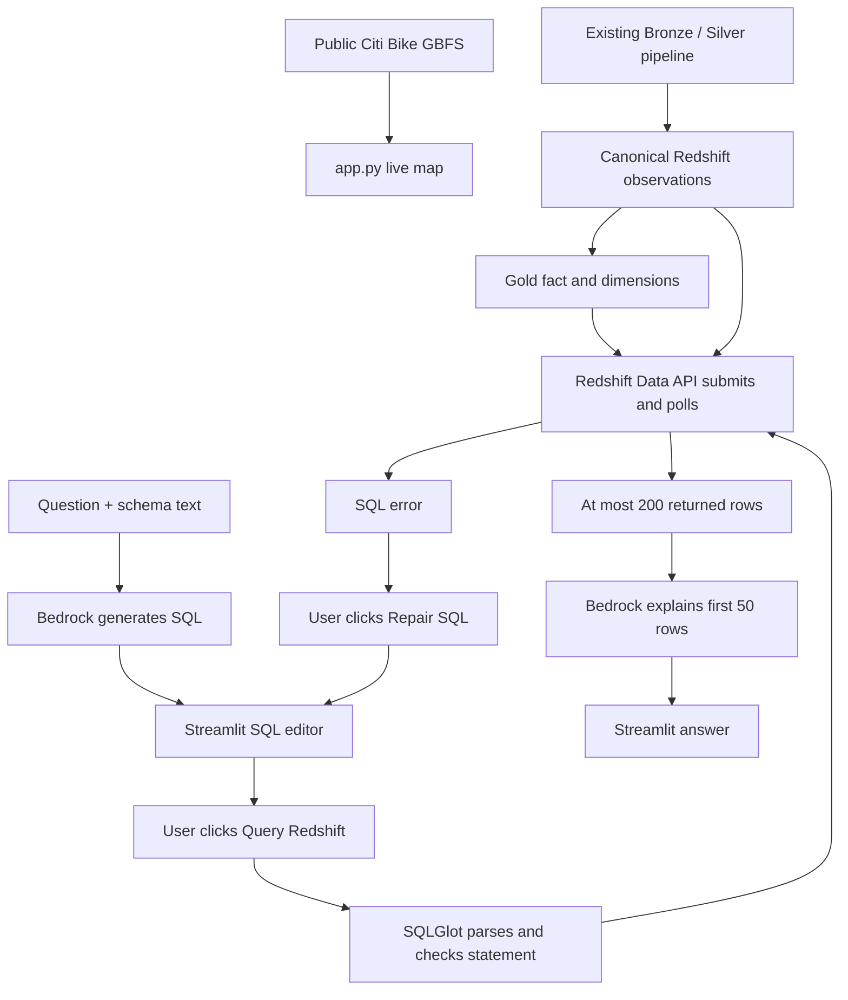

# Thursday lab: understand the Citi Bike AI analytics demo

> Status: Incremental Gold schema and history SQL verified; live UI and Bedrock reproduction pending  
> Level: Beginner to intermediate  
> Example status: Instructor snapshots plus a separate Richard adaptation  
> Evidence status: Offline source, SDK-stub and Streamlit AppTest checks only  
> Last reviewed: 2026-10-15

## Overview and learning objectives

A useful AI analytics interface depends on trustworthy warehouse data. This lab explains how a user question becomes proposed SQL, how the user approves execution, and how returned rows become a model-generated explanation. The data pipeline remains responsible for collecting, deduplicating and publishing observations; the model does not repair those guarantees.

After following the reading route, you should be able to trace the application across files, distinguish live GBFS data from historical warehouse data, configure a separate learner copy, recognize missing SQL permissions and definitions, and explain what offline checks establish.

Read [Thursday lecture notes](../4_Thur_AI.md), [Thursday homework](../4.1_Thur_HW.md), and Wednesday [Part 2 implementation requirements](../3.2_Wed_HW.md#part-2--implementation-requirements) first. The homework prioritizes the existing pipeline and explicitly does not require implementing the AI application overnight. This directory supplies reference material and application plumbing; it does not supply your homework answers or implement the required ingestion, Gold model, checkpoint, scheduling or Terraform work.

## Start here: numbered checkpoints

For terminal commands, console checks, expected results and failure recovery in order, follow the [practical checkpoint walkthrough](../4.2-bedrock-steps.md). Start with its pipeline-readiness gate before live model or warehouse work.

1. Read this guide through the flow and file map. Predict which buttons contact Bedrock, Redshift or the public GBFS service.
2. Compare [schema context](reference/instructor/redshift_schema.txt) with your intended warehouse. Identify missing objects before configuring a connection.
3. Read [deployment review](deployment-review.md). The instructor deployment commands are historical source, not a ready deployment procedure.
4. Run the offline verifier from the repository root. Read [verification](verification.md) for its precise limits.
5. Read [Richard adaptation notes](richard/README.md). Configure and launch locally only when the warehouse and permissions prerequisites are met. A local launch can still make paid cloud calls when buttons are clicked.
6. Keep collecting evidence for your own pipeline separately. Do not treat a map, generated SQL, successful SDK stub, or empty query result as proof the warehouse is complete or fresh.

## Mental model and terminology

This is **schema-grounded text-to-SQL**, followed by result-grounded explanation. The code sends table descriptions directly to Bedrock, executes approved SQL through the Redshift Data API, and sends a small result sample back to Bedrock. It contains no embeddings, vector search, Bedrock Knowledge Base, document ingestion or model training. RAG retrieves relevant external information for generation; a vector database commonly searches numerical embeddings by similarity. A vector database is not tokenized information that simulates training. These clarifications apply to the shorthand in Thursday's lecture without rewriting the original notes.

Bedrock is a managed AWS inference service, even when the Streamlit UI runs locally. `bedrock` is the management client; this application uses `bedrock-runtime.converse` for inference. A model ID or inference-profile ID chooses what serves the request. Streamlit reruns the page script on interaction; `st.session_state` carries values between those reruns for that browser session.

There are two independent read paths. The home map joins current station information/status from public HTTP endpoints, with a 60-second cache. Its optional history button reads hourly observation counts over two days; the Richard adaptation now reads `gold.incremental_fact_station_snapshot`. The AI page uses the saved schema descriptions and Redshift tables. A working live map proves neither Redshift connectivity nor pipeline progress. GBFS cache expiry is not a background refresh schedule; the page must rerun.

## Selected instructor files and reading order

Original names are preserved under [reference/instructor](reference/instructor/README.md), including names that differ from repository kebab-case conventions. This exception preserves source identity. [Provenance manifest](reference/provenance.json) records all 17 files, original relative paths, byte sizes and SHA-256 hashes. Capture date: 2026-10-15; source: `/Users/richardwilkerson/Downloads/ai_demo/`, supplied by Richard as the instructor bundle. These are local originals, not independently retrieved deployed versions. No source file was changed to make a snapshot look correct.

| File under `reference/instructor/` | Purpose and what to inspect |
| --- | --- |
| [app.py](reference/instructor/app.py) | Streamlit entry point: live GBFS requests, inner join on `station_id`, numeric cleanup, map/filter/summary displays, and optional canonical-history Data API query. Unmatched station records disappear from the inner join; missing numeric fields become zero, so this is a presentation transform, not a data-quality audit. |
| [pages/2_AI_SQL_Generator.py](reference/instructor/pages/2_AI_SQL_Generator.py) | Multipage AI UI. Loads schema beside the app; stores proposed SQL, original question, usage, execution/error/results and explanation in session state. Generation does not execute SQL. Query Redshift is the explicit execution action. Repair proposes a replacement; it must be reviewed and executed again. |
| [bedrock_sql.py](reference/instructor/bedrock_sql.py) | `generate_sql`, `repair_sql`, `explain_results`. System prompt specifies allowed schema, intended grain, Redshift windows/QUALIFY, and `INSUFFICIENT_SCHEMA`. Calls Converse with 700 output tokens for generation/explanation and 900 for repair, temperature zero, connection/read timeouts and SDK retries. Temperature zero does not certify correctness or determinism. |
| [redshift_query.py](reference/instructor/redshift_query.py) | Parses with SQLGlot's Redshift dialect, requires a single SELECT/UNION tree, rejects listed mutating operations, wraps SQL in an outer LIMIT 200, submits, polls up to a nominal 90 seconds, attempts cancellation, paginates and decodes typed Data API cells. |
| [redshift_schema.txt](reference/instructor/redshift_schema.txt) | Prompt context: columns/types, fact-to-dimension relationships, observation grain and ranking rules. It is a saved description, not executable DDL or a live schema lookup. |
| [requirements.txt](reference/instructor/requirements.txt) | Six third-party dependencies with ranges, not a lockfile: Streamlit UI; pandas tables; requests HTTP; pydeck maps; boto3 AWS clients (botocore is transitive); SQLGlot SQL parsing. |
| [dashboard.tf](reference/instructor/dashboard.tf) | EC2 host, networking, instance role/profile, SSM, S3 deployment reads, Bedrock/Data API IAM, user-data template, and outputs. Reviewed as infrastructure context only. |
| [dashboard-user-data.sh.tftpl](reference/instructor/dashboard-user-data.sh.tftpl) | Amazon Linux bootstrap: Python/venv, embedded home app/requirements, systemd Streamlit service on port 8501. Does not install the AI page/helpers/schema. |
| [deploy-chatbot.sh](reference/instructor/deploy-chatbot.sh) | S3 staging, syntax check, pip install, file backups, installs and systemd restart. Omits the required Redshift helper; see deployment review. |
| [ssm-chatbot-v2.json](reference/instructor/ssm-chatbot-v2.json) | Later remote-update fragment that includes `redshift_query.py`, but assumes app/schema/service already exist and installs only SQLGlot rather than the full requirements. Not a complete fresh install. |
| [ssm-prompt-update.json](reference/instructor/ssm-prompt-update.json) | Remote prompt/schema-only replacement and service restart; depends on an existing compatible application. |
| [ssm-sql-repair.json](reference/instructor/ssm-sql-repair.json) | Remote Bedrock helper/AI-page replacement to add repair; assumes all other components are present. |
| [README.md](reference/instructor/README.md) | Earlier Step Functions deployment notes retained to show provenance. They are stale for this combined bundle: the no-schedule and destroy-scope statements conflict with included scheduler/dashboard/coordinator resources. Do not follow them as this lab's instructions. |
| [main.tf](reference/instructor/main.tf) | Instructor account/profile/provider pins, existing incremental Glue job names, coordinator-driven state machine and logging. Context for what publishes warehouse data, not a Thursday deployment target. |
| [orchestration.tf](reference/instructor/orchestration.tf) | Packages coordinator Lambda, supplies warehouse environment variables, and defines its separate writer IAM role. Does not create warehouse SQL objects or grants. |
| [scheduler.tf](reference/instructor/scheduler.tf) | Enabled thirty-minute processing schedule and start-execution role; independent from five-minute ingestion. Applying this source would enable activity. |
| [coordinator.py](reference/instructor/coordinator.py) | Reads checkpoint, computes two-hour overlap/ten-minute lag, and calls/polls `sp_complete_citibike_batch` after Glue. Confirms handoff code shape, but cannot establish unavailable stored-procedure transaction or deduplication behavior. |

Excluded: Terraform state and state backups, every saved `*.tfplan`, `.terraform/` and other caches, generated zip archives, redundant `*.backup`/`*.pre-final-backup`, and `ssm-deploy.json` (a heredoc embedding the selected `deploy-chatbot.sh`). These exclusions remain in Downloads; nothing there was deleted. No credentials or secret values are needed for these snapshots. Account IDs, resource names and infrastructure topology remain as instructor reference identifiers.

## Application flow, state and trust boundaries

1. **Generate:** The AI page reads schema text, combines it with the question and system rules, then calls Bedrock. It strips simple Markdown code fences and saves the proposal. `INSUFFICIENT_SCHEMA` is a visible refusal sentinel. Output is untrusted SQL text, even when it looks plausible.
2. **Review:** The user can edit the SQL. Query Redshift executes the current editor value. This is a click-based classroom approval, not a separate authenticated reviewer or durable audit record. The stored question remains the question from generation even if the question box later changes; generate again for a new question.
3. **Validate and submit:** SQLGlot checks a narrow syntax/operation policy. It does not enforce table/column allowlists, verify schema existence, prove read-only functions, constrain query cost, or guarantee correct business meaning. The database identity and SQL privileges are the actual access boundary.
4. **Poll and decode:** Data API returns a statement ID first, not query rows. The helper polls until FINISHED/FAILED/ABORTED, then retrieves pages and converts strings, integers, doubles, booleans and SQL NULL (`None`). Unsupported field forms currently become `None`; blob results are not handled. Query failure stops the explanation path.
5. **Explain:** After successful execution, the page automatically calls Bedrock with the saved question, executed SQL, columns, returned count and first 50 rows. At most 200 rows reach the application. The result explanation is sampled evidence, not an audit of all warehouse records; a bounded row count does not reveal the total matching count.
6. **Repair:** After a query error, the user may send the schema, question, SQL and error text back to Bedrock. Repair does not rerun automatically. Richard's version fixes the widget update timing; the original defect is reproduced by the offline verifier. In this UI, Repair becomes enabled on a rerun after the error is stored.
7. **Rerun:** Results are shown only when current editor text equals executed SQL. A new generation or execution clears prior results/explanations. The server process owns SDK clients; browser session state is transient. Session loss removes this UI history but does not cancel an already-submitted warehouse statement.

The pipeline owns authoritative canonical/Gold data; schema text, map transforms and model answers are derived views. Questions, SQL, schema descriptions, error messages and sampled rows cross the model boundary. Only send data appropriate for the selected model/profile and account. Prompts telling the model to ignore instructions inside rows are useful guidance, not enforced isolation.

## Requirements, invariants and missing prerequisites

The intended fact key is `(station_id, snapshot_timestamp)`. `gold.dim_station` intends one row per station ID and `gold.dim_date` one per date key. Join cardinality, uniqueness, orphan checks and canonical-to-Gold reconciliation must be established by the owning pipeline. Latest-per-station queries require an explicit time ordering and a documented tie policy if the intended key is not unique. Timestamp-without-time-zone columns require an agreed UTC interpretation; the snapshot says observation time but does not establish source-versus-capture clock mapping or date-key generation.

| Prerequisite | Available evidence | Required before live reproduction |
| --- | --- | --- |
| Canonical and physical Gold data | Column context for `public.citibike_station_snapshot_v2`, `gold.dim_station`, `gold.dim_date`, `gold.fact_station_snapshot` | Obtain actual DDL, keys/types/null policy, load logic, current schema, populated rows, time semantics and read-only quality/freshness evidence. `redshift_schema.txt` does not create tables. |
| Pipeline SQL | Coordinator names `public.citibike_pipeline_checkpoint`, `sp_complete_citibike_batch(VARCHAR, TIMESTAMP)`; handoff also names landing and `sp_process_citibike_batch(VARCHAR)` | Obtain full landing/canonical/checkpoint/Gold definitions, procedure bodies, signatures, security/transaction modes, grants, checkpoint bootstrap and failure/replay rules. These are missing from `ai_demo`. |
| Dashboard database identity | Data API calls specify workgroup/database and omit SecretArn/DbUser; IAM role policy is supplied for EC2 | Confirm the actual database user with `SELECT current_user;`. Role temporary authentication generally maps to `IAMR:<role-name>` and IAM-user authentication to `IAM:<user-name>`. Dashboard role has a generated suffix: do not copy the coordinator principal or guess the name. |
| SQL read privileges | No GRANT SQL supplied | DBA must authorize the real dashboard/local caller identity with schema USAGE and SELECT on the four described objects (canonical table plus three Gold tables), or on reviewed replacement views with matching schema context. Check inherited/PUBLIC privileges and ownership; do not grant write/admin/procedure-execution rights to the AI reader. Database privilege design is pending, not solved by IAM policy attachment. |
| Coordinator SQL authorization | Historical handoff reports grant failures and later fixes for `IAMR:CitiBikeBatchCoordinatorRole` | Obtain the actual coordinator grants and procedure security mode; its writer permissions are separate from dashboard reader permissions and Richard's future identities. |
| IAM/API authorization | Snapshot policies show InvokeModel, Data API actions and GetCredentials | Confirm caller's intended account/region, `bedrock:InvokeModel`, profile/model resources and any destination-region controls, `redshift-data:ExecuteStatement`, `DescribeStatement`, `GetStatementResult`, `CancelStatement`, and `redshift-serverless:GetCredentials` for the intended workgroup. JSON/source inspection does not prove access. |
| Bedrock selection | Original default `us.amazon.nova-micro-v1:0`, region `us-east-2` | Verify supported model/profile, region, account entitlement and quotas at run time. This capture did not list models or invoke Bedrock. A `us.` profile can route inference across supported US regions; configure deliberately. |
| Local dependencies/authentication | Adaptation checked in existing repository `.venv` | Use your own authenticated SDK profile/session. An AWS connector session or instructor `company` profile is not automatically your local SDK identity. No password, token or AWS credential file is copied. |
| Hosted deployment | EC2/systemd/SSM reference files | Resolve the deployment review, source versions, IAM/networking, host/service assumptions and database grants before considering hosting. No hosted deployment is prepared or verified here. |

A narrow, read-only discovery step for the warehouse owner is `SELECT current_user;` followed by comparing the actual column metadata with the saved schema. This guide deliberately supplies no Gold DDL, merge procedure, checkpoint seed, completed homework query or applied grant. Record missing definitions and request the instructor's source rather than inventing equivalent SQL.

## Separation from Wednesday

Read the [Wednesday README](../3.1-wed-citibike-step-functions-lab/README.md) and [instructor handoff](../3.1-wed-citibike-step-functions-lab/reference/instructor-handoff.md) for the reconstruction boundary. Wednesday's `citibike_v2_lab` namespace, accepted-batch ledger and ordinary summary view differ from this instructor's physical Gold model and checkpoint coordinator. Do not just rename tables in the prompt to hide those differences.

The four newly supplied pipeline-context originals remain under this Thursday reference tree. They improve source availability but have not been compared with deployed Lambda/ASL/state or used to revise Wednesday Terraform. No state was copied; no import, plan, apply, destroy, schedule or workflow action was performed. The original bundle's account and `company` profile refer to the instructor configuration. Richard adaptations stay under `richard/`; no `.tf` files are offered there.

## Failure model and recovery

| Symptom | Owning boundary and next action |
| --- | --- |
| Map fails before history UI appears | Public HTTP/feed/schema boundary; inspect request errors and feed discovery. This does not diagnose Redshift. |
| Bedrock access/model error | Local SDK identity, inference permission, model/profile/region or quota. Fix configuration/access before retrying; do not create another pipeline. |
| `INSUFFICIENT_SCHEMA` or hallucinated names | Schema grounding; compare actual supported objects and request intent. Repair can still invent names. |
| Parser rejects SQL | Review operation and SQLGlot dialect support. Do not bypass validation to make an error disappear. |
| Redshift permission denied | Determine current database identity; distinguish IAM authentication from SQL grants. Have the owning DBA resolve the minimal reader access. |
| Empty/stale results | Check query time filter, pipeline checkpoint, canonical/Gold freshness and source coverage. A successful query can read incomplete data. |
| Timeout | AI helper attempts cancellation; failure to cancel is swallowed. Verify statement status before resubmitting. The home history path polls 30 times and does not cancel on timeout. |
| Correct-looking answer disagrees with data | Inspect executed SQL, grain, joins, time window, NULL behavior and sampled rows. Model prose is not authoritative. |
| Reload or remote update fails | Preserve original source/statement IDs; review service logs and actual installed files. Reference scripts lack atomic publication and dependency rollback. |

Polling deadlines are nominal; SDK latency/retries and result retrieval can exceed them. A LIMIT bounds rows returned, not bytes, scanned rows, joins, execution time or spend. Multi-user concurrency can multiply model requests and warehouse queries. There is no durable queue, workload admission, query-budget policy or cross-session approval/audit ledger in this classroom application.

## Data quality, production considerations and evidence

Offline results and exact commands are recorded in [verification.md](verification.md). The verifier uses synthetic results, fake AWS credentials, denied socket connections, SDK Stubber and UI doubles. A negative test demonstrates that nonexistent table/column names still pass the parser: the validator is not a schema authorization engine.

Before production use, define workload/concurrency and cost budgets, SQL object/function allowlists, statement/result byte limits, database query controls, authenticated UI access and TLS, scoped model/workgroup permissions, and redacted audit records linking question/prompt version, approved SQL, identity, statement ID, outcome and token usage. The sample exposes detailed errors and does not provide these controls. Human review remains necessary. Keep reader permissions separate from the pipeline's writer and checkpoint permissions.

Track freshness, result truncation, failed/aborted/timed-out statements and cancellation outcomes. Record UTC query time and accepted pipeline boundary; the newest row alone does not prove completeness. The UI token display is per-operation session information, not a bill or cumulative usage report; repair overwrites generation usage. Model generation, repair and automatic explanations can each incur inference charges. Redshift, EC2, storage and network costs have separate owners. None were measured here.

## Knowledge check and completion checklist

- [ ] Trace one question through the files and identify the exact execution approval button.
- [ ] Explain why a station ranking over raw historical rows can repeat a station.
- [ ] Identify which selected files describe columns and which actually create infrastructure.
- [ ] Explain why the reader role can authenticate yet fail SELECT.
- [ ] Predict what happens when edited SQL differs from the last executed SQL.
- [ ] Explain what a 200-row query limit and a 50-row explanation sample cannot establish.
- [ ] Run the offline checks and distinguish them from current cloud/schema/permission evidence.
- [ ] Obtain missing instructor definitions and complete your own pipeline before attempting the live extension.

## Primary references

Reviewed 2026-10-15: [Bedrock Converse request/response and InvokeModel permission](https://docs.aws.amazon.com/bedrock/latest/APIReference/API_runtime_Converse.html), [Redshift ExecuteStatement authentication and asynchronous submission](https://docs.aws.amazon.com/redshift-data/latest/APIReference/API_ExecuteStatement.html), [Streamlit session-state widget restrictions](https://docs.streamlit.io/develop/api-reference/caching-and-state/st.session_state). These references support API and UI behavior; they do not verify this account, model availability, database grants or deployment.
