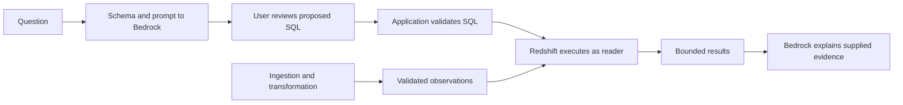

# Thursday — Analytical SQL and AI-assisted warehouse questions

> Status: Expanded lecture; cloud reproduction pending
> Level: Beginner to intermediate, with production design considerations
> Applies to: Dimensional modeling, analytical SQL, Redshift, Bedrock, Streamlit
> Data scale: Small illustrative records; instructor warehouse scale unverified
> Example status: Teaching examples, inspected instructor source, separate Richard adaptation
> Evidence status: Source review and offline checks; live inference and warehouse execution pending
> Last reviewed: 2026-10-15

## Overview

A trustworthy analytical answer starts with knowing what the data represents. SQL turns records into a result; a foundation model can help propose SQL and explain that result, but the pipeline and warehouse still own data correctness. This lesson moves from row meaning to analytical queries, then follows the classroom application across its human, model, and database boundaries.

The [Thursday homework](4.1_Thur_HW.md) prioritizes your existing pipeline. Understanding the demonstration does not require implementing an AI application by tomorrow. Examples below demonstrate individual concepts; they do not complete the homework aggregation, latest-record, duplicate-detection, analytical-question exercises, or conceptual answers.

## Learning objectives

- State the grain of a fact table, a dimension, and a query result.
- Explain how joins, grouping, time filters, and window functions affect an answer.
- Trace `ROW_NUMBER`, `RANK`, `LAG`, `AVG OVER`, and Redshift `QUALIFY`.
- Distinguish inference, prompting, schema grounding, hallucinations, RAG, embeddings, and vector search.
- Follow generation → review → validation → execution → explanation, including failures and repair.
- Separate implemented functionality from database prerequisites and possible extensions.

## Prerequisites and study route

You need basic `SELECT`, `FROM`, `WHERE`, keys, and timestamps. Review [Week 5 star-schema notes](../Week5/5_Fri_AWS_Adv_pt2.md) for modeling context and [Wednesday's orchestration guide](3_Wed_Step_Functions.md) for the pipeline that produces the warehouse data.

1. Follow the table and time-series examples before reading the AI sections.
2. Predict the window outputs, then compare with the annotated expectations.
3. Trace the demo-flow table while opening its linked source files.
4. Follow the [practical checkpoint walkthrough](4.2-bedrock-steps.md), then use the [lab reading route](4.3-thur-bedrock-streamlit-lab/README.md) and offline verifier for further study.
5. Return to your own pipeline and separate homework. Reading this lecture requires no cloud credentials or paid model calls.

## Mental model and terminology



| Term | Meaning here |
| --- | --- |
| Grain | The precise meaning of one row at a particular stage |
| Fact | An event or observation with measurements and references to descriptive entities |
| Dimension | Descriptive context for an entity or calendar date at a declared grain |
| Aggregation | Combining rows into summary rows |
| Window function | Calculating across related rows while retaining individual rows before later filtering |
| Inference | Using an existing model to generate a response |
| Grounding | Supplying authoritative context to support or constrain generation |
| Hallucination | A generated reference or claim that is unsupported or false |
| RAG | Retrieval-augmented generation: retrieving external evidence and supplying it to generation |

## 1. Facts, dimensions, and grain

### A fact records an observation

The instructor's [schema context](4.3-thur-bedrock-streamlit-lab/reference/instructor/redshift_schema.txt) describes `gold.fact_station_snapshot`. Its intended grain is **one station observation at one snapshot timestamp**, identified by `(station_id, snapshot_timestamp)`. That is a contract to verify, not proof that duplicates cannot exist.

Illustrative records, not queried classroom data:

| station_id | snapshot_timestamp | bikes_available |
| --- | --- | --- |
| A | 2026-10-15 09:00:00 | 8 |
| A | 2026-10-15 09:05:00 | 5 |
| A | 2026-10-15 09:10:00 | 5 |
| B | 2026-10-15 09:00:00 | 3 |

Station A appears three times because there are three observations. Station ID alone does not identify a fact row. Two observations can legitimately have the same bike count.

### A dimension supplies context

| Described table | Intended row meaning | Relationship |
| --- | --- | --- |
| `gold.dim_station` | One station with `station_name` and `capacity` | Fact `station_id` joins to dimension `station_id` |
| `gold.dim_date` | One calendar date with year/month/day attributes | Fact `date_key` joins to dimension `date_key` |
| `gold.fact_station_snapshot` | One station at one observation timestamp | Many observations can reference one dimension row |
| `public.citibike_station_snapshot_v2` | Denormalized observations according to the supplied context | Alternative containing measurements and descriptive fields together |

The fact supplies “what was measured, and when?” Dimensions supply descriptive context. A date key is a join identifier; it does not replace the exact observation timestamp.

Do not assume `dim_station` preserves historical station names or capacity changes. A current-state dimension can attach today's description to yesterday's observation. Historical descriptions require a deliberate history model and load contract; the schema text does not implement either.

### Input grain and result grain are separate decisions

“Show observations” retains observation grain. “Compare stations over a period” needs a defined station-level summary. “Compare dates” needs a date-level result and a chosen measure. Before writing or generating SQL, complete: **One output row should represent ____ over ____ using ____ measurement.**

Checkpoint: explain why repeated station IDs are expected, then describe what would make two observations duplicates. Equal measurements and equal record identity are different concepts.

## 2. Joins add context; aggregation changes grain

### Trace join cardinality

Imagine `dim_station` contains A → “River Dock” and B → “Park Dock.” Joining the four illustrative fact rows attaches “River Dock” to all three A observations. Repeated station names are expected at observation grain.

This is a join fragment, not a complete homework query:

```sql
-- Each observation should match exactly one station description.
FROM gold.fact_station_snapshot AS f
JOIN gold.dim_station AS s
  ON f.station_id = s.station_id
```

- Exactly one dimension match per observation preserves the four input rows.
- Two dimension matches for A turn its three observations into six joined rows. Summaries can become biased.
- An inner join drops observations with no matching dimension. A left join retains them with missing descriptive attributes.
- A nonunique station name or missing join condition can multiply records unexpectedly.

Redshift primary-key, unique, and foreign-key constraints are informational rather than enforced. The pipeline must establish their validity; declaring them does not prevent duplicates or orphan references. See [Redshift table constraints](https://docs.aws.amazon.com/redshift/latest/dg/t_Defining_constraints.html).

### Give every aggregate a meaning

| Expression | Meaning over selected input rows | Limitation |
| --- | --- | --- |
| `COUNT(*)` | Number of rows | Includes duplicate records |
| `COUNT(bikes_available)` | Rows with a non-NULL measurement | Can differ from observation count |
| `SUM(bikes_available)` | Sum of sampled values | Across time, this is not current inventory or trip count |
| `AVG(bikes_available)` | Mean of non-NULL samples | Weights each sampled row equally |
| `MIN` / `MAX` | Lowest / highest observed value | Does not establish how long it persisted |
| `CASE WHEN` | Conditional value per row | Defines a value; does not itself aggregate |

For example, `CASE WHEN bikes_available = 0 THEN 1 ELSE 0 END` flags an empty observation. For NULL, this particular expression produces zero; decide whether unknown should remain unknown before interpreting the flag.

`GROUP BY` creates a summary per distinct grouping key. Adding station name to a grouping does not automatically select one observation. `WHERE` chooses input rows; `HAVING` filters grouped results. See [Redshift aggregate functions](https://docs.aws.amazon.com/redshift/latest/dg/c_Aggregate_Functions.html).

A's three samples sum to 18 and have a sample mean of 6. No observation showed 18 bikes at A. Neither number establishes trip volume.

Checkpoint: predict a row count after duplicating one dimension record. Explain how syntactically valid SQL could produce a misleading summary.

## 3. Time-series interpretation

Bike availability is a **stock measured at a point in time**. Distinct transaction quantities can often be added across transactions; repeated inventory snapshots cannot be added across time and called inventory. These measures are often called semi-additive: adding across stations at a comparable observation time may be meaningful, while adding across observation times is not.

- **Latest known:** the newest stored observation for each station. Different stations can have different newest timestamps; their combined values need not describe one synchronized citywide instant.
- **Freshness:** how old those observations are. Latest in the warehouse does not guarantee current on the street.
- **Change:** 8 → 5 is a net change of −3. Rentals, returns, rebalancing, and missing observations prevent calling that exactly three trips.
- **Sampling:** a station sampled 100 times weighs more in a pooled row average than one sampled twice. Unequal time intervals also distinguish sample means from time-weighted means.
- **Missing values:** no observation does not prove zero availability. NULL and absent intervals need explicit treatment.

Define timestamp source and time zone before grouping by day/hour. The schema uses `timestamp without time zone`; that type alone does not establish UTC. Confirm the loader's convention. `DATE_TRUNC('hour', snapshot_timestamp)` labels an hourly bucket; it does not fill gaps, synchronize stations, or choose an aggregate. A half-open interval, start inclusive and end exclusive, avoids sharing boundary observations across adjacent windows.

The AI schema exposes stored `utilization_pct` without establishing its calculation or historical capacity policy. The home map computes its own percentage from current GBFS fields. Do not treat that presentation calculation as proof of warehouse metric lineage.

Checkpoint: what evidence distinguishes “availability stayed at five” from “we received only two observations, both showing five”?

## 4. Window functions

`GROUP BY` collapses rows into summaries. A window function adds a calculation across related rows while retaining individual rows. A window is a logical calculation scope, not a new physical table or storage partition.

- `OVER (...)` marks the window calculation.
- `PARTITION BY` restarts it for each logical group, such as each station.
- `ORDER BY` inside `OVER` defines sequence or ranking criteria for that function.
- A frame selects the rows contributing to a window aggregate.
- Final query `ORDER BY` controls presentation; window ordering alone does not promise sorted output.

### ROW_NUMBER: position in a sequence

This expression fragment labels observations earliest to latest. It deliberately does not implement the homework latest-record query:

```sql
ROW_NUMBER() OVER (
  PARTITION BY station_id
  ORDER BY snapshot_timestamp ASC
)
```

A receives positions 1, 2, 3; B restarts at 1. Reversing the order changes which timestamp receives position 1. Equal ordering keys need a real tie-breaker or upstream uniqueness rule. `ROW_NUMBER` assigns different numbers to tied rows, but their assignment is nondeterministic. Do not invent a tie-breaker absent from the schema. See [ROW_NUMBER](https://docs.aws.amazon.com/redshift/latest/dg/r_WF_ROW_NUMBER.html).

### RANK: retain ties in the business criterion

For measurements `8, 5, 5, 2`, ranked descending:

| Measurement | ROW_NUMBER with an additional unique tie-breaker | RANK on measurement alone | DENSE_RANK on measurement alone |
| --- | --- | --- | --- |
| 8 | 1 | 1 | 1 |
| 5 | 2 | 2 | 2 |
| 5 | 3 | 2 | 2 |
| 2 | 4 | 4 | 3 |

`RANK` leaves a gap after ties. A rank threshold can return more rows than the threshold. Adding a unique ID to the ranking criterion breaks measurement ties, so distinguish business ranking from display ordering. See [RANK](https://docs.aws.amazon.com/redshift/latest/dg/r_WF_RANK.html).

Ranking raw observations ranks observations. Ranking stations first requires defining a comparable station-level measurement. Window syntax cannot supply that business definition.

### LAG: previous row in the sequence

```sql
LAG(bikes_available, 1) OVER (
  PARTITION BY station_id
  ORDER BY snapshot_timestamp ASC
)
```

A's previous values are NULL, 8, 5. B's first previous value is also NULL. The offset is **one row**, not five minutes; missing samples can make the previous row much older. Current minus previous produces net change where a comparison exists. Redshift `LAG` does not accept a window frame. See [LAG](https://docs.aws.amazon.com/redshift/latest/dg/r_WF_LAG.html).

### AVG OVER: add a moving mean

```sql
-- Cast integer measurements so fractional means are retained.
AVG(CAST(bikes_available AS DOUBLE PRECISION)) OVER (
  PARTITION BY station_id
  ORDER BY snapshot_timestamp ASC
  ROWS BETWEEN 1 PRECEDING AND CURRENT ROW
)
```

A's two-row moving means are 8, 6.5, 5. The first frame has one row; subsequent frames have the preceding and current rows. This is a two-observation mean, not a fixed-duration mean. Without window ordering/frame, `AVG(...) OVER (PARTITION BY station_id)` repeats the whole partition's mean beside each observation.

Redshift requires an explicit frame for aggregate windows with `ORDER BY`. Integer-input AVG return types can discard fractional detail, hence the cast. AVG ignores NULL measurements. See [AVG window function](https://docs.aws.amazon.com/redshift/latest/dg/r_WF_AVG.html).

### QUALIFY: filter after window calculation

Use this conceptual sequence: `FROM/JOIN` → `WHERE` → `GROUP BY/HAVING` → window calculations → `QUALIFY` → final ordering/limit. It explains clause responsibilities; it is not a physical execution plan.

Window functions cannot appear in the same query level's `WHERE` or `HAVING`. `QUALIFY` filters their computed results. Another approach calculates the window value in a CTE/subquery, then filters it in an outer query. Redshift requires a relation alias when `QUALIFY` immediately follows `FROM`. See [window functions](https://docs.aws.amazon.com/redshift/latest/dg/c_Window_functions.html) and [QUALIFY](https://docs.aws.amazon.com/redshift/latest/dg/r_QUALIFY_clause.html).

Checkpoint: predict which rows in the ranking table survive a rank threshold of two. Explain why filtering input before calculating a window changes its scope. Assemble your own latest-record query in the homework.

## 5. Foundation models and managed Bedrock inference

A foundation model learns general patterns from broad training data. A text-generating model responds based on its inputs; it is not a SQL compiler with guaranteed rules, and it does not automatically know your private database. **Training** changes model parameters. **Inference** uses an existing model. Supplying schema text for a request is inference-time context, not retraining.

Amazon Bedrock provides managed model access through AWS APIs. A local Streamlit app sends requests to AWS; the model is not running locally on your Mac. The helper uses `bedrock-runtime.converse`, a message-based inference API for compatible models. Management operations such as `list-foundation-models` use the `bedrock` API. See [Converse](https://docs.aws.amazon.com/bedrock/latest/APIReference/API_runtime_Converse.html).

The original model-list command was discovery, not invocation. If needed later, use your own configured credentials rather than assuming the instructor's `company` profile:

```bash
aws bedrock list-foundation-models --region us-east-2 --query 'modelSummaries[*].{Name:modelName,ID:modelId}' --output table --no-cli-pager
```

Listing models does not prove invocation permission. The instructor defaults to `us.amazon.nova-micro-v1:0` in `us-east-2`, overridable with `BEDROCK_MODEL_ID`. This is a geographic Nova Micro inference-profile ID, not a local model filename. Routing can cross supported US regions; verify current source/destination regions, model support, and account permissions before use. See [Nova Micro](https://docs.aws.amazon.com/bedrock/latest/userguide/model-card-amazon-nova-micro.html) and [inference profile support](https://docs.aws.amazon.com/bedrock/latest/userguide/inference-profiles-support.html). No model was invoked for this lecture edit.

## 6. Prompts, schema grounding, and hallucinations

A prompt combines instructions and context. The application's system prompt requests Redshift syntax, one read-only query, explicit joins, suitable aggregation, and an intended result grain. Its user message contains the saved schema and question. The schema supplies names, types, relationships, observation meaning, and station-ranking rules. The requested fallback for inadequate schema is exactly `INSUFFICIENT_SCHEMA`.

Consider “How busy are stations?” Clarify whether busy means availability, utilization, or trips, and specify a period. The schema has observations but no trip records. A useful interface should seek clarification or admit missing evidence; inventing `trip_count` would be a hallucination. The current UI has no dedicated clarification workflow. Its fallback is a prompt instruction, not a guarantee the model obeys.

Grounding reduces guessing but does not enforce correctness. Context can become stale, the model can choose the wrong grain, and real columns can still produce a misleading measure. A syntax error means SQL is malformed. A nonexistent column can appear in syntactically valid SQL and fail during database analysis. An incorrect time definition can run successfully and remain analytically wrong.

The helper strips simple Markdown fences and requests temperature zero. Neither cleanup nor temperature certifies correctness, reproducibility, or truth. Treat questions, generated SQL, errors, and returned text values as untrusted inputs. Instructions are not authorization boundaries.

Checkpoint: distinguish missing schema information from an ambiguous business definition. What needs a catalog check, and what needs a conversation with the person asking?

## 7. RAG, embeddings, and vector search

RAG retrieves relevant external evidence and includes it in generation. Giving a model access to a directory is not a complete retrieval design: something must select appropriate evidence. Sources can include documents, keyword indexes, databases, or other authorized systems. Retrieval does not itself train the model.

An **embedding** is a numerical vector representing content in a learned space. **Tokenization** splits input into model-processing units; it is different from embedding. A vector index searches representations using a similarity/distance measure. Similarity suggests relevance, not truth or exact relational equality.

Conceptual document flow: split a maintenance handbook into chunks → embed/index chunks with source metadata → embed a question → retrieve relevant chunks → send their text to a model → generate an evidence-supported answer. Stale chunks, poor retrieval, or unsupported generation can each cause failure. Vector storage does not simulate model training or replace warehouse joins and exact calculations. See [how Bedrock Knowledge Bases work](https://docs.aws.amazon.com/bedrock/latest/userguide/kb-how-it-works.html).

| Approach | Appropriate use | Status here |
| --- | --- | --- |
| Schema-grounded text-to-SQL | Structured filters, joins, and calculations over warehouse rows | Implemented in source |
| Result-grounded explanation | Explain supplied query evidence | Implemented in source |
| Document RAG with vector retrieval | Find relevant handbook/policy passages | Conceptual extension |
| Combined document and SQL workflow | Relate measured observations to documentary evidence | Conceptual extension |

SQL-result retrieval followed by generation fits a broad retrieval-augmented pattern. The precise description of this demo is **schema-grounded SQL generation followed by result-grounded explanation**. It implements no embedding calls, vector index, document ingestion, or Bedrock Knowledge Base. RAG and vectors are not alternatives: vector search is one possible retrieval mechanism within RAG. Direct Redshift querying is the implemented analytical path.

## 8. The actual demonstration, file by file

Use the current [lab guide](4.3-thur-bedrock-streamlit-lab/README.md) and [Richard adaptation notes](4.3-thur-bedrock-streamlit-lab/richard/README.md). The [instructor README snapshot](4.3-thur-bedrock-streamlit-lab/reference/instructor/README.md) preserves earlier deployment notes; it is not the current lab procedure.

| Step | Actual behavior | Source |
| --- | --- | --- |
| Question | UI accepts text; an empty question produces a warning | [AI page](4.3-thur-bedrock-streamlit-lab/reference/instructor/pages/2_AI_SQL_Generator.py) |
| Schema and prompt | Page reads a saved file; helper combines schema, question, and instructions. No live catalog discovery | [Schema](4.3-thur-bedrock-streamlit-lab/reference/instructor/redshift_schema.txt), [Bedrock helper](4.3-thur-bedrock-streamlit-lab/reference/instructor/bedrock_sql.py) |
| SQL generation | Generate SQL calls Converse with 700 output tokens maximum and stores proposal/question/usage. No database query occurs | `generate_sql` in Bedrock helper |
| User review | Editable SQL appears; user checks meaning, tables, joins, grain, period, ordering, and exposure, then clicks Query Redshift. Blank SQL and exact fallback marker are blocked | AI page |
| Validation | SQLGlot parses Redshift dialect, requires one SELECT/UNION tree, rejects listed mutation/administrative constructs including SELECT INTO. CTE-based SELECT is supported | [Redshift helper](4.3-thur-bedrock-streamlit-lab/reference/instructor/redshift_query.py) |
| Execution | Helper wraps normalized SQL in an outer LIMIT 200, submits with Data API, polls completion, fetches/paginates typed result cells | `query_redshift` in Redshift helper |
| Results | UI displays a pandas table and returned count for the exact editor SQL executed. Editing it hides earlier results | AI page |
| Explanation | Successful results automatically trigger Converse with stored question, executed editor SQL, columns, returned count, and first 50 rows; output maximum 700 tokens | `explain_results` in Bedrock helper |

Converse returns generated content and usage metadata. The [Redshift Data API](https://docs.aws.amazon.com/redshift/latest/mgmt/data-api.html) returns a statement ID to poll, rather than immediate query rows. These are separate network/service boundaries even though the UI waits for them.

The explanation records the reviewed editor SQL; Redshift receives a normalized, wrapped version. The model sees at most 50 rows, so its explanation cannot establish facts about every returned or stored row. An empty result may mean no matching observations, an unsuitable filter, or incomplete data; it does not automatically prove absence in the real world.

The home [app.py](4.3-thur-bedrock-streamlit-lab/reference/instructor/app.py) follows a separate public GBFS path: current station information/status → join → map/summaries, cached for 60 seconds. Optional history queries use Redshift. A working map proves neither populated Gold tables nor working AI SQL. Cache expiry requires another rerun to fetch; it is not background pipeline scheduling.

### Repair behavior and Streamlit state

1. Validation/execution errors are saved as `query_error`. Repair SQL becomes available; manual correction is also possible.
2. Repair sends the stored original question, schema, current editor SQL, and error to Bedrock with a 900-token output maximum. The prompt requests a correction preserving meaning.
3. Intended behavior replaces the proposal and clears prior errors/results/explanation. It does not execute the repair. Review and a new Query Redshift click are required.
4. The instructor snapshot changes the editor's session-state key after creating its widget. This violates Streamlit's keyed-widget rule and was reproduced offline. The [adapted page](4.3-thur-bedrock-streamlit-lab/richard/pages/2_AI_SQL_Generator.py) saves `pending_sql`, reruns, then applies it before constructing the editor. See [Streamlit Session State](https://docs.streamlit.io/develop/api-reference/caching-and-state/st.session_state).

This is a user-triggered proposal, not an autonomous retry-until-success agent. SQL repair cannot fix missing grants, absent warehouse loads, bad measurements, or undefined metrics merely by rewriting SQL. If you change the question, generate a new proposal: repair and explanation use the question stored during generation.

## 9. Requirements, ownership, and database boundaries

| Boundary | Authority and requirement | Implemented behavior and limit |
| --- | --- | --- |
| Pipeline → warehouse | Pipeline owns uniqueness, completeness, freshness, metric definitions | App consumes tables; it does not load, deduplicate, or refresh Gold |
| Schema → model | Reviewed context must describe actual data | Saved context; parser does not verify schema existence/drift |
| Model → reviewer | SQL remains a proposal | Editable review; no independent proof of meaning |
| Reviewer → validator | Validate before submission | Structural checks; no table/column allowlist, cost estimate, or semantic verifier |
| App → database | Database principal must have restricted read access | Data API execution; code does not create or verify reader grants |
| Results → model | Share only authorized, necessary data | Automatically sends up to 50 rows; no separate explanation-consent button or masking layer |

### Read-only permissions

IAM access to `ExecuteStatement` authorizes an API operation. Database privileges determine what SQL the resolved principal can perform. Prompts, review, and parsing are additional defenses; they cannot replace a restricted database identity.

The intended reader needs schema USAGE and SELECT on approved objects/views. Review inherited roles, PUBLIC grants, ownership, and procedure access; keep pipeline writer/coordinator privileges separate. The lab supplies no verified reader GRANT implementation. Calls omit `SecretArn`/`DbUser`; confirm the actual database identity instead of guessing its name. See [Redshift GRANT](https://docs.aws.amazon.com/redshift/latest/dg/r_GRANT.html) and the lab's [prerequisites](4.3-thur-bedrock-streamlit-lab/README.md).

Read-only access can still expose sensitive columns, unrelated tables, or costly scans. Restricted views, allowlists, workload controls, and application authentication are future design work. The [deployment review](4.3-thur-bedrock-streamlit-lab/deployment-review.md) documents missing artifacts and host/access gaps; historical Terraform/shell files are not a complete deployment recipe.

### Limits are different controls

| Limit | Enforcement point | What it does not guarantee |
| --- | --- | --- |
| LIMIT 100 for nonaggregate detail unless another limit is requested | Prompt instruction | Model compliance or enforced ceiling |
| Outer LIMIT 200 and bounded result fetching | Query helper | Low scan/sort/join cost or complete results |
| First 50 returned rows for explanation | Model payload | Representative sample or explanation of all displayed rows |
| 700 / 900 output tokens | Generation/explanation / repair requests | Input byte ceiling or complete output before truncation |
| Nominal 90-second polling deadline | Query helper | Strict end-to-end wall-clock bound |

The wrapper adds no ordering. Do not assume inner query order guarantees final display order or a reproducible subset. A result limit bounds returned rows but may still require substantial database work. SDK calls and sleeps can extend elapsed time past the polling budget. Timeout cancellation is best effort, not confirmed termination.

## 10. Failure model and recovery

| Symptom | Owning boundary | Response and limit |
| --- | --- | --- |
| Missing schema file | Configuration/UI | Page stops; restore reviewed context |
| `INSUFFICIENT_SCHEMA` | Generation | Do not execute; clarify requirements or obtain missing data/schema |
| Malformed/prohibited SQL | Application validation | Submission stops; correct manually or request repair |
| Unknown column/relation | Database/context | Inspect actual catalog and update stale context |
| Access denied | IAM or database permissions | Identify the failed layer; do not give a reader writer/admin rights |
| FAILED/ABORTED statement | Redshift | Helper raises; no results for that attempt |
| Polling timeout | Execution/network | Best-effort cancellation; inspect statement state before assuming it stopped |
| Bedrock timeout/throttling | Inference/API | UI reports failure; bounded SDK retries differ from the user's Repair action |
| Explanation failure | Second inference call | Results can remain visible with an analysis error; inspect them directly |
| Plausible but wrong summary | Modeling/data quality | Check grain, joins, freshness, sampling, and definitions |

Generating a new proposal clears prior query state; executing again clears old results/explanation. Editing SQL hides mismatched results. Session state is browser-session state, not a durable audit log or warehouse checkpoint. The helper does not inspect Converse `stopReason`; output-token exhaustion can truncate SQL or prose. Robust stop-reason handling is a future improvement.

## 11. Model cost, latency, and production considerations

Nova Micro is the instructor's default, not a measured universal best choice. A smaller model may offer useful cost/latency for a narrow schema; a stronger model may handle more complex reasoning but still needs review and permissions. Compare models on fixed authorized questions, including ambiguous and missing-data cases.

- A normal successful interaction has two logical model calls: generation and explanation. Each Repair click adds a call; SDK retries can add attempts.
- Input contains instructions, schema, question, and later SQL/results. Fifty rows can contain large text values; a row ceiling is not an input-token ceiling.
- Output budgets limit generated length. Larger outputs can increase cost and latency but may be needed for complete SQL.
- Total latency includes generation, human review, database processing/polling, and explanation. This code uses nonstreaming Converse; streamed output is not implemented.
- Measure cost per correct reviewed answer, repair frequency, analytical correctness, explanation faithfulness, and latency. UI token counters are not a complete bill: repair replaces stored SQL usage rather than accumulating the whole session.

Text inference is commonly priced by input/output tokens; rates depend on model, region, and inference option. Use current [Bedrock pricing](https://aws.amazon.com/bedrock/pricing/) before estimating charges. No latency benchmark, model-quality comparison, or billing measurement was performed for this lecture.

Production evolution can add reviewed schema versions, restricted analytical views, durable records of approved/submitted SQL and statement IDs, model/prompt versions, token/error/latency metrics, and access-controlled logs. Track warehouse freshness alongside answers. A stronger model cannot compensate for duplicated facts or an incomplete pipeline.

## 12. Common misconceptions corrected

| Original shorthand or tempting conclusion | Correct understanding |
| --- | --- |
| Bedrock is local AI | UI can run locally; managed inference runs through AWS APIs |
| A directory the AI can access is RAG | Retrieval must select evidence and supply it to generation |
| A vector database simulates training with tokenized information | It indexes numerical representations for similarity retrieval; training is separate |
| Use vector instead of RAG | Vector search can provide retrieval within RAG |
| Vectors are needed to query Redshift | This demo uses schema-grounded SQL and Data API; no vector path |
| A parser-approved SELECT makes the app safe | Database privileges, data scope, and resource controls still matter |
| Successful execution proves the answer | Grain, definitions, joins, coverage, freshness, and explanation need evidence |

## 13. Data quality, testing, and evidence

The warehouse contract requires unique observation keys, unique dimension keys, suitable fact-to-dimension matches, consistent timestamp conventions, and documented missing-value/metric behavior. Establish these in your own pipeline; this lesson does not complete homework validation queries.

The [verification record](4.3-thur-bedrock-streamlit-lab/verification.md) describes the existing 11-test offline suite. Dummy credentials, denied sockets, SDK Stubber, and Streamlit AppTest doubles cover request contracts, SQL boundaries, pagination/decoding, errors/cancellation requests, the original repair defect, and adapted review/repair/results. A nonexistent schema reference is deliberately accepted in the parser check, demonstrating that boundary's limit.

From the repository root:

```bash
.venv/bin/python docs/Training/Week6/4.3-thur-bedrock-streamlit-lab/verify-local.py
```

Expected: 11 tests pass, including reproduction of the instructor defect. A passing defect-reproduction test does not mean the original button works. Dependency versions and precise limits are recorded in the verification document.

| Evidence | Scope |
| --- | --- |
| Instructor/adapted source review | Reviewed for this expansion; identifies source behavior, not deployed behavior |
| Primary documentation | Reviewed 2026-10-15; links accompany relevant claims |
| Lecture static checks and offline verifier rerun | Exact results recorded in curriculum coverage |
| SQL expression/join fragments | Illustrative; not executed against Redshift |
| Live inference, effective permissions, data quality, repair accuracy, latency, billing | Pending; no cloud service call or deployment performed for this edit |

## Knowledge check

- Trace one observation through a dimension join and a window calculation.
- Predict A's previous values and moving means before rereading the examples.
- Explain which business requirement determines whether ties share a rank.
- Identify where a nonexistent column could pass one boundary and fail at another.
- Identify which button sends schema, which sends error text, and which action sends results to Bedrock.
- Describe what the explanation lacks when the UI displays 200 rows but sends only 50.
- Distinguish an exact numerical question for SQL from a documentary question for retrieval.

## Completion checklist

- [ ] I can state input/output grain before choosing a query shape.
- [ ] I can explain join multiplication, sample means, missing observations, and freshness.
- [ ] I can trace the five requested SQL mechanisms without copying a homework solution.
- [ ] I can distinguish inference, grounding, RAG, embeddings, and vector search.
- [ ] I can follow the app across files and explain review, repair, and limits.
- [ ] I can separate implemented behavior, offline evidence, and pending cloud work.
- [ ] I can return to my pipeline with a concrete next checkpoint and evidence to collect.


https://nextim.itcapp.ai/api/nextcloud/share?token=eyJ2IjoiMSIsImtleSI6InJlY29yZGluZ3MvdHJhaW5pbmdzLzE1LTEwLTI2IC0gRFMgRmluYWwgUHJlc2VudGF0aW9ucyMtI0FESE9DIy0jVFJBSU5JTkcjLSNVSy9SZWNvcmRpbmcgMjAyNi0xMC0xNSAxMS0xMC0zOS53ZWJtIiwiY29tcGFueSI6IlVLIn0