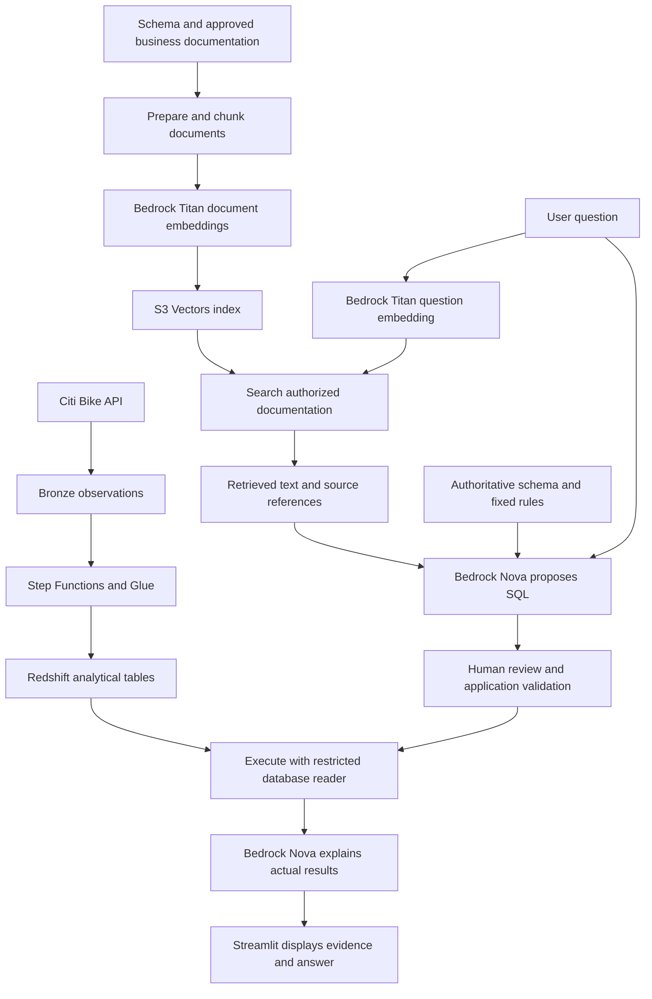

# Friday — Embeddings, vector databases, and RAG for data engineering

> Status: Expanded lecture; Friday implementation and cloud reproduction pending
> Level: Beginner to intermediate, with senior engineering considerations
> Applies to: Documentation pipelines, semantic retrieval, S3 Vectors, Bedrock, Redshift, Streamlit
> Data scale: Small illustrative document collection; classroom index size unverified
> Example status: Conceptual walkthrough grounded in class notes, homework, and inspected Thursday source
> Evidence status: Local source review and documentation checks; no live vector retrieval or model invocation
> Last reviewed: 2026-10-17

## Overview

A useful analytics assistant must understand the meaning of your data before it can produce a trustworthy query. A warehouse stores observations; documentation explains their tables, relationships, time semantics, and business definitions. Friday's lesson connects that documentation to the SQL-generation application through retrieval.

The data engineering problem is to deliver **relevant, current, authorized context** to a model and then verify what the application does with it. Embeddings and vector search help select context. They do not establish that the context is correct or that the generated SQL answers the intended question.

Your class notes describe creating an S3 vector bucket and index, embedding Redshift schema and SQL-pattern documents with Titan V2, building `search_vectors.py`, and integrating retrieval into Streamlit's `2_AI_SQL_Generator.py`. The [Friday homework](5.1_Fri_HW.md) confirms the intended architecture and also mentions local document retrieval. The Friday scripts and live resource configuration were not available for verification in this edit; the walkthrough below reconstructs the responsibilities without claiming to reproduce the instructor's exact code.

The homework says AWS resources are shut down for the weekend and must not be restarted without authorization. You can study this entire guide offline. It does not require deploying resources, running model calls, or completing the homework prompt-building function.

## Learning objectives

- Explain an embedding, a vector index, semantic search, and retrieval-augmented generation in plain language.
- Trace both document indexing and question-time retrieval.
- Distinguish Titan's embedding task from Nova's SQL-generation and explanation tasks.
- Explain why retrieved documentation and actual warehouse results serve different purposes.
- Design document grain, metadata, provenance, refreshes, deletion, and repeat-safe processing.
- Diagnose retrieval failures separately from SQL, warehouse, and model failures.
- Evaluate quality, authorization, freshness, latency, and cost before calling an assistant reliable.

## Prerequisites and study route

You need the grain, joins, timestamps, and AI application flow in [Thursday's lecture](4_Thur_AI.md). The [Thursday walkthrough](4.2-bedrock-steps.md) and [lab reading route](4.3-thur-bedrock-streamlit-lab/README.md) explain the existing application. The [Wednesday incremental project](3.4-wed-incremental-pipeline/README.md) supplies the warehouse context.

1. Read Sections 1–5 to understand why retrieval exists and what the numbers mean.
2. Read Sections 6–10 while tracing the classroom file responsibilities.
3. Read Sections 11–16 to connect the demo to professional data engineering work.
4. Use Sections 17–19 for the next-week bridge, knowledge checks, and completion criteria.

## Mental model

There are two data products: the analytical tables and a searchable collection of documentation about them.



The upper documentation branch runs when documents change. The question branch runs when somebody asks a question. The warehouse pipeline remains responsible for the observations used in the final calculation.

## 1. Why use vectors?

Suppose a user asks, “Where are riders most likely to find a bike?” Your documentation might use the phrase “latest station availability,” which shares few exact words with that question. A search based only on literal words may miss useful guidance.

- **Keyword search** finds words, phrases, or lexical matches. It is especially useful for exact identifiers such as `capacity_at_capture` or an error code.
- **Semantic search** uses learned representations to find related meanings, even when wording differs.
- **Hybrid retrieval** combines lexical and semantic signals. This is an application or search-system design choice; do not assume a particular S3 Vectors API call implements the entire hybrid workflow.

For this project, useful retrieved material might explain how to choose the latest observation per station, join station names, or interpret availability. The search result is guidance for computing an answer.

A small application with three short, stable schema documents may work well by loading them all directly. Retrieval becomes more valuable when documentation grows across many datasets, business definitions, operational runbooks, and SQL patterns. Adopt it because it improves measured context selection, rather than because every LLM application needs a vector database.

**Checkpoint:** If the only available document is an outdated schema, can semantic search make it authoritative? Explain what must change upstream.

## 2. Embeddings: text becomes a list of numbers

An **embedding model** maps input content to a vector: an ordered list of numerical values. A text embedding is designed so that related inputs tend to have useful geometric relationships.

```text
Text: "Choose the latest station observation before ranking availability."
                |
                v
         Embedding model
                |
                v
      [0.021, -0.117, 0.304, ...]
```

The numbers above are invented for illustration.

- A **dimension** is one position in that list. A 1,024-dimensional embedding contains 1,024 values.
- Individual positions generally do not have simple labels such as “bikes,” “time,” or “SQL.” Meaning is distributed across the representation.
- An embedding is not a row of business measurements. Its coordinates are model output, unlike `bikes_available`, which has a defined unit and source.
- An embedding is not a reversible copy of the document. Keep the original text or a reliable pointer so the application can supply readable context to the LLM.
- Generating embeddings uses an existing model. It does not train Nova on your warehouse or update model weights.

### The compatibility contract

Use the same embedding model/version, dimension setting, and compatible preprocessing for documents and questions. Two models can both output 1,024 values while placing meaning in different spaces; matching vector length alone is insufficient.

Record the embedding configuration with each published index version. Treat a model change as a migration requiring re-embedding and evaluation, rather than quietly mixing old and new vectors.

## 3. Similarity, distance, and nearest neighbors

A vector search compares a question vector with stored document vectors and returns nearby candidates. A **nearest neighbor** is a stored vector close to the query according to a chosen metric.

Cosine similarity compares direction:

```text
cosine_similarity(q, d) = dot(q, d) / (length(q) * length(d))
cosine_distance(q, d)   = 1 - cosine_similarity(q, d)
```

For this definition, a larger similarity or a smaller distance means closer vectors. Always check whether an API returns a distance or a similarity before deciding which way to sort or filter.

A tiny mathematical example, using made-up unit vectors rather than real text embeddings:

| Item | Vector | Cosine similarity to question | Cosine distance |
| --- | --- | --- | --- |
| Question | `[1, 0, 0]` | 1.0 | 0.0 |
| Document A | `[0.8, 0.6, 0]` | 0.8 | 0.2 |
| Document B | `[0.6, 0, 0.8]` | 0.6 | 0.4 |
| Document C | `[0, 1, 0]` | 0.0 | 1.0 |

An exact cosine ranking places A before B before C. A distance of `0.2` does **not** mean “80% probability that this document is correct.” Scores depend on the model, metric, corpus, and query.

- **Top-k** means retrieve a requested number of nearby candidates, such as three documents. It does not guarantee that any candidate is relevant.
- **Exact nearest-neighbor search** compares against every eligible vector; its work grows with collection size.
- **Approximate nearest-neighbor search (ANN)** trades exhaustive comparison for scalable retrieval and can miss some exact neighbors.
- **Reranking** scores retrieved candidates again to improve their order. It adds work and must be evaluated independently.

S3 Vectors `QueryVectors` performs ANN retrieval and can return keys, distances, and metadata. Those fields let you inspect candidates; they do not certify their factual accuracy. See the [QueryVectors API](https://docs.aws.amazon.com/AmazonS3/latest/API/API_S3VectorBuckets_QueryVectors.html).

## 4. Vector databases and relational databases

A vector database or vector-capable store supports similarity retrieval over numerical representations. A relational database supports records, predicates, joins, and calculations. A product can support both capabilities; “vector” and “relational” are not mutually exclusive categories.

| Need | Appropriate operation in this application |
| --- | --- |
| Find guidance about latest station availability | Retrieve relevant documentation |
| Find an exact schema/table/column name | Catalog lookup or lexical lookup, possibly alongside semantic search |
| Identify the highest observed bike count at a defined time | SQL over validated warehouse observations |
| Join a station ID to its approved display name | Relational join |
| Explain why a metric uses historical capacity | Retrieve the documented definition |
| Calculate that metric for every station | SQL using the actual measures and definition |

Retrieving a paragraph about “high availability” does not discover the station with the most bikes. An embedding also does not preserve exact arithmetic, ordering, or referential integrity guarantees for your business data.

## 5. RAG: retrieve evidence before generating

**Retrieval-augmented generation (RAG)** supplies retrieved external material as context to a generative model.

```text
Question → retrieve relevant text → build grounded prompt → generate output
```

Vector search is one retrieval mechanism. Local keyword search, a catalog lookup, or another document retriever can also support RAG when it selects relevant external evidence for generation. Loading the same fixed schema file into every prompt is schema grounding; it does not demonstrate question-dependent retrieval.

| Approach | What changes | Suitable purpose |
| --- | --- | --- |
| Prompting | Instructions and context in the current request | Define output format and behavior |
| RAG | External evidence selected for the current request | Supply current or private documentation |
| Fine-tuning | Model weights through a training process | Adapt learned behavior for an evaluated task |
| SQL execution | Data is selected and calculated by a database | Obtain exact analytical results |

RAG can reduce unsupported guesses by supplying useful evidence. It can also retrieve irrelevant, obsolete, conflicting, or malicious content. Generation quality therefore depends on source quality, retrieval quality, prompt construction, and downstream checks.

## 6. Amazon Bedrock: Titan and Nova have different jobs

Amazon Bedrock exposes foundation models through AWS APIs. The application chooses the appropriate model for each task.

| Component | Input | Output | Classroom responsibility |
| --- | --- | --- | --- |
| Titan Text Embeddings V2 | Document chunk or user question | Numerical vector | Make text suitable for similarity comparison |
| S3 Vectors | Stored vectors, query vector, optional filters | Nearby record keys and optional metadata/distances | Retrieve candidate context |
| Nova text generation | Instructions, question, schema, retrieved text | Proposed SQL or explanation | Generate text from supplied context |
| Redshift | Validated SQL under database permissions | Actual query result | Calculate the analytical answer |

AWS documents Titan V2 as `amazon.titan-embed-text-v2:0`, with output sizes of 1,024 by default, 512, or 256. It accepts up to 8,192 tokens or 50,000 characters, but logical document segmentation is recommended for retrieval. Treat these as model limits, not good chunk-size targets. See [Titan Text Embeddings models](https://docs.aws.amazon.com/bedrock/latest/userguide/titan-embedding-models.html).

The inspected Thursday helper uses `bedrock-runtime.converse` for Nova. Titan embedding invocation uses its model-specific `InvokeModel` request, rather than the chat request shape. Titan V2 accepts settings such as `inputText`, `dimensions`, and `normalize`; text-generation parameters are not interchangeable with embedding parameters. See [Titan embedding request and response parameters](https://docs.aws.amazon.com/bedrock/latest/userguide/model-parameters-titan-embed-text.html).

Model availability, quotas, API support, and inference-profile requirements vary by model and Region. A model ID in a local file is configuration, not proof that an account can invoke it. The local code's Nova profile is not evidence of the instructor's current Friday settings.

## 7. Amazon S3 Vectors: bucket, index, and record

In the original note “create vector bucket and schema,” **schema** needs two separate meanings:

- The vector index configuration defines how vectors are stored and compared.
- Redshift schema documentation describes the SQL tables and their meaning.

An S3 vector bucket contains vector indexes. An index specifies vector dimensions, a distance metric, and metadata configuration. This is distinct from a general-purpose S3 bucket containing objects such as JSON or Markdown files. Merely uploading an embedding JSON file as a normal object does not create a searchable vector index.

AWS documents that changing an index's name, dimension, distance metric, or non-filterable metadata keys requires a new index. Verify these choices before ingestion. See [S3 vector indexes](https://docs.aws.amazon.com/AmazonS3/latest/userguide/s3-vectors-indexes.html).

A stored record has a key, vector data, and optional metadata. `PutVectors` writes records to an index, using float32 vector data. Keep the document identity and readable-text lookup attached to that write. See [PutVectors](https://docs.aws.amazon.com/AmazonS3/latest/API/API_S3VectorBuckets_PutVectors.html).

### A proposed logical record

This is a teaching record, **not** a complete AWS request or a real Titan embedding. Its three-value vector is only for illustration.

```json
{
  "key": "station-grain-v3-chunk-001",
  "data": {"float32": [0.8, 0.6, 0.0]},
  "metadata": {
    "document_id": "station-grain",
    "document_version": "v3",
    "schema_version": "incremental-gold-v1",
    "topic": "latest-availability",
    "text": "Each fact row represents one station at one UTC capture timestamp."
  }
}
```

- The key identifies a document chunk within the index.
- The vector supports similarity retrieval.
- Metadata provides context, filtering attributes, and provenance.
- Text may be returned in metadata or fetched through a separately stored source reference; implement and authorize that lookup explicitly.

S3 Vectors distinguishes filterable and non-filterable metadata. Text can be designated non-filterable while still being returned. Filter support also depends on index mode, so inspect the existing configuration before copying a filter example. See [metadata filtering](https://docs.aws.amazon.com/AmazonS3/latest/userguide/s3-vectors-metadata-filtering.html).

**Checkpoint:** If the query returns only vector keys, what must the application do before it can build a readable prompt?

## 8. The indexing pipeline: turn documentation into a data product

Document indexing is an ETL pipeline with its own grain and correctness requirements.

```text
Approved source documents
  → extract text and preserve source identity
  → normalize formatting without changing meaning
  → split into logical chunks
  → attach versions and metadata
  → generate embeddings
  → validate records
  → write and reconcile the index
  → publish a tested retrieval configuration
```

### Choose the document content

For this Citi Bike application, useful topics include:

- **Schema contract:** approved tables, columns, types, keys, and join relationships.
- **Grain:** one station observation per `(station_id, snapshot_timestamp)`.
- **Time:** UTC capture time versus station-reported time; latest stored is not necessarily live.
- **Metrics:** bike availability is a stock measurement; adding observations across time does not count trips.
- **Business definitions:** utilization, capacity, operational status, and missing-data interpretation.
- **SQL patterns:** how to reason about latest records, time buckets, aggregates, and window functions.

Use approved documentation, rather than filling the corpus with unreviewed model-generated SQL. A convincing but incorrect example can teach the assistant the wrong pattern repeatedly.

### Chunking: one record should carry a coherent idea

A **chunk** is the unit embedded and retrieved. For this corpus, start with meaningful sections: a table contract plus its grain, a metric definition, or one SQL pattern and its assumptions.

- Chunks that are too small may separate a column from the warning that defines its meaning.
- Chunks that are too large can mix unrelated topics and consume excessive prompt space.
- Overlap can preserve nearby context, but increases duplicates and embedding work.
- Repeat essential table identifiers or headings where needed so a chunk remains understandable by itself.
- Preserve code blocks and explanations together when splitting SQL-pattern documents.

There is no universally correct chunk size. Evaluate sizes against real questions, including paraphrases, exact identifiers, ambiguous questions, and unsupported requests.

### Metadata and lineage

In a production design, track `document_id`, `chunk_id`, source URI, source content hash, document version, schema version, embedding model/configuration, ingestion batch, and publication time. Add access scope where required. Decide which attributes belong in vector metadata and which belong in a separate ingestion manifest.

The trace should be reversible: **answer → SQL/result → prompt → retrieved chunks → source document version**. That makes a wrong answer diagnosable.

## 9. The question pipeline: what `search_vectors.py` should do

Your notes mention this classroom command:

```text
python scripts/search_vectors.py "Which station has the most bikes available"
```

It is a record of the instructor's interface. That path is not present in the inspected Thursday lab, so this is not a runnable command supplied by this guide.

Conceptually, the script has five responsibilities:

1. Read a non-empty question and load the published retrieval configuration.
2. Embed the question using the compatible embedding model and settings.
3. Query the intended index with appropriate access and schema-version restrictions.
4. Resolve returned records to readable text and source references.
5. Return bounded context plus diagnostics, rather than a claimed station ranking.

A useful search-debug output would show document ID, version, text excerpt, distance, and applied filters. It should let you determine whether retrieval worked **before** involving Nova or Redshift.

AWS's [query guide](https://docs.aws.amazon.com/AmazonS3/latest/userguide/s3-vectors-query.html) describes query-vector search and returned results. When requesting metadata or applying metadata filters, the API requires both `s3vectors:QueryVectors` and `s3vectors:GetVectors`; query-only permission is insufficient for those options. See [QueryVectors permissions](https://docs.aws.amazon.com/AmazonS3/latest/API/API_S3VectorBuckets_QueryVectors.html).

### Concrete question trace

For “Which station has the most bikes available?”:

1. Retrieval might select guidance on latest station observations and station-name joins.
2. The application must establish the intended time semantics: latest stored per station, one common capture, or a historical maximum. Similarity cannot resolve an unstated business requirement reliably.
3. Nova receives the question, authoritative schema, fixed rules, and selected guidance.
4. The user reviews the proposed SQL; the application validates it.
5. Redshift computes the result from observations the reader is allowed to access.
6. Nova explains the returned result and its time bounds.

Latest-per-station comparisons may mix observation times. Show timestamps or enforce a freshness/completeness policy. If the data is old, a correct query still cannot establish current street conditions.

## 10. Connecting retrieval to `2_AI_SQL_Generator.py`

Your note “gets the RAG docs?” refers to the missing middle step: the page must obtain the **retrieved text** and pass it into the SQL-generation request. Merely calling a search script or displaying its output does not augment generation unless the prompt actually includes that context.

| Stage | Inspected Thursday application | Friday extension described by notes |
| --- | --- | --- |
| Load context | Read local `redshift_schema.txt` | Retain authoritative schema and retrieve supplemental guidance |
| Retrieve | No question-dependent vector retrieval in the inspected page | Embed question, search, resolve text |
| Generate | Nova proposes SQL from question/schema | Nova also receives selected documents |
| Review and validate | Editable SQL and application checks | Preserve these controls after adding retrieval |
| Execute | Redshift reader path | Same warehouse responsibility |
| Explain | Nova sees bounded actual results | Explain results with relevant definitions and provenance |

You can inspect [Richard's current page](4.3-thur-bedrock-streamlit-lab/richard/pages/2_AI_SQL_Generator.py), [model helper](4.3-thur-bedrock-streamlit-lab/richard/bedrock_sql.py), and [schema context](4.3-thur-bedrock-streamlit-lab/richard/redshift_schema.txt). These are existing source files, not newly implemented Friday retrieval.

### What belongs in the generation request?

- Fixed application rules: approved SQL dialect, allowed operations, and required output format.
- Authoritative schema: approved tables, columns, types, relationships, and core grain.
- Retrieved documentation: relevant definitions and patterns, labeled with their source/version.
- User question: the request to answer, with any clarified time semantics.

Keep essential schema and access rules outside optional top-k selection. A relevant pattern can be retrieved while the necessary join contract is missed. Retrieved documents should supply evidence, not override application controls.

### Streamlit state and review

Streamlit reruns the page as users interact; session state can retain the current question, retrieved context, generated SQL, results, and explanation. It is interface state, not a durable audit log or an authorization boundary.

Bind review to the question, exact SQL text, schema version, and context version. If those change, clear stale results and require a fresh execution decision. A repaired query needs another review, and result explanation must correspond to the SQL that actually ran.

### Two generation tasks remain separate

SQL generation proposes a calculation. Result explanation interprets evidence produced by that calculation. An explanation must disclose relevant limits: returned rows, truncation or sampling, observation timestamps, and missing data. It must not extrapolate a whole-dataset conclusion from an arbitrary displayed subset.

## 11. Current schema, ownership, and invariants

The inspected Richard schema context currently names `gold.incremental_dim_station`, `gold.incremental_dim_date`, and `gold.incremental_fact_station_snapshot`. It uses `snapshot_date` for the date join and explicitly has no `date_key`. Older instructor documents use different table names. This is a concrete reason to filter or publish documentation by schema version.

This observation comes from the local schema file; this lecture edit did not query the live warehouse or verify grants.

| Boundary | Authority and responsibility |
| --- | --- |
| Source observations | Ingestion preserves raw records and capture lineage |
| Analytical tables | Warehouse pipeline defines grain, transformations, accepted data, and recovery |
| Schema/business documentation | Dataset owners approve definitions and version changes |
| Vector index | Retrieval pipeline owns derived representations, completeness, and source links |
| Generated SQL | Application and reviewer enforce structural and semantic checks |
| Database execution | Database grants restrict accessible data and operations |
| Explanation | Application supplies actual evidence and checks unsupported claims |

### Requirements and invariants

- Every indexed chunk resolves to an approved source version and readable content.
- Query and document embeddings use a compatible representation.
- Context matches the intended dataset/schema and the user's permitted scope.
- Generated identifiers exist in the authoritative schema; names are not invented from older examples.
- Station rankings preserve the intended station/result grain and time meaning.
- Retrieval failure cannot silently produce an answer presented as warehouse evidence.
- Repeat ingestion does not accumulate duplicate active chunks for unchanged source content.
- Deleted or revoked documents stop influencing answers according to a defined propagation policy.

## 12. Refreshes, idempotency, deletion, and migration

A documentation corpus needs a lifecycle just as an incremental fact table does.

| Change | Required engineering response |
| --- | --- |
| Same source content arrives again | Detect unchanged content; avoid unnecessary re-embedding and duplicate publication |
| Document wording changes | Rebuild affected chunks and validate their links/version |
| Document shrinks | Remove obsolete chunks; rewriting surviving keys alone leaves stale records |
| Table or metric changes | Update source documentation, compatibility rules, and retrieval tests together |
| Source is deleted or access is revoked | Remove/restrict derived chunks, cached context, and copies in retained artifacts as policy requires |
| Embedding model or dimension changes | Build a compatible new index, re-embed, evaluate, then switch readers |

A possible deterministic identity is `(document_id, document_version, chunk_number)`, with a manifest recording all keys in that version. A content hash helps detect unchanged input. The identity scheme and replacement process must agree: versioned keys avoid overwriting the old publication, but require retirement of old versions.

Do not claim a transaction across document storage, embeddings, and the vector store. If ingestion fails after some writes, reconcile the manifest and resume or rebuild missing work. Publish a version only after completeness and retrieval checks pass.

For a larger migration, build and test a new index separately, switch application configuration deliberately, and retain a rollback path until acceptance. Coordinate concurrent writers so an older job cannot republish obsolete content after a newer version.

There are at least three freshness clocks: source observations in Redshift, documentation/index publication, and application caches. Refreshing embeddings does not refresh the warehouse; loading new facts does not correct stale schema documentation.

## 13. Failure model and recovery

| Symptom | Likely boundary | What to inspect and how to recover |
| --- | --- | --- |
| Embedding request rejected | Model invocation | Check model-specific request, input limits, Region, permissions, and dimensions |
| Write rejects vector length | Index contract | Compare configured dimension with actual vector length; rebuild incompatible configuration |
| Query finds no useful guidance | Retrieval | Check target index, document coverage, model compatibility, filters, and readable-text lookup |
| Relevant-looking but obsolete SQL patterns | Documentation lifecycle | Inspect source/schema versions; retire stale publication and clear affected caches |
| Intermittent embedding/search failure | Service dependency | Bound retries for transient failures; track failed items for replay |
| Some chunks missing after ingestion | Publication | Reconcile expected manifest against stored/resolvable keys before publishing |
| Generated query references nonexistent column | Schema/generation | Reject it; inspect current schema and retrieved context, then repair and review again |
| Valid SQL produces implausible ranking | Analytical semantics | Check grain, joins, latest-record logic, timestamps, filters, and source completeness |
| Explanation disagrees with rows | Generation/evidence | Inspect the exact result subset and prompt; suppress unsupported explanation |
| Question changes but old result remains | UI state | Invalidate dependent state and bind result to its executed SQL |

Retrying cannot repair wrong dimensions, obsolete schema, denied permissions, or a broken metric definition. Use retries for failures classified as transient; stop and correct the contract for persistent errors.

If retrieval is unavailable, either show an actionable failure or use an explicitly labeled, approved schema-only fallback. A fallback changes the available evidence and should not be invisible to the user.

## 14. Security, privacy, and trust boundaries

- **Authorize retrieval:** restrict datasets and document scopes before supplying content to a model. Similarity is not an access-control decision.
- **Authorize execution:** database grants are necessary even when prompts say “read-only.” Structural SQL validation and an actual restricted reader have separate jobs.
- **Separate identities:** the ingestion role may need writes; a query application should receive only its required retrieval and invocation permissions.
- **Treat retrieved text as untrusted input:** a document might contain instructions such as “ignore previous rules.” Label it as source material and keep tool/SQL controls outside model obedience.
- **Minimize sensitive context:** avoid embedding secrets or unnecessary personal data. Embeddings are derived data, not an anonymization guarantee.
- **Protect every copy:** apply appropriate encryption, retention, and access controls to source documents, vectors, prompts, query results, logs, and caches.
- **Audit safely:** record useful versions and IDs while avoiding unnecessary sensitive text in logs.

A read-only query can still expose restricted information or consume substantial resources. A row limit also does not establish a low scan cost. Keep allowed relations, query budgets, cancellation, and restricted access as explicit application/database controls.

## 15. Data quality, testing, and evidence

Test each boundary so a polished answer cannot hide the wrong intermediate step.

| Layer | Useful evidence |
| --- | --- |
| Source corpus | Approved owner, current schema version, no secrets, coherent metric definitions |
| Chunking | Complete meaning, intact SQL examples, stable source links, expected chunk counts |
| Embeddings | Correct model/configuration, expected length, finite numbers, failed-input accounting |
| Index publication | Expected keys resolvable; retired versions absent from active retrieval |
| Retrieval | Known questions retrieve the required context within the chosen k |
| Authorization | Forbidden scopes cannot reach prompts, explanations, logs, or caches |
| SQL | Allowed syntax and identifiers; correct grain, joins, time rules, and calculations |
| Results/explanation | Independent reference result and claims supported by the supplied evidence |
| Operations | Partial-write recovery, deletion propagation, bounded retries, latency and cost evidence |

Build a small, reviewed evaluation set. Include a paraphrased availability question, an exact column lookup, a historical-average question, an ambiguous “most utilized” question, an unsupported trip-demand question, a stale-schema example, and a forbidden-scope case. Label which documents and behaviors each case needs.

### Metrics with explicit denominators

- **Hit rate at k:** proportion of evaluated questions with at least one labeled relevant chunk in the top-k results.
- **Recall at k:** number of labeled relevant chunks retrieved in the top-k divided by all labeled relevant chunks for that question.
- **Precision at k:** relevant returned chunks divided by returned chunks considered.
- **SQL execution success:** fraction of generated queries that run successfully; this is distinct from answering the right question.
- **Semantic correctness:** fraction that match the intended calculation under the agreed data/time assumptions.
- **Grounded explanation:** claims supported by the actual result evidence, evaluated separately from writing fluency.

For illustration, four relevant chunks among five returned gives precision `4/5 = 0.8`. If eight chunks were labeled relevant in total, recall is `4/8 = 0.5`. These are arithmetic examples, not measured results for this application.

### Evidence status for this guide

The lecture uses local notes, the homework, the inspected Thursday application/schema, and current primary documentation. The toy vectors and metrics are illustrative. Local link, fence, JSON, arithmetic, and whitespace checks are recorded in the coverage inventory after execution. No Friday script execution, vector write/search, Bedrock invocation, SQL execution, authorization test, quality benchmark, or billing measurement is established here.

## 16. Production considerations: performance, cost, and observability

Separate indexing work from question-serving work when estimating capacity.

- **Indexing:** number/size of changed chunks, embedding requests, vector writes, storage, manifest reconciliation, and replacement/deletion work.
- **Each question:** question embedding, vector query, optional source-text fetch/reranking, SQL generation, warehouse work, and result explanation.
- **Latency:** measure each stage and total p50/p95, rather than reporting only model response time.
- **Prompt budget:** bound and deduplicate retrieved context; more chunks can add irrelevant material and crowd out essential schema.
- **Caching:** include corpus/schema version, model configuration, question, and authorization scope in relevant cache identities. Never share private cached context across users accidentally.
- **Quotas:** verify current model/service quotas and bound concurrency; plan for ingestion and interactive traffic competing for capacity.

Useful telemetry includes request ID, corpus/index version, retrieved chunk IDs/distances, question/context size, model IDs, stage duration, retries, SQL validation outcome, database query ID, returned row count, truncation, observation freshness, and explanation status. Store sensitive details only where policy permits.

Avoid assuming the cheapest storage produces the cheapest or fastest application. Compare total workload cost and measured retrieval quality. Tune chunking, k, filters, and model choices one variable at a time against the same evaluation set.

### Direct retrieval versus Bedrock Knowledge Bases

Your notes describe an application-managed path: code prepares documents, invokes Titan, writes/searches S3 Vectors, and assembles the Nova prompt. Amazon Bedrock Knowledge Bases offers managed ingestion/retrieval capabilities and can work with supported vector stores, including S3 Vectors. It is a different implementation path; using S3 Vectors alone does not prove a Knowledge Base was created. See [Bedrock Knowledge Bases](https://docs.aws.amazon.com/bedrock/latest/userguide/knowledge-base.html).

Choose ownership deliberately: direct code provides explicit control but leaves chunking, publication, retrieval integration, and recovery with your team. A managed integration reduces some plumbing while still requiring source quality, access design, evaluation, and lifecycle decisions. Neither choice removes SQL review or warehouse correctness requirements.

## 17. Preview: tabular ML, MLflow, Databricks, and forecasting

The original notes say these subjects were deferred. Treat this section as a bridge to next week, rather than material already demonstrated in Friday's vector application.

- **Tabular data** has rows and columns. A tabular ML dataset gives each training row a defined prediction unit, features, and usually a target. “Tabular” alone does not identify a particular product from the class notes.
- **Regression** predicts a numeric target, such as a future bike count. Data preparation must define the horizon and prevent information from the future entering features.
- **Forecasting** predicts future observations using time structure. Use time-aware validation; random row splitting can leak closely related observations across train/test sets.
- **MLflow** supports tracking experiments, parameters, metrics, and artifacts, with model lifecycle capabilities. It helps compare runs; it does not repair bad features or select a trustworthy target automatically. See [MLflow documentation](https://mlflow.org/docs/latest/ml/).
- **Databricks** combines data engineering, SQL/analytics, and AI/ML capabilities. The instructor suggested Azure for the forthcoming class setup; that is classroom guidance, not a universal claim that Azure is always easier. Use the instructor's chosen environment. See [Databricks overview](https://docs.databricks.com/aws/en/introduction/).

For a forecasting dataset, define one row as a station at a prediction cutoff. Build features only from information available by that cutoff; construct the future label separately. Preserve training-data versions, handle missing intervals, and monitor how inference-time inputs differ from training inputs.

Station snapshots describe availability, not completed rides or unconstrained demand. Changes can reflect rides, returns, rebalancing, outages, or reporting behavior. Do not label a snapshot-derived change “rental demand” without an appropriate source and definition.

RAG supplies evidence to generation; forecasting learns a predictive mapping from training examples. Both depend on strong data engineering, but they have different inputs, evaluation criteria, and failure modes.

## 18. Knowledge check and homework reading map

Use these as self-checks before writing your own homework answers:

1. Where do readable source text and numerical embeddings each appear in the flow?
2. Why can equal-length embeddings from different models be incompatible?
3. Why is the nearest document not necessarily relevant or true?
4. What additional step turns search output into RAG context?
5. Which component finds documentation, which generates SQL, and which computes the result?
6. Why should core schema rules remain available even when top-k retrieval misses a document?
7. What happens to obsolete chunks when a document shrinks?
8. How would you distinguish a retrieval defect from a join-grain defect?
9. What must change when a table is renamed or an embedding model changes?
10. What evidence would justify claiming the assistant is accurate and secure?

| Homework section | Relevant lecture material |
| --- | --- |
| Part 1: Pipeline completion | Wednesday project and Thursday walkthrough; retrieval does not replace pipeline readiness |
| Part 2: End-to-end architecture | Mental model and ownership in Section 11 |
| Part 3: AI concepts | Sections 1–7 |
| Part 4: Streamlit integration | Sections 9–10 and 13–15 |
| Part 5: Prompt-building exercise | Prompt components in Section 10; implement and test your own function |

## 19. Completion checklist

- [ ] I can draw indexing and question-serving as separate flows.
- [ ] I can explain embeddings, distance, top-k, ANN, vector stores, and RAG.
- [ ] I can distinguish Titan embeddings from Nova generation and Redshift execution.
- [ ] I know which classroom details are observed locally and which remain unverified.
- [ ] I can define the chunk grain, metadata, provenance, and compatibility contract.
- [ ] I can explain refreshes, obsolete-chunk deletion, partial-failure recovery, and index migration.
- [ ] I can spot stale schema, incorrect station grain, and ambiguous time semantics.
- [ ] I can identify necessary access controls and independent quality checks.
- [ ] I can plan evaluation and telemetry without treating a successful API call as correctness.
- [ ] I can continue the separate homework without restarting weekend infrastructure.

## Primary references and related material

AWS details were checked against primary documentation on 2026-10-17. Recheck current model, Region, index-mode, quota, and pricing details before implementation.

- [Titan Text Embeddings models](https://docs.aws.amazon.com/bedrock/latest/userguide/titan-embedding-models.html)
- [Titan embedding request/response parameters](https://docs.aws.amazon.com/bedrock/latest/userguide/model-parameters-titan-embed-text.html)
- [S3 vector indexes](https://docs.aws.amazon.com/AmazonS3/latest/userguide/s3-vectors-indexes.html)
- [S3 Vectors metadata filtering](https://docs.aws.amazon.com/AmazonS3/latest/userguide/s3-vectors-metadata-filtering.html)
- [PutVectors API](https://docs.aws.amazon.com/AmazonS3/latest/API/API_S3VectorBuckets_PutVectors.html)
- [QueryVectors API](https://docs.aws.amazon.com/AmazonS3/latest/API/API_S3VectorBuckets_QueryVectors.html)
- [Querying vectors](https://docs.aws.amazon.com/AmazonS3/latest/userguide/s3-vectors-query.html)
- [Bedrock Knowledge Bases](https://docs.aws.amazon.com/bedrock/latest/userguide/knowledge-base.html)
- [MLflow documentation](https://mlflow.org/docs/latest/ml/)
- [Databricks overview](https://docs.databricks.com/aws/en/introduction/)
- [Friday homework](5.1_Fri_HW.md)
- [Thursday analytical SQL and AI lecture](4_Thur_AI.md)
- [Thursday application reading route](4.3-thur-bedrock-streamlit-lab/README.md)
