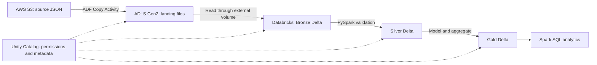

# Week 7 Tuesday — Understanding the Azure Citi Bike Pipeline

> Level: Beginner to intermediate  
> Focus: ADF, ADLS Gen2, Databricks, Spark, Delta Lake, and Unity Catalog  
> Practical context: [Completed pipeline steps](2.1_Tue_steps.md)  
> Evidence: Practical lab completed by the learner; this revision adds no cloud execution  
> Primary documentation reviewed: 2026-10-22

## Overview and study route

A data pipeline needs to move source data, interpret it, improve its quality, and make the result usable for analysis. These are different responsibilities. This lesson explains which component handles each responsibility in an Azure lakehouse pipeline.

Use the Citi Bike flow as the running example: move source files, expose governed access, transform station observations, and publish analytical tables. The practical companion records the learner-reported run separately from the concepts taught here.

Recommended study order:

1. Read Sections 1–3 to understand the architecture, ADF objects, and identities.
2. Read Sections 4–5 to explain how Spark turns files into useful tables.
3. Read Sections 6–7 to separate Delta's table guarantees from Unity Catalog's governance.
4. Use Sections 8–10 to reason about failures and test your understanding.
5. Use the [steps guide](2.1_Tue_steps.md) for practical examples and Section 12 for the preserved timestamped video breakdown.

By the end, you should be able to trace a file from S3 to a Gold query, distinguish connection configuration from data selection, explain distributed execution, state each table's grain, and diagnose which boundary owns a failure. Prerequisites are basic JSON, Python DataFrames, SQL tables, and [Monday’s foundations](1_Mon_Azure.md). Advanced platform administration and optimization are follow-up topics.

## 1. Mental model: movement, storage, compute, and governance



The Unity Catalog arrow to ADLS represents governed Databricks access through registered storage objects. It does not mean Unity Catalog controls every client that can access the storage account directly.

| Component | Responsibility in this lab | Concrete example |
| --- | --- | --- |
| AWS S3 | Holds the original source files | Collected station-status JSON snapshots |
| Azure Data Factory (ADF) | Coordinates copying between storage services | Copy the Citi Bike directory into Azure |
| Azure Data Lake Storage Gen2 (ADLS Gen2) | Persists files in Azure | Landing JSON and storage backing lakehouse data |
| Apache Spark | Executes distributed transformations | Flatten station arrays and process observations |
| Azure Databricks | Provides a managed analytics environment | Notebooks, compute, and integrated data tooling |
| Delta Lake | Adds table transaction metadata to data files | A versioned Silver table |
| Unity Catalog | Governs named data objects and access | Catalog/schema/table names and volume privileges |

**Storage holds bytes; compute processes them.** Stopping notebook compute does not remove persisted tables. An ADF copy does not automatically run the notebook, and copying JSON into a container named `bronze` does not automatically create a Bronze Delta table.

The source S3 copy and Azure landing copy are separate physical datasets. Bronze, Silver, and Gold are derived datasets owned by your processing workflow. Preserve source data so you can explain and reproduce a result after changing transformation logic.

The completed lab uses a few gigabytes of collected snapshots. It demonstrates the architecture; it does not establish production throughput, cost, or recovery guarantees. Databricks' managed platform role is described in [What is Azure Databricks?](https://learn.microsoft.com/en-us/azure/databricks/introduction/).

## 2. Azure Data Factory: what each object means

### 2.1 Pipeline and activities

A **pipeline** groups related steps and their dependencies. An **activity** is an individual action in that workflow. A pipeline might copy files and then invoke a Databricks notebook; the notebook must be configured as a separate activity if ADF is to coordinate both steps. See [Pipelines and activities](https://learn.microsoft.com/en-us/azure/data-factory/concepts-pipelines-activities).

In your completed copy pipeline, the Copy Activity moves files. It does not apply the notebook's station-level cleaning rules. Although Copy Activity supports mapping and format conversion in other configurations, the lab's Binary copy preserves file content without parsing JSON. [Binary format documentation](https://learn.microsoft.com/en-us/azure/data-factory/format-binary) explains this behavior.

**Publishing** saves/deploys definitions for subsequent triggered runs. **Triggering** starts a run. A published pipeline can still fail when executed because its credentials, permissions, paths, or network access are wrong.

### 2.2 Linked Service versus Dataset

Think of configuring a database connection separately from choosing a table to query. ADF makes a similar separation for file storage:

| Object | Question it answers | Example from your lab |
| --- | --- | --- |
| Linked Service | Which service do I connect to, and how? | `LS_S3_Citibike_Richard` identifies the S3 connection and authentication |
| Dataset | Which data within that connection, in what format? | `DS_S3_Citibike_Binary` selects bucket/directory and Binary format |
| Activity | What operation should use those inputs and outputs? | Copy the selected source files to the sink dataset |

A dataset is a configuration describing data, not a separate copy of the data. One linked service can support several datasets pointing to different directories. Moving the source directory changes data selection; changing authentication changes the connection. See [Datasets and linked services](https://learn.microsoft.com/en-us/azure/data-factory/concepts-datasets-linked-services).

**Reasoning checkpoint:** You can connect to S3, but the copy finds zero files. Which dataset path and recursive-selection settings would you inspect before changing credentials?

**The SSH analogy:** A linked service configures ADF's connection to one system, including authentication; it does not itself link AWS directly to Azure or grant storage permissions. The Copy Activity uses a source dataset and a sink dataset, each referencing its own linked service. Your Binary dataset tells ADF to treat selected files as bytes; JSON parsing happens later in Spark.

**Trace one copy:** Source linked service = S3 access; source dataset = the selected bucket/directory and Binary format; sink linked service = ADLS access; sink dataset = the destination directory and Binary format; Copy Activity = the operation connecting those inputs and outputs. File-selection options such as recursion can also be configured on the activity.

### 2.3 Integration Runtime

The **Integration Runtime (IR)** supplies the execution/connectivity infrastructure for ADF integration work. It can move data and dispatch/monitor work on another compute service. Dispatching a Databricks activity does not make the IR the Spark engine.

| Runtime type | Basic use |
| --- | --- |
| Azure IR | Managed cloud integration, including supported cloud-to-cloud copies |
| Self-hosted IR | Integration through a customer-managed machine with access to the required network |
| Azure-SSIS IR | Running SQL Server Integration Services packages |

Study which runtime your linked services reference and why it can reach both stores. A private source changes the connectivity requirement; increasing Spark executor count would not solve that connection problem. See [Integration Runtime concepts](https://learn.microsoft.com/en-us/azure/data-factory/concepts-integration-runtime).

**Runtime versus compiler:** A compiler translates code. An IR supplies infrastructure for integration execution and connectivity. Think of the pipeline as a work order and the Copy Activity as a transfer task: the IR provides the environment that performs that transfer. A notebook activity uses IR to dispatch work to Databricks, where Spark executes the transformations. See the [IR capabilities](https://learn.microsoft.com/en-us/azure/data-factory/concepts-integration-runtime).

**Concrete failure:** If the IR cannot reach a private database, valid credentials alone will not make the transfer work. First identify the runtime and its network access. This is why ADF asks about execution infrastructure in addition to connection details.

### 2.4 Why use ADF instead of a transfer script?

For this lab, ADF provides reusable connectors, a visual workflow, execution monitoring, and configurable scheduling/retries. A custom Python script can also transfer files, but you would own its authentication, pagination, error handling, logging, restart behavior, and deployment. ADF still needs correct configuration and reconciliation; managed orchestration does not prove that every intended file arrived.

## 3. Managed identities, RBAC, and separate callers

**Authentication** establishes who is making a request. **Authorization** decides what that identity may do. A **managed identity** is an Azure-managed identity for a resource or application; Azure handles its credential lifecycle. **RBAC**, or role-based access control, grants permissions at a selected scope.

For ADF's ADLS connection, managed identity avoids placing storage account keys in your pipeline configuration. It still needs an appropriate storage data role. In your lab, the instructor granted **Storage Blob Data Contributor**, which supports the required write access. An Azure resource-management role alone does not necessarily grant access to file contents. See [ADLS Gen2 connector authentication and permissions](https://learn.microsoft.com/en-us/azure/data-factory/connector-azure-data-lake-storage).

| Caller | Storage access needed in this workflow | Separate configuration |
| --- | --- | --- |
| ADF factory identity | Write copied files into the landing area | ADLS linked service and Azure storage grant |
| Databricks Access Connector identity | Access storage used through Unity Catalog | Connector, storage credential, and Azure storage grant |
| Notebook user | Use the catalog objects and read the volume/tables | Unity Catalog privileges |

Your ADF grant and Access Connector grant apply to different identities. The fact that ADF can write a file does not establish that the notebook user can read it. Likewise, the Azure identity used for ADLS does not automatically authorize access to AWS S3; that source uses its own AWS authentication and permissions.

An **Access Connector for Azure Databricks** connects a managed identity to Databricks storage access. A Unity Catalog storage credential references that identity configuration. Azure manages credentials, while administrators still assign permissions. See [Managed identities for Unity Catalog storage](https://learn.microsoft.com/en-us/azure/databricks/connect/unity-catalog/cloud-storage/azure-managed-identities).

**Reasoning checkpoint:** ADF Copy succeeds, but listing `/Volumes/...` fails. Identify the two authorization layers to inspect: the connector's Azure storage access and the user's Unity Catalog access. Keep network/path failures as separate possibilities.

### 3.1 Why a managed identity helps

**RBAC terminology:** RBAC means **role-based access control**. An analogy for authorization is: John is the identity, firefighter is the role, and the jurisdiction is the scope. The role defines allowed actions; a credential or token proves who John is.

**Follow the request:** An administrator enables ADF's managed identity and assigns it a storage data role at the required scope. ADF obtains a Microsoft Entra token for that identity and uses it to request storage access. Storage evaluates the identity's permissions. You avoid maintaining a storage key or application secret in the pipeline; Azure manages the identity's credentials. An identity without a suitable grant still gets denied. See [Managed identities](https://learn.microsoft.com/en-us/entra/identity/managed-identities-azure-resources/overview).

A **system-assigned** identity belongs to one resource and is deleted with it. A **user-assigned** identity is a separate Azure resource that can be attached to supported resources. Your lab uses separate system-assigned identities for ADF and the Databricks Access Connector.

### 3.2 How the notebook reaches ADLS

**ADF does the earlier copy:** Reading landed JSON from Databricks does not send the request through ADF. The notebook uses a volume path; Unity Catalog checks the user's object privileges and uses the configured storage identity to access ADLS. The Access Connector's managed identity needs its own Azure storage grant. See [Managed identities in Unity Catalog](https://learn.microsoft.com/en-us/azure/databricks/connect/unity-catalog/cloud-storage/azure-managed-identities).

```text
Earlier: S3 → ADF Copy → ADLS files
Later: notebook → Unity Catalog volume → configured storage identity → ADLS files
```

If the files already exist in ADLS, the later read can work without running the copy pipeline again.

## 4. Databricks and Spark: how the notebook executes

### 4.1 Spark DataFrames versus ordinary pandas DataFrames

| Property | Ordinary pandas DataFrame | Spark DataFrame |
| --- | --- | --- |
| Normal execution setting | One Python process on one machine | Partitioned computation, potentially across multiple machines |
| Representation | Local tabular data | A structured dataset and a query plan |
| Typical operation timing | Most operations compute immediately | Transformations generally build a plan; actions request execution |
| Main capacity concern | Local process memory | Partition sizes, executor resources, shuffle, and driver limits |

PySpark is Spark's Python interface. Built-in DataFrame expressions let Spark optimize structured computations; SQL and DataFrame operations use the same underlying structured engine. See [Spark SQL and DataFrames](https://spark.apache.org/docs/latest/sql-programming-guide.html).

Spark is useful here for learning distributed transformations and processing history. A small dataset alone does not require Spark: startup and coordination costs may outweigh parallelism. The useful question is what workload and operational requirements justify distributed compute.

### 4.2 Driver, executors, partitions, and cluster

The **driver** coordinates the application and schedules tasks. **Executors** run tasks and hold intermediate data. A **partition** is a portion of a distributed dataset processed by tasks. A **cluster** supplies computing resources; cluster management allocates resources, while the driver schedules the application's tasks. Serverless Databricks manages infrastructure details for you, but distributed execution still matters when reasoning about data size and failures. See [Spark cluster overview](https://spark.apache.org/docs/latest/cluster-overview.html).

Operations such as grouping and many joins can require a **shuffle**, which redistributes records between partitions. More machines do not automatically repair a badly chosen join or a single oversized partition.

### 4.3 Lazy evaluation and notebook state

Consider this illustrative PySpark fragment using an already-existing table; it was not executed for this guide:

```python
observations = spark.table("<catalog>.silver.station_status")
identified = observations.filter("station_id IS NOT NULL")
identified.explain()  # Inspect the plan; do not materialize all result rows.
identified.show(5)    # Request execution sufficient to display a small result.
```

The filter expresses the desired computation. Laziness lets Spark optimize before executing it. `show`, `count`, and table writes request execution; schema inference or metadata inspection during reads may also perform work. Lazy does not mean every API call performs zero I/O. Repeated actions may repeat computation unless results are persisted. See [Spark operations and lazy evaluation](https://spark.apache.org/docs/latest/rdd-programming-guide.html#rdd-operations).

A notebook stores code and displayed results, while attached compute executes cells. Variables depend on session state and execution order. A previously displayed result can remain visible after code changes; explain the cells and their dependencies rather than treating old output as proof of a new run.

Avoid bringing an entire distributed dataset into driver memory with `collect()` or `toPandas()` just to inspect it. Prefer a bounded display or an aggregate when studying.

## 5. Medallion architecture: quality and business meaning

Medallion layers communicate increasing usefulness and trust. They are responsibilities you implement, not quality guarantees created by naming a schema. [Microsoft's medallion guide](https://learn.microsoft.com/en-us/azure/databricks/lakehouse/medallion) describes the raw, validated, and business-oriented progression.

| Layer | Main purpose | Citi Bike interpretation | What to preserve or check |
| --- | --- | --- | --- |
| Landing | Retain copied source files | JSON documents in ADLS | Source paths, copy scope, and replay input |
| Bronze | Make source records available with minimal change | Flatten a snapshot's station array into rows | Source values, duplicates, provenance |
| Silver | Establish a reliable observation contract | Typed, validated station observations | Required keys, valid counts, timestamps, duplicate rules |
| Gold | Serve a defined analytical use | Facts/dimensions or hourly availability | Business grain, join correctness, reporting coverage |

### 5.1 Flattening and provenance

A snapshot JSON document can contain an array of many stations. `explode` changes one array-containing record into multiple records, and selecting `station.*` expands each station's fields into columns. File count and station-row count therefore measure different things.

Source filename and ingestion timestamp help trace a row back to its input. **Ingestion time** records when your pipeline accepted data; **snapshot time** records when the source snapshot represents conditions. In this lab, `last_updated` supplies snapshot time, while a station's `last_reported` can indicate an earlier individual report. These times have different meanings.

### 5.2 Silver invariants: define a valid observation

An **invariant** is a condition that must remain true after processing. For station-status history, the intended grain is one observation per **`(station_id, snapshot_timestamp)`**.

- A station ID must be present; decide how to handle blank or whitespace-only values as well as NULL.
- Counts must have appropriate numeric types and satisfy the chosen validity rules, such as nonnegative bicycle counts.
- Missing measurements remain distinct from measured zero. SQL filters do not treat a NULL comparison as true.
- Epoch seconds must be interpreted as seconds, and the session time zone must be explicit when deriving hours/dates. The completed notebook uses UTC.
- Exact duplicate removal compares whole rows. Conflicting values for the same business key need a deliberate resolution rule; arbitrary key-based deduplication can discard information.

Your [completed steps](2.1_Tue_steps.md) document exact-row deduplication and timestamp conversion, with no observed key conflicts. A stronger Silver contract also includes explicit casting, missing-ID filtering, and invalid-value filtering. Review what the notebook actually implements before claiming every listed validation ran; a successful table write alone does not prove those checks.

For rejected records, retain enough source information and a rejection reason to investigate them. Reconcile input, accepted, duplicate, and rejected counts rather than silently losing records.

### 5.3 Gold can preserve detail or aggregate it

Gold includes business-ready detail models as well as summaries. Your completed lab created a historical station dimension, a date dimension, and a station-snapshot fact. An hourly network table is another analytical design with a different grain.

The historical station dimension has versions identified by station ID and `valid_from`. A fact joins to the version effective at its snapshot time. Joining only on station ID can multiply facts when a station has several versions. Preserve fact count and check unmatched/ambiguous matches when assessing that join.

### 5.4 Why hourly availability needs a selection rule

This example is invented for reasoning, not observed lab output:

| Station | Snapshot time, UTC | Bikes available |
| --- | --- | --- |
| A | 10:05 | 8 |
| A | 10:50 | 5 |
| B | 10:40 | 7 |

Summing every row gives 20, which adds repeated observations of station A. Selecting each station’s latest observation within the hour, giving 5 + 7 = 12 across two reporting stations. The average is 6 per reporting station. Availability is a snapshot measure; adding it through time does not count trips or unique bicycles.

Those latest observations are not necessarily simultaneous. The result is an hourly reporting convention. A station absent from the hour is missing coverage, not automatically zero availability. Compare reporting-station counts and freshness before interpreting an hour with a low total.

**Reasoning checkpoint:** Station A has two conflicting records at 10:50. What additional ordering or rejection policy would make the selection deterministic?

## 6. Delta Lake: from files to transactional tables

JSON describes records flexibly; Parquet stores columns efficiently. A directory of either format does not by itself define a transaction covering a changing multi-file table. Delta extends Parquet data files with a transaction log recording table state. Delta-aware readers use committed table metadata to determine which files belong to a version. See [Delta Lake overview](https://learn.microsoft.com/en-us/azure/databricks/delta/).

### 6.0 What “table state” means

**Transaction-log contents:** A Delta table's `_delta_log` records versioned actions: added/removed data-file references, schema and table properties, reader/writer protocol requirements, and commit information. Some actions include file statistics or partition values. An `updated_at` column in your rows is separate business metadata; Delta does not automatically maintain it. See the [Delta transaction-log protocol](https://github.com/delta-io/delta/blob/master/PROTOCOL.md).

**How a reader uses the log:** Conceptually, it selects a committed version, reconstructs its active files and metadata from a checkpoint plus subsequent log actions when available, and reads that snapshot. An illustrative version 0 might reference file A; version 1 might remove A and add B. The current snapshot uses B even if A remains physically present for old reads. Reading every Parquet file in the directory could combine obsolete and active data. Use a Delta-aware table read. See [Snapshot reconciliation](https://github.com/delta-io/delta/blob/master/PROTOCOL.md#action-reconciliation).

**What happens during a write:** Writers prepare changes and publish a commit after applicable conflict checks. Readers see a consistent snapshot; concurrent writes can conflict and fail. Exact physical update behavior depends on enabled features, so an UPDATE need not always rewrite an entire file. See [Isolation and write conflicts](https://learn.microsoft.com/en-us/azure/databricks/optimizations/isolation/).

### 6.1 ACID in practical terms

| Property | Meaning for a Delta table |
| --- | --- |
| Atomicity | A transaction publishes its table changes together |
| Consistency | Supported table rules are enforced; application business rules still need validation |
| Isolation | Readers/writers follow transactional concurrency rules rather than observing arbitrary partial file changes |
| Durability | A committed result persists in underlying storage |

A transaction on Bronze does not automatically include later Silver and Gold writes. If Silver fails after Bronze commits, the pipeline can contain layers from different refreshes. Medallion architecture alone supplies no atomic publication across all tables.

**Scope of that limitation:** Your notebook performs separate writes. Azure Databricks also documents explicit transactions across eligible Unity Catalog managed tables with catalog commits enabled and supported compute. That capability must be deliberately configured and used; it does not automatically wrap notebook cells or the S3-to-ADLS copy. See [Transaction modes and requirements](https://learn.microsoft.com/en-us/azure/databricks/transactions/transaction-modes).

### 6.2 Schema enforcement versus business validation

Schema enforcement checks incoming data against a Delta table's schema. Controlled schema evolution can permit intended changes. Neither automatically rejects every business error: an integer column can still contain a negative bicycle count unless your processing or constraints prevent it. See [Schema enforcement](https://learn.microsoft.com/en-us/azure/databricks/tables/schema-enforcement).

The `overwrite` and `overwriteSchema` options deliberately replace data/schema. Understand their scope before rerunning a cell. The completed step record defaults to `error` to protect existing tables; an intentional full rebuild requires an explicit decision and rebuilding dependents.

### 6.3 History, time travel, and replay

Table history records committed operations; time travel queries an earlier retained version. Availability depends on retained logs and data files, so history is not a permanent backup. Deleting obsolete files can make old versions unreadable. See [Table history and time travel](https://learn.microsoft.com/en-us/azure/databricks/tables/history).

Delta history versions table writes. A historical station dimension records changes to station attributes in business data. These are different kinds of history.
**Four meanings of history:**

| History | Question answered | Citi Bike example |
| --- | --- | --- |
| Delta transaction history | What writes changed this table? | Version 12 was an overwrite performed by a job |
| Observation history | What measurements were recorded over time? | Station A had 8 bikes at 10:05 and 5 at 10:50 |
| Dimension history | What attributes applied at an observed time? | Station A had one capacity before a change and another afterward |
| Pipeline execution history | What happened during a workflow run? | ADF copied the files successfully; a later notebook step failed |

These are conceptual examples. A full overwrite can remove observation rows from the current table even while an older Delta version remains temporarily readable. Conversely, one newly created Delta version can contain months of observation and dimension history. Table version numbers count commits, not stations, snapshots, or days.

ACID also does not make repeated appends idempotent. **Idempotency** means retrying the same logical input leaves the same intended result. You still need stable keys, controlled input, and an appropriate replay/update policy.

## 7. Unity Catalog and external storage

Unity Catalog provides governance such as object permissions, discovery, lineage, and auditing. It organizes data objects under **catalog → schema → table or volume**. A table name such as `richard_citibike_wg.silver.station_status` is a governed logical name, not an ADLS path. See [Unity Catalog overview](https://learn.microsoft.com/en-us/azure/databricks/data-governance/unity-catalog/).

### 7.1 Unity Catalog versus an individual catalog

**Use the library analogy:** Unity Catalog is the governance system. A **metastore** holds its registered objects; a **catalog** groups related objects; a **schema** groups tables, views, volumes, and other objects inside a catalog. In `richard_citibike_wg.silver.station_status`, those three parts mean catalog, schema, and table. The logical name lets your code refer to a registered object while administrators manage its access and storage configuration. See [Unity Catalog](https://learn.microsoft.com/en-us/azure/databricks/data-governance/unity-catalog/).

**Limits of the switchboard analogy:** Unity Catalog helps centralize object definitions and authorization, but someone must still configure the storage connections and grants. Microsoft Entra handles the Azure identities; Unity Catalog checks access to its objects; Azure storage authorizes its storage caller. ADF has its own linked services and is not automatically wired through Unity Catalog.

**Follow one permission check:** To read a volume, the notebook user normally needs `USE CATALOG`, `USE SCHEMA`, and `READ VOLUME`. For table queries, the corresponding data privilege is `SELECT`. These are separate from the Access Connector's Azure storage role. See [Volume privileges](https://learn.microsoft.com/en-us/azure/databricks/volumes/privileges).

### 7.2 Storage objects and paths

| Object | Meaning | Relationship to the next object |
| --- | --- | --- |
| Storage credential | Configured storage authentication | Supplies an identity for an external location |
| External location | Registered cloud path associated with a credential | Defines an authorized storage area |
| External volume | Governed access to files in external storage | Exposes a file namespace under a catalog/schema |
| Table | Governed tabular dataset | Queried by table name using its table metadata |

The two paths below illustrate two views of external files:

```text
Physical storage: abfss://<container>@<account>.dfs.core.windows.net/<directory>/
Governed file access: /Volumes/<catalog>/<schema>/<volume>/<relative-file-path>
```

An external volume registers access to files already held in cloud storage; creating it does not copy them into the notebook. It can hold JSON or other file formats. A file in a volume is not automatically a SQL table, and you should use separate table storage rather than registering a table inside a volume path. Dropping an external volume removes its registration while leaving underlying files in external storage. See [Unity Catalog volumes](https://learn.microsoft.com/en-us/azure/databricks/volumes/).

**External means external cloud storage:** An external volume registers a cloud directory, not a file on your laptop. Uploading a local file into a volume copies it into the backing cloud storage. The pointer analogy fits registration: creating a volume over existing cloud files does not duplicate them. Reads still transfer bytes to compute. Azure Databricks also supports separately configured read-only S3 access; your lab instead copied S3 data into ADLS. See [Supported cloud storage](https://learn.microsoft.com/en-us/azure/databricks/connect/unity-catalog/cloud-storage/).

### 7.3 Files in a volume versus rows in a table

**Choose according to the object you need:** A volume exposes files by path, such as a raw snapshot JSON document. A registered table exposes rows and columns by name. A JSON file containing a station array does not become a flattened station table just because you put it in a volume.

Your lab needs both: read the landed JSON through the external volume, flatten it with Spark, then write the DataFrame into a separate Bronze table. `saveAsTable` without an explicit external location creates a managed table using configured managed storage. That write creates derived table data; creating the volume alone does not. File formats do not decide this distinction: a CSV can contain rows and still be accessed as a file.

**Separate storage paths:** Registering a table inside a volume's directory is prohibited by Unity Catalog's path-overlap rules. Use managed table storage or an eligible external table location outside the volume directory. You can query files through supported SQL file-reading functions, but that is different from registering a persistent table. See [Table and volume path rules](https://learn.microsoft.com/en-us/azure/databricks/volumes/paths).

In your lab, the ADLS container named `bronze` and Databricks schema named `bronze` are separate objects. Likewise, a Unity Catalog **schema** is a namespace, while a DataFrame **schema** describes columns/types. Ask which meaning applies whenever you hear “schema.”

**Reasoning checkpoint:** Can one JSON directory be readable through a volume before any Bronze table exists? Explain the difference between file access and table creation.

## 8. Failure model, evidence, and production progression

| Symptom | Boundary to inspect | Useful evidence or next step |
| --- | --- | --- |
| Copy cannot authenticate to S3 | AWS source access | Exact connector error, approved credentials, bucket/prefix permissions |
| Copy cannot write ADLS | ADF identity/storage/network | Factory identity, storage data role scope, connector test, network error |
| Copy succeeds but data is incomplete | File selection and reconciliation | Expected source paths versus copied paths, counts/bytes, sampled content |
| Notebook cannot read a volume | Databricks governance/storage/path | User privileges, connector identity, external location, actual directory |
| Silver drops too many rows | Transformation rules | Input/output/rejection counts, NULL/type failures, duplicate samples |
| Gold totals inflate after a join | Business grain and join cardinality | Matches per fact, key uniqueness, historical effective intervals |
| Bronze updates while Gold stays old | Separate table commits | Run IDs, table versions, downstream error and refresh timestamps |

Use this table to choose where to investigate a failure. A successful ADF copy establishes that the transfer ran; volume access and downstream join correctness require their own checks.

The learner-reported completed lab demonstrated file copying, volume reads, Delta table writes, and a historical join without multiplying the facts or leaving unmatched station versions. Those are separate successes. Optional file-events setup remained unresolved: a normal notebook read explicitly opens existing files, whereas file events help discover newly arriving files. You can understand the completed batch lab without fixing that optional feature. Each result supports the step it actually checked.

For a production evolution, reason through these questions before adding tools:

- **Replay:** Which frozen input files belong to a run, and what happens if it runs twice?
- **Publication:** How will consumers know all required Gold outputs belong to one completed refresh?
- **Quality:** How many records were read, accepted, rejected, deduplicated, and joined? What freshness and coverage are required?
- **Scale and cost:** Are file listing, small files, shuffles, driver memory, cross-cloud transfer, or idle compute the main concern? Measure before changing capacity.
- **Ownership:** Who repairs a bad source record, grants access, retries a failed copy, and rebuilds a derived table?

Two later topics fit here: `MERGE` supports keyed table changes; Auto Loader tracks incremental discovery/processing of arriving files. Neither substitutes for defining observation keys and validation rules. Study these after the core concepts; see [Auto Loader overview](https://learn.microsoft.com/en-us/azure/databricks/ingestion/cloud-object-storage/auto-loader/).

## 9. Connect the concepts

| Concept | Explain the decision |
| --- | --- |
| Connection versus data selection | Which setting changes authentication, and which changes a directory? |
| Execution responsibility | Who moves files, dispatches notebook work, and runs Spark tasks? |
| Identity and authorization | Which caller needs an Azure storage role, and which needs Unity Catalog privileges? |
| Medallion contracts | What does one row represent at each layer, and which rules improve its reliability? |
| Table transactions | Which table state is committed, and what remains outside that transaction? |
| Governed file access | How do credential → location → volume map to physical ADLS files? |

## 10. Knowledge check and completion checklist

Try these without looking back. Use them to check the relationships between components:

1. A dataset names the right directory, but its linked service uses expired credentials. Which object has the problem, and why does the correct path not solve it?
2. You build three DataFrame transformations and then call `count()`. Explain when Spark needs the result and why the driver should not hold every row.
3. A snapshot has 2,000 stations. Explain why copying one file can eventually produce 2,000 Bronze rows.
4. A station appears ten times in one hour. Explain the difference between total observations, distinct reporting stations, and the latest bike count.
5. A Delta write succeeds with negative counts. Which guarantee worked, and which business rule was missing?
6. A Bronze overwrite succeeds and Silver fails. What remains committed, and what evidence would you inspect before rerunning?
7. A user has an Azure storage grant but lacks volume privileges. Explain why access through Unity Catalog can still fail.
8. Your Gold fact count doubles after a historical station join. Which grain assumption should you test first?

- [ ] I can draw the pipeline and name each component's responsibility.
- [ ] I can identify the source/sink datasets, linked services, and runtime in my copy workflow.
- [ ] I can distinguish the factory identity, connector identity, and notebook user.
- [ ] I can explain driver/executor roles and transformations versus actions.
- [ ] I can state the station observation key and separate snapshot time from ingestion time.
- [ ] I can distinguish intended Silver rules from checks actually present in my notebook.
- [ ] I can explain why Gold includes both detail models and aggregates.
- [ ] I can distinguish Delta transactions, business validation, replay safety, and multi-table publication.
- [ ] I can distinguish ADLS files, an external volume, and a registered table.
- [ ] I can explain the pipeline independently and distinguish design expectations from observed results.

## 11. Optional practice: inspect, change, and ingest data

The SQL exercises, chart instructions, and Auto Loader sketch now live in [Tuesday steps, Section 10](2.1_Tue_steps.md#10-optional-practice-inspect-change-and-ingest-data). This section retains the destination of earlier study links; the lecture's conceptual material is above.

## 12. Video transcript breakdown: Databricks and the Lakehouse Explained

**Video:** [Databricks and the Lakehouse Explained: Delta Lake, 2013–2026](https://www.youtube.com/watch?v=eISoZIX5b4A), by **History Through Data**, approximately **6 minutes 49 seconds**.

**Transcript evidence:** Reviewed the complete creator-provided English caption track on 2026-10-21: 93 timestamped segments from the opening through the closing description-link reference. YouTube also offered auto-generated English captions; this breakdown uses the creator-provided track. This is a paraphrased transcript breakdown with separately labeled teaching clarifications, not a verbatim transcript or a review of the video's visual demonstrations. Company dates, acquisitions, and financial claims are presented as the video's historical narrative, not independently verified current company information.

### 12.1 Main argument

The video explains why Databricks grew beyond providing hosted Spark: fast processing alone does not make changing files behave like a reliable table. Delta Lake adds table-level transaction metadata; the lakehouse combines that reliability with analytical processing over cloud storage; medallion layers organize transformations; Unity Catalog governs the resulting objects.

For the Citi Bike example, connect those ideas to **ADLS storing files → Spark processing rows → Delta managing table versions → Bronze/Silver/Gold defining responsibilities → Unity Catalog governing access**. ADF handles the earlier cross-cloud copy; this video does not teach your linked-service, dataset, or Integration Runtime setup.

### 12.2 Timestamped walkthrough

The time ranges follow the publisher's chapter boundaries. Each row paraphrases that chapter; the final column supplies a study connection rather than claiming the video demonstrates your particular lab.

| Time and chapter | What the transcript explains | What to understand for your Citi Bike pipeline |
| --- | --- | --- |
| [0:00–0:39: A Lake and a Warehouse](https://www.youtube.com/watch?v=eISoZIX5b4A&t=0s) | The opening contrasts inexpensive raw-file storage with a separate warehouse used for reliable analytics. Copying between the two creates operational work and freshness delays. | A directory of snapshots gives you stored input. You still need rules for deciding which files and rows form a trustworthy analytical table. |
| [0:39–1:18: Spark's Creators, in the Cloud](https://www.youtube.com/watch?v=eISoZIX5b4A&t=39s) | The narrative traces Databricks from Spark's research origins into a hosted service with browser-based compute and collaborative notebooks. | Spark is the processing engine. Databricks supplies the surrounding platform in which you run and organize that processing. |
| [1:18–1:53: Files Plus a Log](https://www.youtube.com/watch?v=eISoZIX5b4A&t=78s) | Delta Lake is introduced as Parquet data accompanied by a versioned log that tracks additions and removals of data files. | The log determines table membership. An old file can remain in storage without belonging to the current version; see Section 6.0. |
| [1:53–2:27: ACID, and Time Travel](https://www.youtube.com/watch?v=eISoZIX5b4A&t=113s) | The narration connects commits and concurrent-writer coordination with consistent reads, then introduces querying earlier table versions. | A table reader gets a committed snapshot. Retained earlier versions can help investigate a bad transformation; see Sections 6.1 and 6.3. |
| [2:27–3:03: The Lakehouse](https://www.youtube.com/watch?v=eISoZIX5b4A&t=147s) | The lakehouse proposal brings warehouse-style capabilities to data in open storage so reporting and machine learning can use a shared foundation. | Your Gold tables can be queried with SQL while the underlying table data remains in cloud storage. SQL is an access interface, not a separate storage medium. |
| [3:03–3:37: Bronze, Silver, Gold](https://www.youtube.com/watch?v=eISoZIX5b4A&t=183s) | The layers preserve input, establish cleaned data, and shape outputs for particular uses. The video compares the progression with dbt models. | Explain the contract at each layer: preserve station observations, validate their keys/types, then create useful historical facts/dimensions or summaries. |
| [3:37–4:16: One Catalog](https://www.youtube.com/watch?v=eISoZIX5b4A&t=217s) | Unity Catalog centralizes governance, names governed objects, and records lineage between data assets. | Recognize `richard_citibike_wg.silver.station_status` as catalog, schema, and object. A registered volume governs file access; it does not perform the earlier S3 copy. |
| [4:16–4:55: Two Roads to One Place](https://www.youtube.com/watch?v=eISoZIX5b4A&t=256s) | The video contrasts Databricks' Spark/data-science origins with Snowflake's warehouse origins, then discusses their competition, benchmarks, and billing units. | Compare platforms by workload and operational needs. A benchmark anecdote or billing-unit name alone cannot tell you which service is faster or cheaper for your pipeline. |
| [4:55–5:33: The Table-Format War](https://www.youtube.com/watch?v=eISoZIX5b4A&t=295s) | Delta, Iceberg, and Hudi are presented as alternative table formats. The narrative links vendor competition and acquisitions with increasing interoperability. | Parquet describes data files; a table format adds metadata and rules around them. Similar goals do not mean the formats or their supported readers are interchangeable. |
| [5:33–6:12: Data and AI](https://www.youtube.com/watch?v=eISoZIX5b4A&t=333s) | The narrator describes Databricks expanding into AI and database products, includes company-growth figures, and acknowledges platform complexity and cost. | These are broader product/company topics. The core lesson concerns storage, processing, transactions, and governance. A small workload can still fit on one machine. |
| [6:12–6:49: Where It Fits](https://www.youtube.com/watch?v=eISoZIX5b4A&t=372s) | The conclusion reconnects transactional files, layered processing, governance, and open formats, then places Databricks alongside Spark, Kafka, SQL, Python, and Snowflake in the video series. | Be able to name each responsibility separately. Kafka is contextual here; your completed lab starts from collected S3 snapshots and does not require Kafka. |

### 12.3 Clarifications to study alongside the video

**Reliable files versus reliable tables:** The opening's failure example concerns the logical consistency of a changing collection of files. It does not mean cloud storage randomly corrupts every file or that every Spark job produces unreliable data. Delta supplies a transaction boundary for the table's changing state; business validation remains your responsibility.

**A complete version is scoped to the transaction:** The ACID chapter's reader guarantee does not mean an entire multi-step workflow commits together. Your Bronze write can succeed before Silver fails. Separate notebook writes are separate operations unless you explicitly use a supported transaction mechanism. See Section 6.1.

**Time travel has retention requirements:** Around 2:22, the video summarizes a seven-day default for old files. Distinguish the default deleted-file retention threshold of seven days from the default log retention of thirty days. Time travel needs both the necessary logs and data, and runtime rules can limit older reads. Retention configuration and cleanup matter; history is not permanent backup. See [Microsoft's table-history and retention documentation](https://learn.microsoft.com/en-us/azure/databricks/tables/history).

**“one copy” describes a shared foundation:** The lakehouse argument reduces the need for a separate warehouse copy for every analytical engine. It does not eliminate derived datasets. Your landed JSON, Bronze rows, Silver rows, and Gold facts are distinct persisted outputs with different purposes. A lakehouse can still contain multiple physical copies.

**Bronze is not necessarily byte-identical input:** The video emphasizes preserving raw input. In your lab, landing retains JSON documents while Bronze explodes their station arrays into rows. That is minimal processing, but it changes representation. Keep the landing files when you need exact source replay. Gold also includes facts and dimensions, not only aggregates. See [Medallion layer responsibilities](https://learn.microsoft.com/en-us/azure/databricks/lakehouse/medallion).

**Three-part names end with the object type:** At about 3:58 the narration uses a table as the naming example. The general pattern is `catalog.schema.object`: the final object can also be a volume, function, or model. Storage credentials and external locations belong elsewhere in the object hierarchy. See [Unity Catalog's object model](https://learn.microsoft.com/en-us/azure/databricks/data-governance/unity-catalog/).

**An open format still needs a compatible engine:** The closing statement about engines reading open formats is an interoperability goal, not universal compatibility. Readers need appropriate format/protocol support and authorization. The earlier mention of Delta generating Iceberg metadata refers to a configured compatibility feature; it is not enabled for every Delta table automatically. See [Iceberg reads for Delta tables](https://learn.microsoft.com/en-us/azure/databricks/delta/iceberg-reads).

### 12.4 Worked mental example: why the log matters

This is an invented teaching example, not output from the video or your notebook:

1. Your Silver table's version 4 contains station A with 8 available bikes, represented by active file A.
2. A transformation prepares a correction to 5 bikes in new file B.
3. Merely creating B does not make that correction a committed Delta table version. A Delta reader uses the active files recorded for its selected committed snapshot.
4. A successful commit publishes version 5, whose state replaces A with B in this simplified example. New reads selecting version 5 see 5 bikes.
5. A retained version 4 can still show 8. That is **table-version history**; it differs from deliberately retaining both 10:05 and 10:50 station measurements as **observation history**.

Real tables can use additional features and different physical update strategies. The point is the relationship between a commit, its active data, and the version the reader selects; see Section 6 for the underlying mechanism.

### 12.5 Check your understanding after watching

- Why does adding more Spark compute fail to solve the table-consistency problem by itself?
- If a new Parquet file appears but its table transaction never commits, should a Delta reader automatically include it?
- How can the lakehouse's shared-data goal coexist with separate Bronze, Silver, and Gold tables?
- Which history tells you that a pipeline overwrote Silver yesterday, and which history tells you a station changed capacity last week?
- Why can a volume read fail even after ADF successfully copied every source file?
- Which claims in this video describe your implemented lab, and which describe optional capabilities or the wider company?

For a focused second viewing, prioritize **1:18–4:16**. Those chapters connect most directly to your Delta, medallion, and Unity Catalog study questions. Return to Sections 2–3 for the ADF and identity details the video does not cover.
