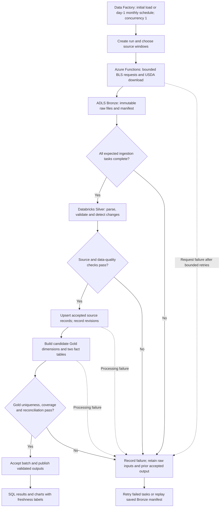

# Architecture: historical load and monthly refresh

## Agreed workflow

Azure Data Factory coordinates ingestion with Azure Functions, raw storage in ADLS Gen2 Bronze, and Databricks processing into Silver and Gold Delta tables. Data Factory provides a visual pipeline canvas where activities can be dragged into place, connected, debugged, and monitored; Python/PySpark still implements the custom ingestion and transformation logic. See [Microsoft visual authoring](https://learn.microsoft.com/en-us/azure/data-factory/author-visually).

This is a planned architecture, not deployed infrastructure or verified runtime behavior. It extends the [data model](data-model.md) and [source plan](README.md). The calendar dimension is `dim_date` with one row per month, not one row per day.

Implementation will be taught through explained console/CLI/Terraform checkpoints that the learner executes. See [project agent guidance](AGENTS.md) and the [step record](steps.md). The choice of Terraform versus console authoring remains open; no resources are to be created merely because this architecture is documented.

## Visual workflow

The diagram shows execution dependencies as well as data movement. Data Factory owns the workflow; data is stored in ADLS/Delta, not inside Data Factory.



Function tasks should be bounded by API series batch or download, rather than one HTTP call performing the entire historical load. Data Factory's Function activity has an HTTP timeout constraint; use an asynchronous orchestration pattern if an ingestion task cannot fit it. See [Function activity guidance](https://learn.microsoft.com/en-us/azure/data-factory/control-flow-azure-function-activity).

## Load modes and reporting dates

| Mode | Window | Purpose |
|---|---|---|
| Historical backfill | January 2015–December 2025 | Establish the homework's historical baseline |
| Catch-up | January 2026 through each source's latest available month | Bridge the baseline to ongoing operation; do not skip 2026 simply because the baseline ends in 2025 |
| Monthly refresh | Only the six reporting months ending at each source's latest available month, inclusive | Insert new records and update revised values within the agreed window |

The 2015–2025 assignment output remains available as a filtered reporting view. Operational tables can continue beyond 2025. Extend `dim_date` by month as new reporting periods are accepted; do not create daily rows.

## Six-month refresh rule

Use six reporting months ending at each source's latest available month, inclusive. For example, if the latest source month is September 2026, re-read April–September 2026. This is a chosen operational policy, not a claim that all publishers stop revising after six months.

Once the initial historical load and catch-up are complete, do not automatically widen the six-month window for gaps or older corrections. If a long outage leaves missing months outside that window, report them for review without silently backfilling them. A maximum observed month does not prove that all earlier months were loaded.

BLS can revise older history, but this project's explicit scope is six months after initial loading. No annual historical reconciliation or automatic older correction replay is included. Previously accepted values outside the window remain as last loaded. This is a known scope limit, not a claim that historical source values never change. See [BLS state revision guidance](https://www.bls.gov/sae/seasonal-adjustment/).

USDA ingestion can download the complete archive snapshot when that is the available download format. Retaining a full raw archive does not authorize updating every historical observation: ongoing Silver/Gold processing still filters to the six-month window. Member-file hashes help identify changes, but do not expand the accepted window.

## Schedule and retries

Use a monthly Data Factory schedule trigger on day 1. The proposed time is 06:00 UTC to make the time zone explicit; select the actual start date/time during setup and activate only after initial loading is verified. A schedule run processes what is available then, not necessarily the preceding calendar month's data. Data published after that run waits until the next monthly run unless the learner manually reruns the workflow. See [schedule trigger guidance](https://learn.microsoft.com/en-us/azure/data-factory/how-to-create-schedule-trigger).

Recommended starting retry policy, to be taught and verified during implementation:

| Failure / layer | Proposed behavior | Why |
|---|---|---|
| Transient API network errors, HTTP 429, and selected server errors inside ingestion | Up to 3 additional request attempts, with exponential delays of approximately 5, 10, and 20 seconds plus small random jitter | Give a temporarily busy source time to recover; jitter prevents synchronized retries |
| Publisher supplies `Retry-After` | Honor the requested delay when it fits the bounded task budget; otherwise stop and record a retryable failure for later rerun | Respect source throttling without holding a short-lived HTTP task open indefinitely |
| Data Factory ingestion activity | Start with no automatic whole-activity retries while request-level retry is active | Avoid multiplying request attempts or repeating successful downloads unexpectedly |
| Other activities with confirmed transient failures and safe replay | A simple starting option is 2 retries, 60 seconds apart; decide per activity during setup | Recover infrastructure failures without blanket-retrying transformation defects |
| Authentication/permission errors, schema changes, invalid data | Record failure and investigate | Repeating the same bad configuration or data does not fix it |
| Source has not yet published a month | Record its availability; retain prior accepted data and handle on the next monthly run | Publication delay is not a short-lived network failure |

Three retries means at most four total request attempts. The exponential request delays belong in our ingestion code. Data Factory's ordinary activity policy exposes retry count and a fixed `retryIntervalInSeconds`; it does not provide exponential backoff merely by setting that property. See [activity policy](https://learn.microsoft.com/en-us/azure/data-factory/concepts-pipelines-activities#activity-policy).

### Why retries can stack

There are two different operations being retried. Inside the Azure Function, our Python code can retry one failed BLS/USDA HTTP request. Outside the Function, a Data Factory activity can retry invoking the entire Function when that activity reports failure. This is a proposed configuration, not retry code or infrastructure already created.

Illustrative worst case for one repeatedly failing API operation:

```text
Data Factory activity attempt 1 -> Function makes 4 API attempts -> fails
Data Factory activity attempt 2 -> Function makes 4 API attempts -> fails
Data Factory activity attempt 3 -> Function makes 4 API attempts -> fails

Function: 1 initial attempt + 3 retries = 4 API attempts per invocation
Data Factory: 1 initial attempt + 2 retries = 3 Function invocations
Combined: 4 x 3 = up to 12 API attempts for that operation
```

An activity retry can also repeat earlier successful requests/downloads in that Function, not just the failing request. That is why the starting policy puts request retries in the Function and sets Data Factory's ingestion activity retries to zero. A manual rerun remains possible after a final failure. If an HTTP/SDK library adds its own automatic retries, count or disable those so they do not create a third unplanned retry loop. The example is not a total request limit for a workflow containing many API operations.

### How to choose retry ownership

There is no universal rule that every pipeline must use only code retries or only orchestrator retries. Assign each operation a clear retry owner, normally the layer that understands its failure and can safely repeat the smallest useful operation. Prefer an appropriate configurable client/SDK retry facility when one exists, rather than wrapping it in another independent retry loop. Microsoft recommends avoiding duplicated/cascading retry layers unless their budgets and consequences are deliberately coordinated. See [transient-fault guidance](https://learn.microsoft.com/en-us/azure/architecture/best-practices/transient-faults).

For our ingestion, the Function's HTTP client/code can inspect API responses, respect rate-limit instructions, and repeat one request. Data Factory coordinates the larger activity and records final success/failure. An orchestrator retry can be useful for a safely repeatable activity with no inner retry owner or for a distinct infrastructure failure; it should not blindly repeat the same exhausted request policy.

Retry ownership and file ownership are different concepts. Saved Bronze files and manifests help us replay processing after ingestion succeeds; a failed Databricks transformation can reuse those files instead of calling the APIs again. Files do not decide retry policy. Our planned ingestion owner remains the Function's request layer, with no automatic Data Factory ingestion activity retry.

## What source coverage means

Coverage means whether we actually have the data combinations the project promises. For example: do we have Idaho's manufacturing jobs for every required month, and Idaho's SNAP values for those same months? Some source series may start later, be unavailable, or have a missing month. This is different from a successful HTTP request or a newly downloaded file.

Check coverage by state/month for unemployment, total jobs, and SNAP, and by state/industry/month for industry jobs. Record absent combinations and do not turn them into zeros. The historical 50-state target is 6,600 state/month combinations; that is a target, not verified coverage. Ongoing refreshes check the six-month window while retaining known gaps in the status summary.

### NULL values and missing records are different

Yes, NULL is an appropriate way to represent an unavailable measurement. But it cannot reveal an entire absent record unless we first compare the source with the expected keys. For example, a source may omit Idaho/January entirely; no existing cell is available to hold NULL. Comparing the source with the expected state/month calendar can expose that missing row and retain the reporting key with a NULL measure.

Illustrative reporting row: Idaho/January has payroll jobs available but SNAP has not yet been published. Keep the jobs value, use NULL for SNAP, and attach a source-level availability status such as `NOT_YET_PUBLISHED`. NULL alone does not distinguish delayed publication, unavailable series, invalid data, or failed ingestion.

| Option | Behavior | Tradeoff |
|---|---|---|
| Keep partial rows with NULL measures and status | Retain available measures and show which source is missing | Useful fresh data, but users must see incompleteness |
| Publish only complete comparable months | Keep partial data in Silver; expose a Gold/reporting view limited to required inputs that are complete | Clear comparisons, but outputs lag the slowest source |
| Keep partial Gold plus a complete-only reporting view | Preserve fresh measurements while the default comparison excludes incomplete records/periods | Accepted project approach; completeness is defined by each report's required inputs |
| Reject a batch for unexpected gaps | Retain prior accepted Gold and record a failed validation | Appropriate for broken extraction or required data that should exist; too strict for normal publication delays |

**Accepted policy:** Process valid available source records. Retain legitimate partial rows in the cleaned/fact data with NULL measurements and source-level status, but make the default Gold reporting views and visuals show only complete comparable records/months. Do not discard valid jobs data solely because SNAP has not yet been published. Technical failures or invalid required inputs remain failed processing, not ordinary publication gaps. A genuinely unsupported state/industry combination should be excluded from the agreed supported-series inventory or explicitly marked unavailable, rather than treated as temporarily missing forever.

Keep status in a linked coverage table/record keyed by source/measure, state, month, and industry where applicable; derive row/report completeness from the required statuses. Exact names and physical types remain for implementation. A whole-month comparison across all 50 states needs a stricter completeness check than an Idaho-only chart.

Apply completeness to the intended comparison: a jobs-and-SNAP chart for Idaho requires both inputs for Idaho/month; a manufacturing-versus-SNAP chart also requires the selected industry observation. An all-50-state total/comparison requires all required states for that month, so filtering individual incomplete rows must not silently produce a 49-state result presented as 50 states. A missing industry should not block an unrelated state-level report that does not use it. Show the reporting view's required scope and latest complete month. Exact report requirements will be specified when each query/chart is built.

Do not overwrite a previously accepted valid value with NULL merely because a later fetch fails or omits the record unexpectedly. Retain that value and flag stale/unverified freshness. A publisher's explicit withdrawal or missing-value revision needs a separately understood rule. Do not fill absent values with zero, carry forward a prior month as if it were a new observation, or interpolate for this project without a deliberate analytical decision. Aggregations can ignore NULLs, so partial totals/averages must be labeled or excluded from complete-only views.

## Preventing concurrent runs

A concurrent run means two copies of the workflow execute at the same time, such as a scheduled run and a manual run. If both write the same tables, their updates and acceptance records can interfere.

Use one orchestrating Data Factory pipeline with its `concurrency` property set to `1`. Put initial load, monthly refresh, and replay behind parameters of that same pipeline. Additional triggered runs queue until the active run completes. For this project, all writes go through this route; do not separately launch a writing notebook or another pipeline while it runs. This setting limits runs of that pipeline, not every possible writer in the subscription. See [pipeline concurrency](https://learn.microsoft.com/en-us/azure/data-factory/concepts-pipelines-activities#pipeline-json).

No additional architecture choice is needed from the learner here: the recommendation is already documented. At the setup checkpoint, configure and verify `concurrency=1` through the chosen console/Terraform route. Operationally, launch writes through this pipeline and avoid an independent writing notebook while it is active. Running read-only analytical queries is a different operation and does not constitute another pipeline writer. Queue behavior and concurrency must still be verified during implementation.

## Keep three different dates separate

| Date | Meaning | Example |
|---|---|---|
| Reporting month | Period the measurement describes | September 2026 |
| Ingestion time | When our pipeline fetched the response/file | October 19, 2026, in UTC |
| Source report/update date | Publisher's date, when supplied | Workbook report date; may differ by fiscal-year member |

A publisher update timestamp is not necessarily supplied per observation. Do not invent the exact time the publisher revised a value; record when we detected the changed value instead.

## Bronze organization: ingestion date and run identity

Use explicit ingestion labels in the Bronze container, rather than ambiguous `/year/month` folders. Example paths below are relative to the storage account:

```text
bronze/source=bls_ces/ingested_date=2026-10-19/run_id=<run-id>/attempt_id=<attempt-id>/batch_001.json
bronze/source=bls_laus/ingested_date=2026-10-19/run_id=<run-id>/attempt_id=<attempt-id>/batch_001.json
bronze/source=usda_snap/ingested_date=2026-10-19/run_id=<run-id>/attempt_id=<attempt-id>/history.zip
bronze/source=usda_snap/ingested_date=2026-10-19/run_id=<run-id>/attempt_id=<attempt-id>/manifest.json
```

One downloaded file can contain many reporting months or years. Its Bronze directory identifies when and in which attempt it was captured; its manifest records what reporting periods were requested and what was actually returned. Extracted USDA files, if saved, retain the original fiscal-year member names under the same attempt. All timestamps use UTC.

Retain repeated snapshots as separate immutable captures, with hashes to identify identical content. A retry must not overwrite a previous capture. Replaying an already complete manifest can reuse its files without downloading again. Silver resolves repeated source records into one current accepted record per business key; Bronze intentionally preserves the capture history.

## Revision and lineage metadata

Keep metadata alongside the cleaned source measurements in Silver. Carry useful change fields to Gold and maintain lineage to each contributing source, since one state/month fact combines several different sources.

| Proposed field | Meaning |
|---|---|
| `first_ingested_at` | UTC time this source business key first entered the accepted cleaned data |
| `last_seen_at` | UTC time the source record was most recently observed, even if unchanged |
| `last_changed_at` | UTC time we detected the current accepted value/meaningful status; initialized on insert and changed only when content changes |
| `revision_count` | Zero on first acceptance; increments when an existing accepted record changes |
| `record_hash` | Hash of canonical measures and meaningful source status/definition; exclude ingestion timestamps, paths, and run IDs |
| `source_as_of` | Publisher date when available, otherwise null; may be report-level rather than observation-level |
| `source_file_id`, `ingestion_run_id` | Link to the exact raw capture and manifest |
| `processed_at`, `processing_run_id` | When and which processing attempt accepted this version; distinct from raw capture on replay |

For Gold, `first_loaded_at`, `last_changed_at`, and `revision_count` describe changes in that fact row. Store source-specific lineage separately so a CES revision is distinguishable from a SNAP revision. Reprocessing an unchanged row must not increment its revision count or move its content-change timestamp.

Maintain a revision log keyed by source business key and revision number, with old/new values, detection time, and capture/processing references. A boolean `was_updated` is unnecessary when `revision_count > 0` answers the question. The monthly fact remains one current row per key; the revision log preserves prior versions. Exact physical audit/log schemas remain implementation work.

## Freshness and acceptance

Track latest observed and latest accepted reporting months separately for each required source/series, plus missing state/month or state/industry/month combinations. A monthly schedule does not imply every source supplies last month's data on that date.

Record run outcomes such as `SUCCEEDED`, `NO_CHANGE`, `FAILED`, and `WAITING_FOR_SOURCE`. A transport-successful API call with an error message, empty series, missing batch, or unexpected schema is not accepted ingestion. A complete archive containing unchanged older data can produce `NO_CHANGE` and still have a valid new capture.

Publish a freshness summary showing which sources cover each month and the latest month complete across the required geography, sources, and selected industries. More recent incomplete months may be retained with explicit completeness flags; they must not be described as fully comparable. Revisions can change old values without advancing the latest reporting month.

Use a run ledger/manifest for requested windows, file hashes, task status, counts, rejected records, accepted source coverage, and output versions. Advance accepted coverage only after validation. If a publisher has not released data, record availability and wait until the next monthly run or a learner-initiated rerun; do not create an additional automatic polling schedule for this project.

## What Gold outputs means

Gold outputs are the actual business-ready data tables: `dim_state`, monthly `dim_date`, `dim_industry`, `fact_state_month`, and `fact_state_industry_month`. Charts, dashboards, or presentation visuals read those tables afterward. "Publish Gold" means make a validated, consistent set of table results available for queries; it does not mean publish a website or design the charts.

The project will process data with Spark/PySpark. The current storage plan is Delta tables backed by Azure storage, with Spark SQL available to create/update/query them; SQL itself is not a storage service. No separate Azure SQL Database or warehouse is selected. See [Delta Lake and Spark/SQL access](https://learn.microsoft.com/en-us/azure/databricks/delta/). The two accepted outputs compare state job changes with SNAP participation changes and selected-industry job gains/losses within states.

The table names, grains, and process-available/report-complete policy are agreed; there is no need to choose another warehouse or visualization tool now. The implementation checkpoint will explain how to validate candidate tables and select the accepted output version, rather than asking the learner to choose a transaction mechanism before seeing the tables. Dashboard/chart selection and the exact completeness requirements for each report can wait until the data is ready to query. No working cross-table publication mechanism has been implemented.

## Safe replay and publication

- Retry transient network/API failures with bounded backoff and respect request limits. Invalid records and unexpected schemas require investigation rather than blind retry.
- Set the single orchestrating pipeline's `concurrency=1` and route all writing execution through it. A repeated accepted input must not create duplicate facts or false revisions.
- Retain complete raw inputs when a later stage fails. Replay from a frozen input manifest instead of silently mixing files fetched at different times.
- Stage candidate Gold outputs and expose them only after all required dimensions, facts, and checks pass. Delta transactions on individual tables do not by themselves provide an atomic publication across all Gold tables; the implementation needs an accepted-batch pointer/version manifest and readers that honor it. Keep the prior accepted output accessible on failure.
- Preserve already accepted Silver versions on replay and use deterministic upserts; processing can resume after a partial Silver write without duplicate current keys. Do not advance publication or accepted coverage merely because one table write succeeded.
- Protect API keys through application settings/secret references, use managed identities and scoped storage access where supported, and keep credentials out of code and raw manifests.

## Pending implementation decisions

Public-source checking has now established actual BLS candidate coverage and all baseline SNAP state/month keys. See [verification and exceptions](source-verification.md). That checkpoint found construction unavailable in two states, source-missing October 2025 unemployment, and one negative SNAP dollar record requiring review; those are source facts, not demonstrated Azure pipeline behavior.

The accepted industry membership is manufacturing/retail in 50 states and standalone construction in 48, based on dated source verification; runtime series/coverage enforcement, USDA source-exception handling, deployment permissions, Terraform versus console choices, ingestion task sizes/budgets, activation date/time, physical lineage schemas, Gold publication mechanism, and Databricks compute settings remain to be validated through learner-executed checkpoints. The day-1 monthly schedule, strict six-month ongoing window, retry starting policy, and single-pipeline concurrency approach are documented design decisions, not deployed settings. Streamlit, natural-language SQL, and optional state GDP are later extensions; the initial output can be working SQL results and charts.
