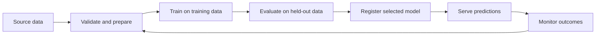
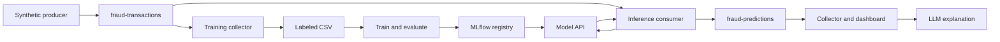

# Machine Learning, MLOps, and MLflow

## Overview

Machine learning uses data to learn patterns that support predictions, grouping, or decisions. A data pipeline makes usable data available; a trained model learns a relationship from that data; an application uses the model's output to support a task.

These notes connect the fundamentals to two classroom examples: predicting Citi Bike station capacity and classifying synthetic financial transactions. The companion [demonstration route](5.1_ML_steps.md) links to ten separate guides with their own steps, theory, and commented code. The [visual companion](friday-ml-demos/visuals/README.md) catalogs the six classroom screenshots and adds diagrams and illustrative metric/time charts.

## How to use the Friday material

Use this lecture for the common theory. Use [shared setup](friday-ml-demos/setup.md) for the current local environment, including Kafka 4.4.0 with KRaft; use the [demo index](friday-ml-demos/README.md) for execution. Each demo adds its own specific assumptions and limits. [Homework](5.2_Fri_HW.md) remains a separate instructor assignment. The older standalone steps page now serves as a route, so its previous troubleshooting and Linux-specific commands do not compete with the current guides.

## Learning objectives

- Distinguish AI, machine learning, and generative AI.
- Identify features, labels, training, evaluation, and inference.
- Choose metrics appropriate to regression and classification.
- Explain how MLflow connects training runs, model versions, serving, and traces.
- Recognize data leakage, unfair model comparisons, and the limits of synthetic demonstrations.

## AI, machine learning, and MLOps

Artificial intelligence is the broad field of building systems that perform tasks associated with intelligence. Machine learning is an approach within AI that learns patterns from examples rather than requiring a developer to specify every decision rule. Generative AI produces content, such as text, from learned patterns.

Scikit-learn supplies algorithms and utilities for tasks such as regression, classification, clustering, preprocessing, and evaluation. MLflow records and manages the surrounding lifecycle; it does not replace the algorithm that learns from data.

MLOps applies engineering practices to the model lifecycle: preparing data, training, evaluating, versioning, deploying, monitoring, and updating models. Reliable data ingestion and consistent feature definitions are central data-engineering responsibilities. RAG and vector-store pipelines can support generative AI applications, but they are not required components of every machine learning system.



## Features, labels, and record grain

A **feature** is an input available to the model when it predicts. A **label** or **target** is the value the model is trained to predict.

| Example | One record represents | Features | Target |
| --- | --- | --- | --- |
| Citi Bike capacity regression | One station in the selected metadata snapshot | Latitude, longitude | Station capacity in docks |
| Fraud classification | One synthetic transaction | Amount, hour, distance from home, new-device indicator, recent transaction count | `is_fraud`, represented as 0 or 1 |
| Geographic clustering | One station | Latitude, longitude | No supplied target; the algorithm assigns a cluster |

Station capacity is a relatively static metadata attribute. Available bikes and available docks are changing status measurements. Joining repeated metadata snapshots without selecting a consistent station record can duplicate examples and contaminate the train/test split.

For fraud inference, `is_fraud` must stay outside the input features. It is an answer used to evaluate predictions, not information a real system normally knows when a transaction first arrives.

## Learning paradigms

| Paradigm | Information supplied during learning | Example |
| --- | --- | --- |
| Supervised learning | Features paired with known targets | Predict capacity or classify labeled transactions |
| Unsupervised learning | Features without target labels | Group stations by similarity |
| Reinforcement learning | An environment, actions, and rewards over time | Learn a policy for choosing actions |

Supervised learning does not require a person to approve every prediction. The algorithm uses known targets and an objective function to update its learned state during training.

Unsupervised learning does not invent its own definition of success. The developer still chooses an algorithm, features, preprocessing, and an objective, such as minimizing within-cluster distances.

Reinforcement learning is a distinct paradigm. Regression and classification are usually supervised; clustering is usually unsupervised. These categories should not all be described as interchangeable supervised or unsupervised versions of the same task.

## Types of machine learning problems

### Regression

Regression predicts a numerical value. Examples include station capacity, travel time, demand, or price. Linear regression fits a linear relationship; Random Forest regression combines predictions from multiple decision trees and can capture nonlinear relationships.

The classroom capacity model used latitude and longitude to predict capacity. This demonstrates statistical prediction; it does not establish that changing a station's location causes its capacity to change.


### Classification

Classification predicts a category. A fraud classifier predicts whether a transaction belongs to the fraud class. Some classifiers also provide scores or estimated probabilities that can be converted to labels using a threshold.

K-nearest neighbors is one possible classification or regression algorithm. Recommendation systems can use neighborhood methods, matrix factorization, and many other approaches; a particular company's entire recommendation system should not be attributed to a single algorithm without a specific source.


### Clustering

Clustering groups examples by similarity without supplied class labels. K-Means alternates between assigning points to nearby centers and updating those centers. The classroom example grouped station coordinates into five clusters.

Cluster numbers are identifiers, not rankings or verified neighborhood names. Results depend on the chosen number of clusters, features, scaling, and distance measure. Standardizing latitude and longitude is useful for demonstrating preprocessing, but it does not turn Euclidean coordinate distance into exact geographic distance.


### Anomaly detection

Anomaly detection identifies observations that differ from an expected pattern. An unusually large payment can be anomalous without being fraudulent, and fraud can occur without an extreme amount. An anomaly score therefore requires interpretation and evaluation.


### Forecasting

Forecasting predicts future values using information available before the forecast time. Regression can be used inside a forecasting system, but predicting a numerical value does not automatically make a task forecasting.

Predicting capacity from location is regression. Predicting tomorrow's available bikes using historical station observations is forecasting. Plotting synthetic availability against hour illustrates trends, but does not establish future predictive performance. Forecast evaluation should respect time order and avoid training on future information.

### Reinforcement learning

An agent observes a state, chooses an action, receives a reward, and learns a policy. For example, a simulated bike-rebalancing agent might learn which stations to replenish. This requires an environment and reward design; it was a theory topic, not a demonstrated deployment in the recovered classroom sequence.

## Training, testing, and inference

Training fits the model to examples. In scikit-learn, `model.fit(X_train, y_train)` is the training operation. A single call can train a complete model; repeated manual runs are not necessary for the first run to count as training.

Inference applies the fitted model to inputs, commonly through `model.predict(...)`. Calling a deployed endpoint makes predictions; it does not automatically retrain the model.

Split examples before fitting learned preprocessing. Fit scalers or imputers on training data and reuse those fitted transformations for evaluation and inference. Otherwise information from evaluation data can leak into training.

The original fraud example used an 80/20 random split with `stratify=y` to approximately preserve class proportions. The current demo 07 instead reserves fixed validation and final-test papers from its first cohort and excludes their transaction IDs from every training run. For repeated experiments, use validation data or cross-validation for selection and reserve a final untouched test set. In the original version, growing the CSV changed the random test split despite the same seed. The updated workflow keeps validation identities and content fixed, logs its hash for comparison, and uses a separate final-test script after selection.

A fixed seed supports repeatability within the same data, code, dependencies, and configuration. It does not guarantee identical results across every environment.

## Evaluating regression

### Mean Absolute Error: error in real-world units

MAE averages the absolute differences between actual and predicted values:

$$
MAE = \frac{1}{n} \sum_{i=1}^{n} |y_i - \hat{y}_i|
$$

| Actual capacity | Predicted capacity | Absolute error |
| ---: | ---: | ---: |
| 20 | 24 | 4 |
| 35 | 28 | 7 |
| 40 | 45 | 5 |
| 15 | 23 | 8 |

These illustrative errors give an MAE of `(4 + 7 + 5 + 8) / 4 = 6` docks. Absolute values prevent overestimates and underestimates from canceling out. Lower is better; zero means perfect predictions on the evaluated records.

The recorded classroom result was **MAE = 6.09 docks**. This means the average absolute error on that evaluated set was about six docks. It does not guarantee that every individual prediction lies within six docks of the actual capacity.

### R²: performance relative to a mean reference

$$
R^2 = 1 - \frac{\sum_i (y_i - \hat{y}_i)^2}{\sum_i (y_i - \bar{y})^2}
$$

The numerator is squared prediction error. The denominator is the squared error from always predicting the mean of the actual targets in the evaluation set. R² uses squared errors, so its interpretation differs from MAE.

| R² | Interpretation for a nonconstant target |
| ---: | --- |
| 1.0 | Perfect predictions |
| 0.652 | About 65.2% reduction in squared error relative to the evaluation-set mean reference |
| 0.0 | Same squared error as that reference |
| -0.5 | Worse squared error than that reference |

The recorded classroom value, **R² = 0.652**, does not mean 65.2% classification accuracy or that 65.2% of predictions were exactly correct. Constant-target data needs special handling because the denominator becomes zero. A deployable constant baseline should learn its constant from training data; the mathematical R² reference uses evaluation-target means.

MAE expresses error in docks; R² expresses relative squared-error performance. Whether either result is useful depends on the business tolerance and evaluation design. See the [scikit-learn metrics guide](https://scikit-learn.org/stable/modules/model_evaluation.html).

## Evaluating classification

| Outcome | Meaning for fraud detection |
| --- | --- |
| True positive: TP | Fraud correctly flagged |
| False positive: FP | Legitimate transaction incorrectly flagged |
| False negative: FN | Fraud missed |
| True negative: TN | Legitimate transaction correctly passed |

| Metric | Formula | Question |
| --- | --- | --- |
| Accuracy | `(TP + TN) / total` | What fraction of all labels were correct? |
| Precision | `TP / (TP + FP)` | Among flagged transactions, how many were fraud? |
| Recall | `TP / (TP + FN)` | Among actual fraud transactions, how many were caught? |
| F1 | `2 × precision × recall / (precision + recall)` | What is the harmonic balance of precision and recall? |

If only 1% of transactions are fraudulent, predicting legitimate for every transaction gives 99% accuracy and zero fraud recall. Metric choice should reflect the cost of missed fraud and unnecessary alerts. Undefined ratios also need an explicit convention; the classroom code used `zero_division=0`.

The [illustrative confusion-matrix chart](friday-ml-demos/visuals/README.md#why-classification-accuracy-is-not-enough) shows why apparently high accuracy can coexist with missed fraud. Its counts are deliberately separate from classroom results.

The shared session reports **98.8% accuracy** for the selected sixth fraud run. This is a reported synthetic-data result, not evidence of performance on real financial transactions. It also does not measure the quality of generated explanations.

## Hyperparameters, learned parameters, and MLflow records

Hyperparameters are settings chosen before fitting. Learned parameters are the state derived from training, such as a tree's learned split thresholds.

| Classroom setting | Meaning |
| --- | --- |
| `n_estimators=100` | Fit 100 trees; aggregate their predictions |
| `max_depth=10` in capacity regression | Limit tree depth |
| `max_depth=8` in fraud classification | Limit tree depth for that example |
| `random_state=42` | Control supported random operations |
| `class_weight="balanced"` | Weight classifier classes inversely to their training frequencies |

MLflow uses the term **parameters** for logged configuration values, including hyperparameters. Metrics are measured results such as MAE or recall. Artifacts are saved outputs such as plots and model files.

| MLflow concept | Role |
| --- | --- |
| Experiment | Organizes related runs |
| Run | Records one execution's settings, measurements, and outputs |
| Logged model | Packages a fitted model with metadata and dependencies |
| Model signature | Describes expected input/output structure and types |
| Registered model | Named collection of model versions |
| Model version | Identifies a particular registered model artifact |
| Alias such as `champion` | Mutable name pointing to a selected version |
| Serving endpoint | Loads a model and accepts prediction requests |

Repeating unchanged data, configuration, and randomness can produce identical metrics. This demonstrates reproducibility. To investigate improvement, change a meaningful factor and compare against a stable evaluation dataset.

Registering a new version does not establish that it is better. Automatically pointing `champion` at the latest version, as the classroom training script did, is a convenience rather than a quality gate. An already running local serving process must be restarted or otherwise explicitly redeployed to load a newly selected model. See [MLflow registry workflows](https://www.mlflow.org/docs/latest/ml/model-registry/workflow/) and [local serving](https://mlflow.org/docs/latest/ml/deployment/deploy-model-locally/).

## Streaming machine learning and data ownership



The active demos read exported station CSV/Parquet files, with no SQL database required. The original classroom SQL view remains a historical reference.

The current local setup uses KRaft: a controller manages Kafka metadata while the broker serves topic records. The demo combines both roles in one JVM. Python clients still connect to the broker on port 9092; controller coordination is separate from data consumption. See [current setup](friday-ml-demos/setup.md) and the [KRaft visual](friday-ml-demos/visuals/README.md#kraft-and-event-processing).

Kafka transports records. The training collector creates a dataset; a separate script fits models. The inference consumer calls an already trained model. Separate consumer groups allow training collection and inference to consume the same topic independently.

The synthetic generator owns the demo labels. The registry identifies model artifacts. Prediction events should preserve transaction identity, original features, prediction time, and the actual deployed model version. A hardcoded version field is trustworthy only while it agrees with the served artifact. The current fraud demo avoids that manual label: the pinned-model server returns its loaded version and source run alongside each prediction.

Acknowledging an output before committing its input offset reduces loss risk, but a crash between those operations can still duplicate output. The demo does not implement an atomic Kafka transaction spanning consumption and publication. Downstream systems need a defined deduplication key and replay behavior.

Live classification metrics require ground truth. Synthetic labels arrive immediately in this demonstration; real fraud outcomes may arrive days or weeks later. Monitor data freshness, schema validity, endpoint failures, latency, consumer lag, and labeled performance separately. A performance drop is a symptom to investigate, not proof of drift by itself.

## Generative AI explanations, traces, and evaluation

The fraud classifier outputs a label; the generative AI application produces a written interpretation of supplied transaction features and predictions. A fluent explanation is not evidence that the classifier made a correct decision, and it does not reveal which internal model features caused that individual decision.

A **trace** records the observable execution of one request. A **span** records an operation within that execution, such as retrieving a transaction, constructing a prompt, calling a model, or formatting the response.

```text
Explanation request: root span
├── Retrieve transaction and prediction
├── Construct prompt
├── Call generative AI model
└── Return explanation
```

This is an illustrative span structure. It appears only if those operations are instrumented; enabling provider autologging alone does not automatically trace every application operation.

Traces can capture inputs, outputs, timings, errors, model metadata, and supported token-usage fields. They help explain application behavior and locate slow or failing operations. They do not expose a model's private internal reasoning or complete chain of thought. A returned reasoning summary is also not an independently verified record of hidden computation.

| Capability | Main question |
| --- | --- |
| Experiment tracking | Which training configuration produced which measured results? |
| Tracing | What happened during this request? |
| Evaluation | Was the prediction or explanation good according to a defined criterion? |

Evaluate generated explanations for faithfulness to supplied features, correct interpretation of the prediction, acknowledgment of uncertainty, and useful next steps. Latency and token usage measure operational behavior rather than factual quality. Traces can retain prompt and transaction data, so logging needs appropriate redaction and retention controls. See [MLflow tracing](https://mlflow.org/docs/latest/genai/tracing/).

## Common pitfalls and production considerations

- Treating a database join as model training: joining enriches data; fitting learns model state.
- Calling a random split a forecasting evaluation: future data must not leak into earlier predictions.
- Comparing changing test datasets as if only the model changed: preserve dataset identity and a fixed benchmark.
- Equating a new registered version with a deployment: check the model loaded by the serving process.
- Assuming an LLM explanation evaluates the classifier: classifier performance and explanation quality require separate measurements.
- Enabling tracing in the wrong process: instrument the application that actually invokes the provider.
- Trusting synthetic accuracy as a production result: assess real data, delayed labels, operational failures, and business costs separately.

For production, retain the training-data snapshot or version, code revision, dependency versions, feature contract, evaluation protocol, and promotion decision. Plan input rejection, bounded retries, duplicate handling, rollback, and monitoring ownership before relying on the output.

## Knowledge check

1. Which columns are features and which is the target in each classroom model?
2. Why is `.fit()` training even when the script executes only once?
3. What do MAE = 6.09 and R² = 0.652 each tell you?
4. How could 99% accuracy coexist with a useless fraud detector?
5. Why can a fixed random seed still yield a different test set when new rows arrive?
6. How do a run, a registered version, an alias, and a running endpoint differ?
7. What can duplicate an output after the inference consumer has published it?
8. What can a trace reveal, and what requires a separate evaluation?

## Sources and evidence

Classroom context: [instructor's shared MLflow session](https://chatgpt.com/share/6ae50688-3694-83e8-870e-ad3844b7fa7c), existing lecture notes, and the six retained classroom images. The shared conversation contains plans, generated code, troubleshooting, and teacher-reported outcomes; those are not equivalent to independently executed evidence.

Technical references reviewed on 2026-10-31: [scikit-learn train/test splitting](https://scikit-learn.org/stable/modules/generated/sklearn.model_selection.train_test_split.html), the metrics guide, and the MLflow references linked above. No training, serving, Kafka processing, or provider calls were executed while preparing these notes. The later reconstructed Flask app passed twelve offline tests, and the visual companion’s two charts were generated locally from illustrative values; neither establishes live model or pipeline results.
