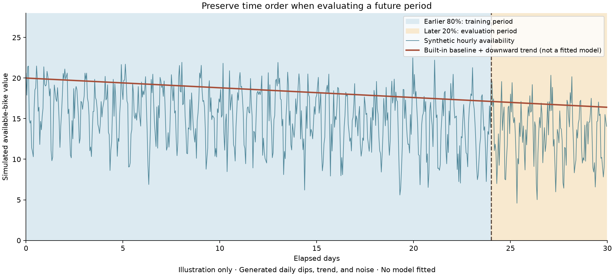

# Time-series regression: theory

[Step-by-step guide](README.md)

## Data and time order

The script simulates 30 days of hourly bike availability: 720 observations beginning October 1, 2026. Morning/evening dips, a slight downward trend, and random noise are deliberately generated. These are synthetic values, not measured Citi Bike activity.

The first 80% of rows train the models; the later 20% evaluates future predictions. A random split would mix earlier and later observations and answer a different question.

## Two models

Linear Regression uses elapsed time to estimate one straight-line trend. Its slope is the estimated change in available bikes per hour; multiplying by 24 gives the change per day. A downward line can coexist with strong repeating daily cycles.

Random Forest uses hour, day of week, and elapsed time. It can learn nonlinear repeating patterns, but tree-based predictions do not naturally extrapolate the downward time trend beyond the training range. The straight line can underfit daily cycles even when its overall direction is useful.

Correlation describes association, not causation. In this demo the trend was explicitly built into the generator. MAE measures error in available-bike units, and R² compares squared error with the test-mean reference.

## MLflow boundary

The conversation suggested logging these two models in a new experiment but did not supply a complete integrated time-series tracking script. The recovered script produces plots and terminal metrics only. The capacity model served in demo 05 remains a separate model with different inputs.

## Visual learning aid

The red line is an imposed generator component, not fitted model output. See the [visual explanation](../visuals/README.md#trend-repeating-patterns-and-future-evaluation) before comparing the two models’ actual demo predictions.
