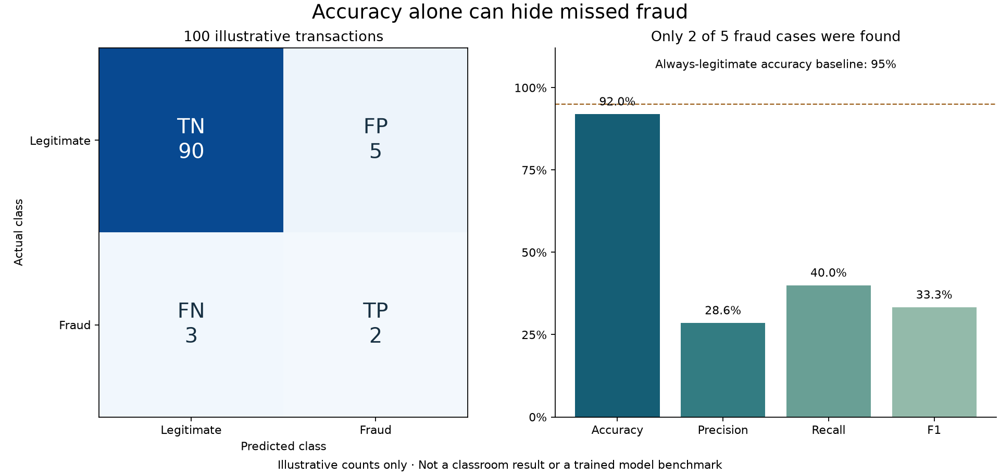

# Kafka fraud training: theory

[Step-by-step guide](README.md)

## Stream to training data

The producer samples a synthetic `is_fraud` label with an approximately 8% fraud rate, then generates feature values with different distributions for fraudulent and legitimate events. Each event includes transaction ID, event time, five model features, and the label.

The collector locks the CSV for a complete row write, flushes and syncs it, then commits that exact Kafka record’s next offset. A replay after a crash can duplicate rows; training deduplicates by `transaction_id`. Syncing improves local durability, but it does not create a transaction with Kafka or eliminate all hardware failure modes.

## Batch learning

The training script freezes the CSV, removes valid replay duplicates and incomplete rows, excludes the fixed validation/test identities, and fits a Random Forest with configurable depth and tree count. The first cohort is approximately 60% training, 20% validation, and 20% final test; later events can enlarge training without entering the fixed papers. Each invocation fits a new model from the accumulated data. This is batch retraining from a stream-fed dataset, not online learning.

The five inputs are `amount`, `hour`, `distance_from_home`, `new_device`, and `transactions_last_hour`. `is_fraud` is the target and is excluded from model inputs. The earlier scripts using `foreign` and `velocity` belong to a different proposal and must not be mixed into this schema.

## Evaluating an imbalanced classifier

Accuracy counts all correct predictions. With roughly 8% fraud, predicting legitimate every time would already approach 92% accuracy. Fraud precision asks what fraction of flagged transactions are truly labeled fraud; recall asks what fraction of fraud cases were detected. F1 balances the two. A false positive triggers an unnecessary alert; a false negative misses a labeled fraud case.

The conversation reported the sixth run at approximately 98.8% accuracy, 91.9% precision, 93.4% recall, and 92.6% F1. Those are reported classroom results on synthetic data, not fresh measurements or proof of real-world performance.

## Comparison limits

Validation and final-test files are created once, hashed, and reused. Every candidate is evaluated on the same validation examples. A separate script evaluates the chosen model on the reserved final test. Changing both training volume and settings still combines two effects, so hold the training snapshot fixed when isolating hyperparameters. Promotion is explicit in demo 08; a new run alone does not move champion.

The CSV collector and inference consumer use different Kafka groups and can receive the same stream independently. Growing the CSV does not alter an already served model.

## Visual learning aids

Use the [two-path lifecycle diagram](../visuals/README.md#one-stream-two-different-model-activities) to separate accumulation/training from inference.

These are hand-authored teaching counts, not measurements from this producer or model. Read the [calculation](../visuals/README.md#why-classification-accuracy-is-not-enough) to see why accuracy alone can mislead.
