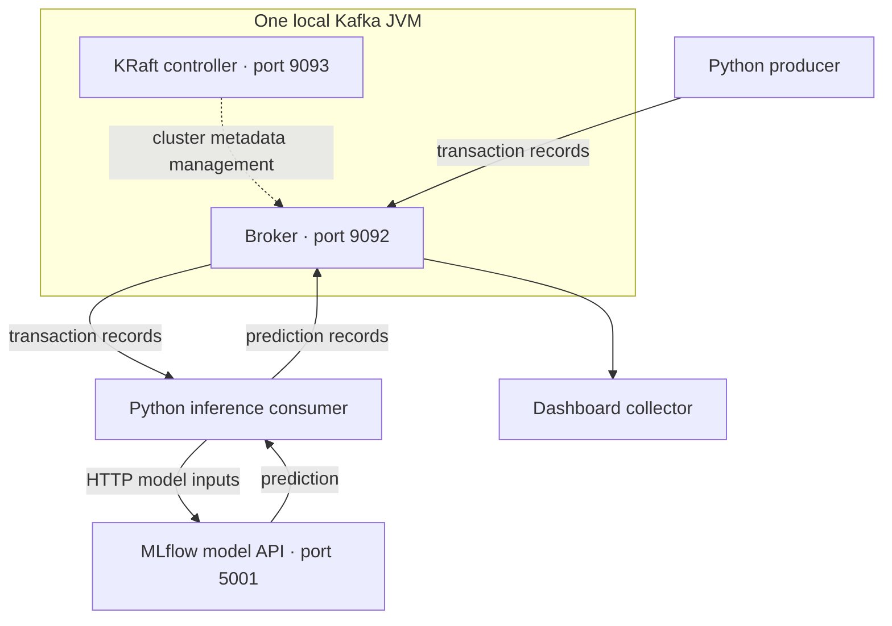
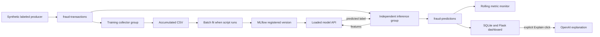
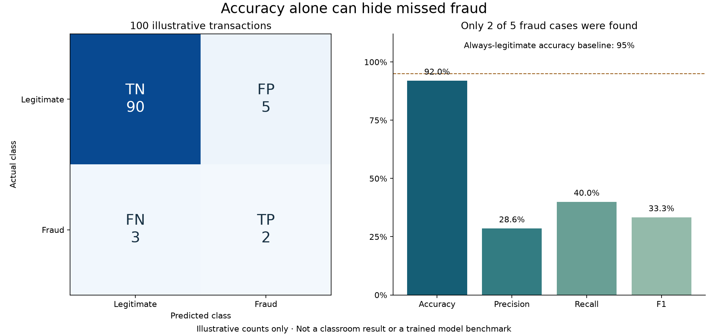
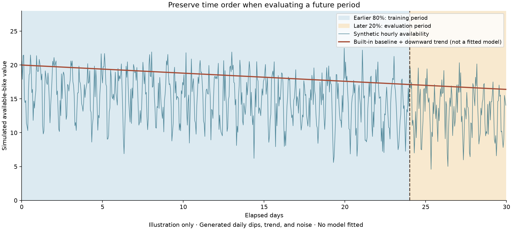
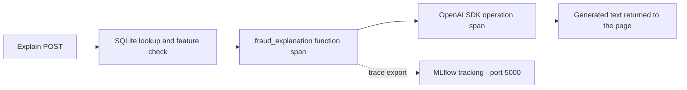

# Friday visual companion

[Demo index](../README.md) · [Main lecture](../../5_Fri_ML_Flow.md)

The six screenshots are the original classroom captures and stay in their original locations. They illustrate concepts, not measurements from the repository's scripts. The diagrams and two charts below are new teaching aids, explicitly separated from actual runtime evidence.

## Classroom screenshot catalog

| Original capture | Content | Where it helps |
| --- | --- | --- |
| [11:52:50](<../../Screenshot 2026-10-30 at 11.52.50 AM.png>) | Linear, quadratic, exponential, and logarithmic regression illustrations | [Capacity regression](../03-capacity-regression/theory.md) |
| [11:53:34](<../../Screenshot 2026-10-30 at 11.53.34 AM.png>) | Simplified supervised/unsupervised task taxonomy | [Station classification](../04-station-classification/theory.md) |
| [11:54:16](<../../Screenshot 2026-10-30 at 11.54.16 AM.png>) | Points before/after grouping | [Station clustering](../01-station-clustering/theory.md) |
| [11:54:45](<../../Screenshot 2026-10-30 at 11.54.45 AM.png>) | Three colored groups and partition boundaries | [Station clustering](../01-station-clustering/theory.md) |
| [11:55:24](<../../Screenshot 2026-10-30 at 11.55.24 AM.png>) | DBSCAN clusters with points marked as anomalies | Main lecture's anomaly-detection section |
| [11:55:50](<../../Screenshot 2026-10-30 at 11.55.50 AM.png>) | A spike in a sequence | Main lecture's anomaly-detection section |

The taxonomy is a simplified visual, not an exhaustive classification of all algorithms. The DBSCAN screenshot shows an approach discussed in theory; it does not establish that the K-Means demo performs anomaly detection. A large time-series spike may warrant investigation without proving fraud.

## KRaft and event processing



The controller manages metadata; the broker serves topic records. One process holds both roles in this lab. Python clients contact the broker, not ZooKeeper or the controller endpoint. This topology has one node and no broker/controller failover. The diagram describes responsibility boundaries, not measured network timing.

## One stream, two different model activities



The upper path creates model versions when you run the trainer. The lower path uses the already loaded model for arriving events. New Kafka records alone do not refit a Random Forest. Arrows carrying a model version represent artifact loading, not an event-triggered automatic deployment.

## Why classification accuracy is not enough



This hand-authored example has 95 legitimate cases and 5 fraud cases. The classifier finds only 2 fraud cases, yet has 92% accuracy. Precision is `2 / 7`, recall is `2 / 5`, and F1 is `4 / 12`. Predicting legitimate every time would score 95% accuracy but detect no fraud. These are teaching counts, not the teacher's 98.8% result or output from the Kafka model.

Use it with [fraud training theory](../07-kafka-fraud-training/theory.md) and [live monitoring theory](../10-live-model-monitoring/theory.md). In a multiclass confusion matrix, the same row/column orientation applies but the class-specific TP/FP/FN interpretation changes per class.

## Trend, repeating patterns, and future evaluation



The blue observations combine an imposed trend, daily dips, and noise. The red line is the generator's baseline plus trend, not a fitted or evaluated prediction. Shading marks the earlier 80% for training and later 20% for evaluation. This chart explains temporal ordering; it does not report a model forecast or real Citi Bike availability. See [demo 06](../06-timeseries-regression/theory.md).

## What an explanation trace represents



This matches the reconstructed app's instrumented function and provider call. The database lookup occurs before the explanation function, so it is not automatically a nested span in that function's trace. Enabling autologging does not make every application action an instrumented operation, and a trace does not certify the generated text's correctness.

## Recreate the two charts

From `friday-ml-demos`, after installing the existing NumPy/Matplotlib demo dependencies:

```bash
python visuals/generate-learning-figures.py
```

The script writes the two PNGs next to itself using fixed synthetic inputs and a noninteractive plotting backend. It does not open a database, train a model, start Kafka, or call an API. The diagrams are editable Mermaid source embedded in this page. The screenshots are preserved originals; the figures are new illustrations. Rendered PNGs were visually inspected after generation.
